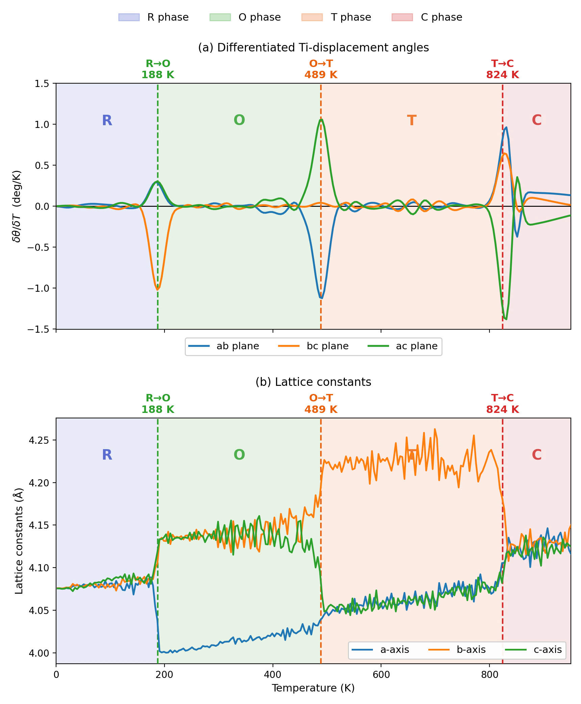
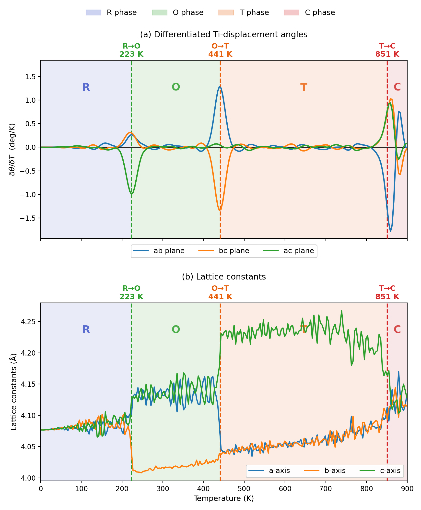
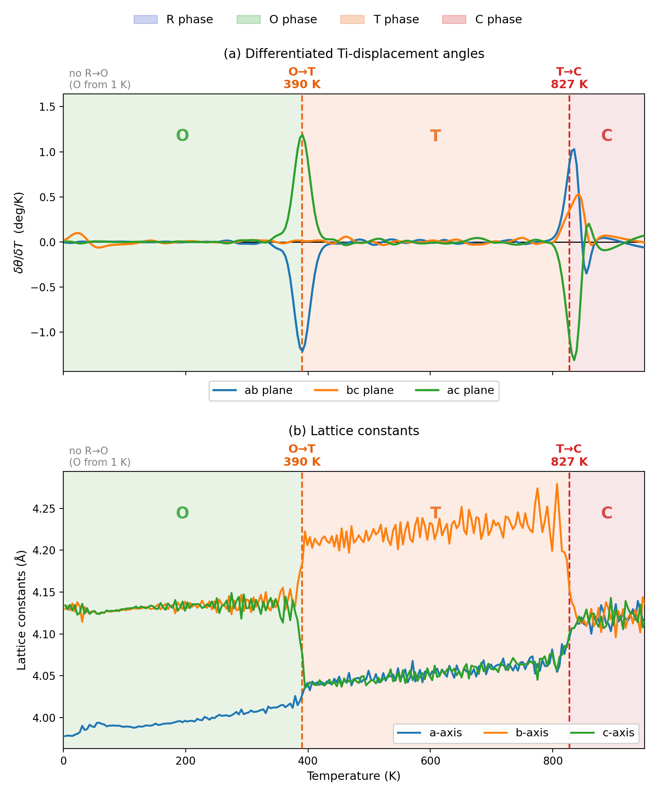
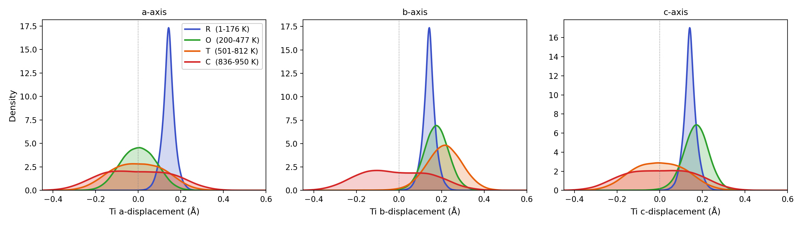
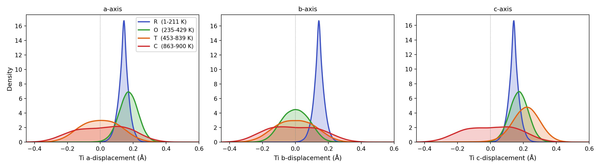
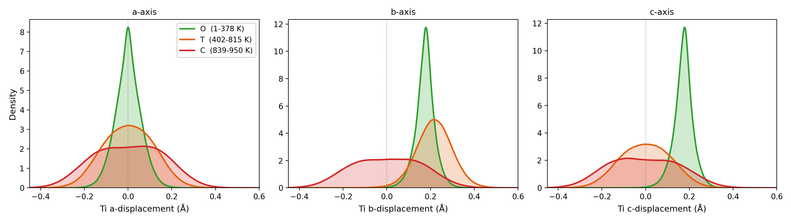
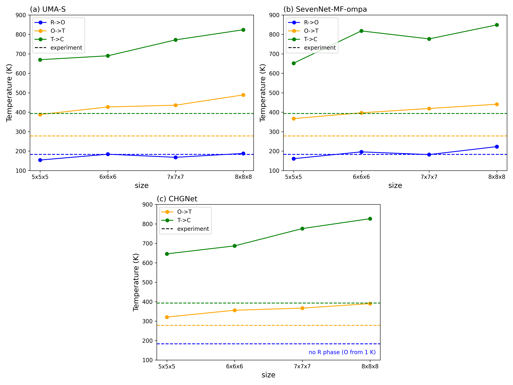
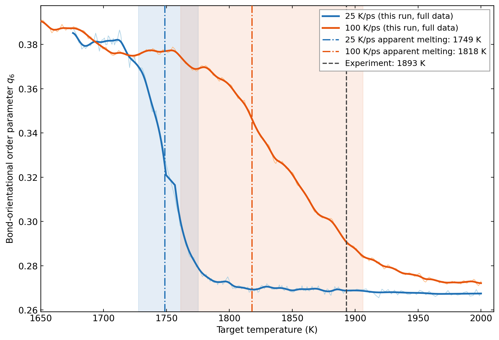
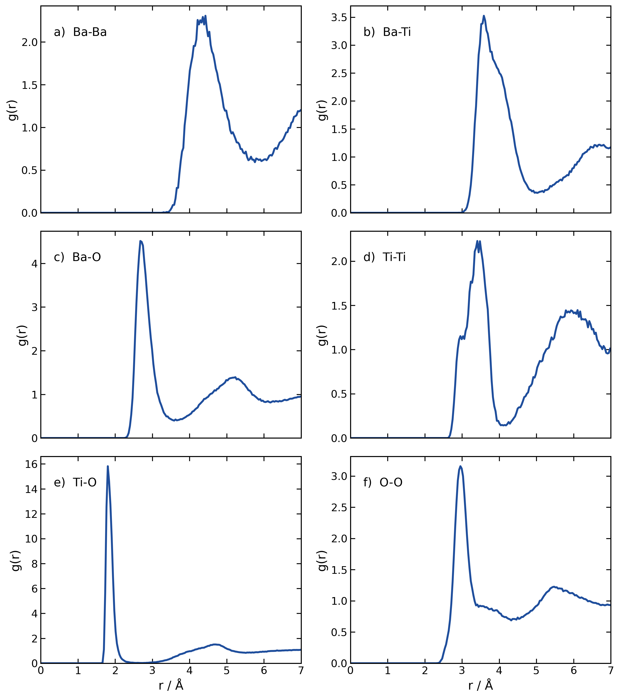
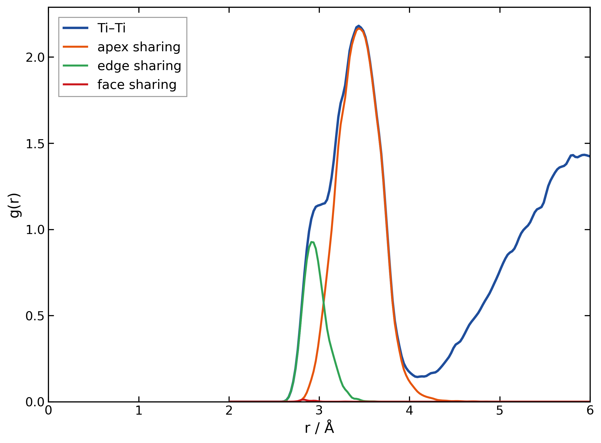

.. _batio3-doc-phase-transition:

==============================
構造相転移
==============================

BaTiO₃ の結晶相の順序と転移温度を、機械学習原子間ポテンシャルでどこまで再現できるでしょうか。
Quloud の GPU で分子動力学（MD）による昇温計算を行い、Ti の局所変位と格子定数から相を判定しました。

UMA-S と SevenNet では、実験と同じ **菱面体晶（R）→ 斜方晶（O）→ 正方晶（T）→ 立方晶（C）** の順に相が現れました。
CHGNet では最低温から斜方晶で、菱面体晶は確認できませんでした。
3 モデルとも、正方晶から立方晶に変わる温度は、実験値の 393 K を 400 K 以上上回りました。

:ref:`転移温度 <batio3-phase-boundaries>` ｜ :ref:`Ti 変位の分布 <batio3-phase-distributions>` ｜ :ref:`サイズ・文献比較 <batio3-phase-comparison>`

.. _batio3-phase-boundaries:

Quloud GPU で得た転移温度
-------------------------

UMA-S（FairChem の UMA モデル、タスク ``omat``）、SevenNet（7net-ompa）、CHGNet で、圧力を制御しながら温度を上げる NPT 昇温計算を行いました。
3 モデルともセルサイズは 8 × 8 × 8（2560 原子）、昇温速度は 10 K/ps としました。

.. list-table:: 昇温軌跡から読み取った転移温度と実験値（K）
   :name: batio3-phase-temperature-summary
   :header-rows: 1
   :stub-columns: 1
   :widths: 34 22 22 22
   :class: wrap-table

   * - モデル・参照値
     - R→O
     - O→T
     - T→C
   * - UMA-S
     - 188
     - 489
     - 824
   * - SevenNet
     - 223
     - 441
     - 851
   * - CHGNet
     - 検出なし
     - 390
     - 827
   * - 実験値 :sup:`[2]`
     - 183
     - 278
     - 393

UMA-S の R→O は実験値より 5 K、SevenNet は 40 K 高くなりました。
O→T は、モデルによって実験値より 112～211 K 高くなりました。
表の計算値は、有限のセルを一定の速度で昇温した 1 本の軌跡ごとに得た **見かけの転移温度** です。
平衡での転移温度を評価するには、セルサイズや保持時間に加え、温度刻み、昇温速度、加熱と冷却による差を確認する必要があります :sup:`[1,2]`。

**転移温度の読み取り方**

上段の図は、Ti の変位方向が ab・bc・ac の各面に対してなす角度の温度微分（度/K）を示します。
角度微分のピークは、変位の向きが急に変わる温度の目印になります。
下段では、a・b・c 軸の格子定数（Å）の分裂や入れ替わりを追います。
両方の変化を照らし合わせ、各図の縦の破線で転移温度を示しました :sup:`[1,2]`。
画像を選ぶと、軸や凡例を拡大して確認できます。

UMA-S では、3 つの転移温度で角度微分が鋭く変化し、格子定数の分裂や入れ替わりが同じ温度帯に現れました。

   UMA-S の昇温軌跡。上段は Ti 変位の角度微分、下段は各軸の格子定数。

SevenNet も同じ順序で相が変わりました。対応する境界を UMA-S と比べると、R→O は 35 K 高く、O→T は 48 K 低く、T→C は 27 K 高くなりました。

   SevenNet の昇温軌跡。上段は Ti 変位の角度微分、下段は各軸の格子定数。

CHGNet では 1 K から O 相に対応する格子定数の分裂が現れました。
CHGNet での R 相の熱力学的安定性を判断するには、初期構造、保持時間、冷却経路、モデルの学習範囲を検証する必要があります。

   CHGNet の昇温軌跡。上段は Ti 変位の角度微分、下段は各軸の格子定数。

.. _batio3-phase-distributions:

Ti 変位分布による相の確認
-------------------------

軌跡から各相の温度範囲を選び、Ti の変位を a・b・c 軸に分けて確率密度を描きました。
各パネルで、分布の主なピークが変位ゼロからずれているかを見ます。
ピークの符号や軸名は分域と座標軸の取り方によって変わるため、ゼロからずれる軸の数を相の判定に使います :sup:`[2]`。

.. list-table:: 相ごとの Ti 変位分布の見方
   :name: batio3-phase-displacement-guide
   :header-rows: 1
   :widths: 28 72
   :class: wrap-table

   * - 相
     - 軸方向の変位分布の特徴
   * - 菱面体晶（R）
     - 3 軸でゼロから離れたピークが現れます。
   * - 斜方晶（O）
     - 2 軸でゼロから離れたピークが現れます。
   * - 正方晶（T）
     - 1 軸でゼロから離れたピークが現れます。
   * - 立方晶（C）
     - 分布が広がり、特定方向への偏りが弱まります。

UMA-S では、R 相の鋭いピークは 3 軸ともゼロから離れています。
O 相では a 軸のピークがゼロ付近に移り、T 相でゼロから離れたピークが目立つのは b 軸です。
C 相では 3 軸とも分布が広がります。局所変位は残るものの、平均としての方向の偏りは弱まります。

   UMA-S の Ti 変位分布。温度範囲は R（1–176 K）、O（200–477 K）、T（501–812 K）、C（836–950 K）。

SevenNet でも、R、O、T の順に、ゼロから離れたピークを持つ軸が 3、2、1 と減ります。
O 相でピークがゼロ付近に移るのは b 軸で、T 相でゼロから離れたピークが目立つのは c 軸です。

   SevenNet の Ti 変位分布。温度範囲は R（1–211 K）、O（235–429 K）、T（453–839 K）、C（863–900 K）。

CHGNet の低温域では、a 軸がゼロ付近に、b・c 軸がゼロから離れた位置にピークを持ち、O 相の割り当てと整合します。
T 相では主に b 軸のピークがゼロから離れ、C 相では分布が広がります。

   CHGNet の Ti 変位分布。温度範囲は O（1–378 K）、T（402–815 K）、C（839–950 K）。

.. _batio3-phase-comparison:

セルサイズの影響と文献比較
--------------------------

3 モデルとも、5 × 5 × 5 セルと比べて 8 × 8 × 8 セルでは、O→T と T→C の転移温度が実験値からさらに離れました。
UMA-S の R→O は 154～188 K、SevenNet は 161～223 K でした。
T→C は両モデルでおおむね上昇しましたが、SevenNet では 6 × 6 × 6 から 7 × 7 × 7 にかけて一度低下しました。
CHGNet では最小セルから最大セルにかけて O→T が 321 K から 390 K に、T→C が 646 K から 827 K に上昇しました。
今回のサイズ範囲では、8 × 8 × 8 で転移温度が収束したとは判断できません。

   セルサイズごとの転移温度。点が Quloud の計算値、横の破線が実験値（R→O 183 K、O→T 278 K、T→C 393 K）。
   CHGNet ではどのサイズでも R→O を検出しませんでした。

BaTiO₃ 向けに学習した先行研究のモデルも実験と同じ相の順序を示しましたが、転移温度のずれは相境界とモデルによって異なりました。
Chen らの微調整 MACE の転移温度は、実験値（183 K、278 K、393 K）より順に 33 K、53 K、103 K 低い値でした :sup:`[2]`。
Sehrawat らの ACE では、R→O は約 80 K と実験値より約 100 K 低く、T→C は約 625 K と約 230 K 高い値でした :sup:`[1]`。

以下の文献値を先に示した実験値と照合すると、ずれの向きと大きさが分かります。
先行研究と本計算では、モデルの学習に使った DFT の条件や昇温速度が異なるため、この比較からモデルの性能の順位は決められません。
微調整の効果を含めてモデルを比べるには、条件をそろえたうえで、構造と相転移を独立なデータで検証する必要があります。

.. list-table:: 先行研究の昇温計算で得た転移温度（K）
   :header-rows: 1
   :widths: 32 15 15 15 23
   :class: wrap-table

   * - 出典・モデル
     - R→O
     - O→T
     - T→C
     - 昇温速度
   * - Chen ら・微調整 MACE :sup:`[2]`
     - 150
     - 225
     - 290
     - 2.5 K/ps
   * - Sehrawat ら・ACE :sup:`[1]`
     - 約 80
     - 約 240
     - 約 625
     - 1 K/ps

補足：昇温速度と融解
--------------------

立方晶からさらに温度を上げるときは、結晶相の判定とは別に、近接原子の並び方を表す結合配向秩序パラメータ :math:`q_6` を使って、融解に伴う結晶秩序の低下を追えます :sup:`[2]`。
この図の 2 本の軌跡では、:math:`q_6` が大きく低下する温度が昇温速度によって変わりました。
見かけの融解温度は、25 K/ps で 1749 K、100 K/ps で 1818 K でした。
転移温度を実験と照合する際は、ポテンシャルに加えて、昇温速度による平衡化への影響を考慮する必要があります。

   昇温中の :math:`q_6`。一点鎖線は各軌跡での見かけの融解温度、黒の破線は実験値の 1893 K :sup:`[2]`。

補足：急冷後に残る局所構造
--------------------------

液相から急冷したアモルファス BaTiO₃ では、長距離の結晶秩序が失われた後も、Ti の周りに O が配位する局所構造が残ります。
部分動径分布関数（RDF） :math:`g(r)` は、原子の組み合わせごとに距離 :math:`r` の分布を表します。
図では Ti–O の鋭い第一ピークが残る一方、遠距離には結晶に特徴的な鋭い周期ピークが見られません。
RDF を別の計算と比べるときは、温度、平均を取る時間、ビン幅をそろえます :sup:`[2]`。

   アモルファス BaTiO₃ の部分動径分布関数。Ba–Ba、Ba–Ti、Ba–O、Ti–Ti、Ti–O、O–O を示します。

Ti–Ti の RDF を、隣接する TiO₆ 八面体が頂点・辺・面のどれを共有するかで分けると、八面体どうしのつながり方が分かります。
図の主ピークは頂点共有に対応し、その短距離側に辺共有のピークがあります。面共有の寄与は小さいです。
急冷後のガラスには TiO₆ の局所配位が残り、頂点共有と辺共有が混在します。
周期的な頂点共有のネットワークを持つ結晶とは、八面体のつながり方と長距離秩序が異なります。

   アモルファス BaTiO₃ の Ti–Ti 動径分布と、TiO₆ 八面体の接続の種類ごとの寄与。

まとめ
------

:doc:`安定基底状態 <stability>` の 0 K の静的計算では、FairChem の UMA-S 系列を含む全手法で R 相のエネルギーが最も低くなりました。
今回の昇温 MD では、UMA-S と SevenNet が実験と同じ R → O → T → C の順に相転移しました。CHGNet の昇温軌跡では R 相を確認できませんでした。

8 × 8 × 8 セルでは、3 モデルとも T→C の転移温度が実験値を 400 K 以上上回りました。
O→T と T→C の転移温度は、3 モデルとも 5 × 5 × 5 セルより 8 × 8 × 8 セルの方が実験値から離れました。
平衡での転移温度を評価するには、昇温速度、セルサイズと保持時間に対する収束、加熱と冷却による差を確かめる必要があります。

CHGNet は 0 K では R 相のエネルギーが最も低いのに、昇温軌跡には R 相が現れませんでした。
このように 0 K のエネルギー順位と昇温時に現れる相は一致するとは限らないため、モデルの検証では、0 K のエネルギー順位、昇温時の相の順序、転移温度をそれぞれ確かめます。

参考文献
--------

* :sup:`[1]` Sehrawat, A.; Albe, K.; Rohrer, J.,
  "Machine-learning interatomic potential for BaTiO3: phase transitions,
  domain walls, and grain boundaries,"
  *Journal of Physics: Condensed Matter*, **38**, 015402, 2026.
  `https://doi.org/10.1088/1361-648X/ae2727 <https://doi.org/10.1088/1361-648X/ae2727>`_

* :sup:`[2]` Chen, P.-Y.; Shibata, K.; Mizoguchi, T.,
  "High precision machine learning force field development for BaTiO3 phase
  transitions, amorphous, and liquid structures,"
  *APL Machine Learning*, **3**, 036115, 2025.
  `https://doi.org/10.1063/5.0268149 <https://doi.org/10.1063/5.0268149>`_
