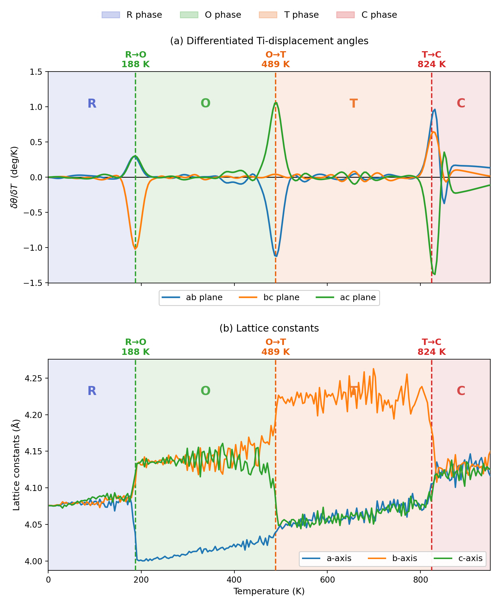
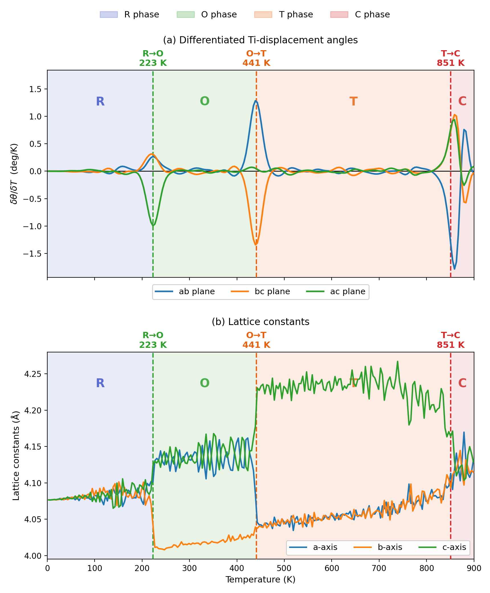
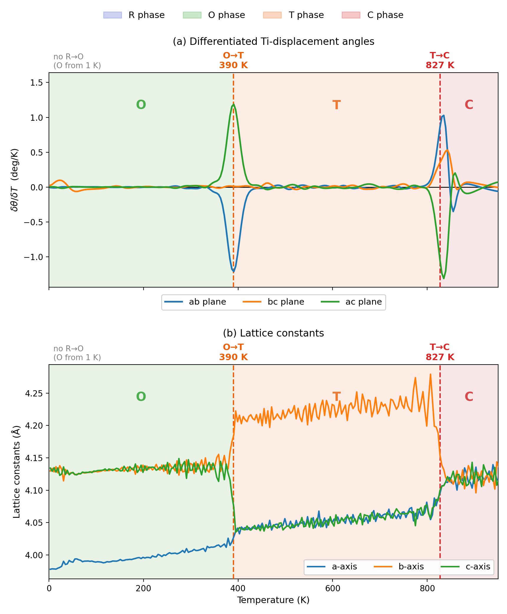
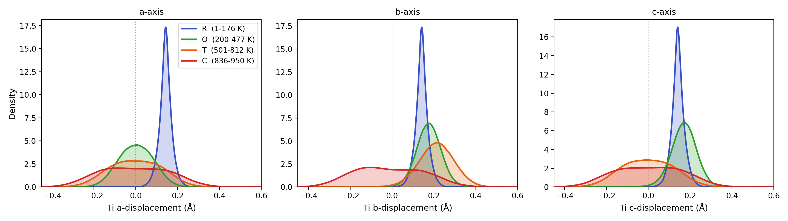
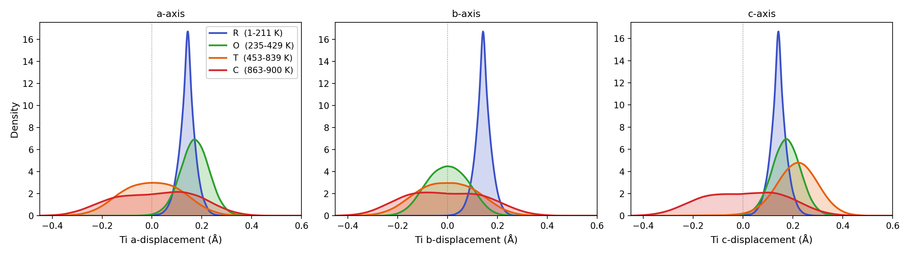
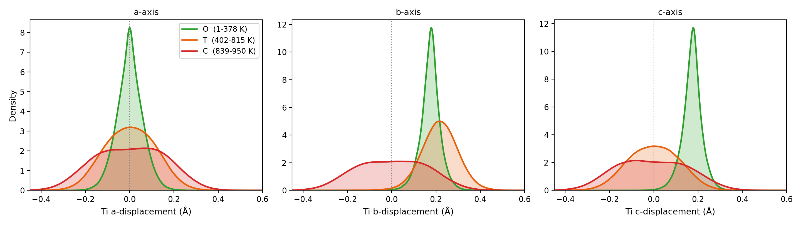
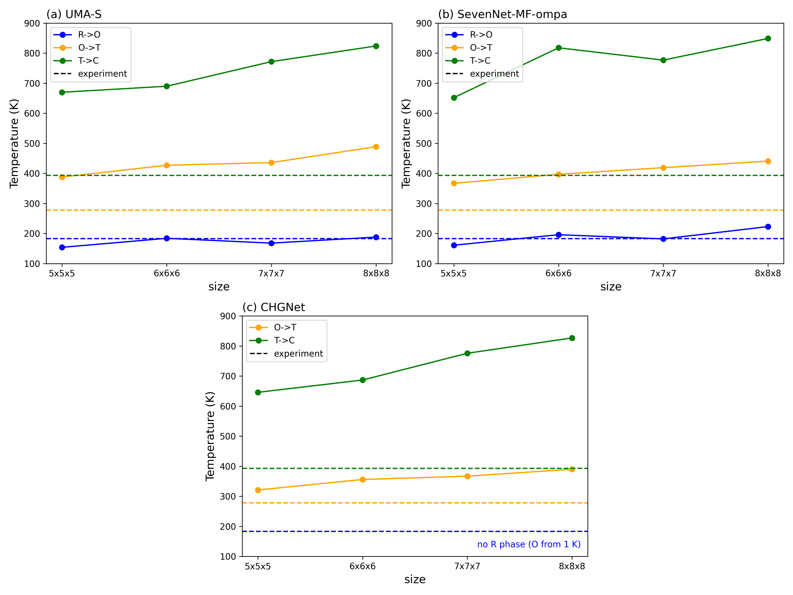
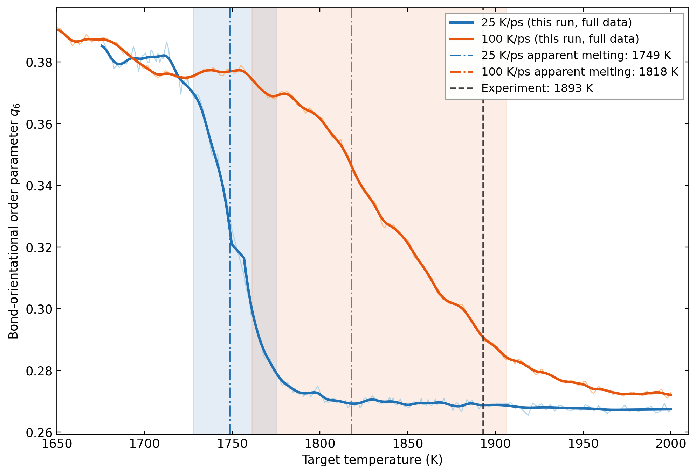
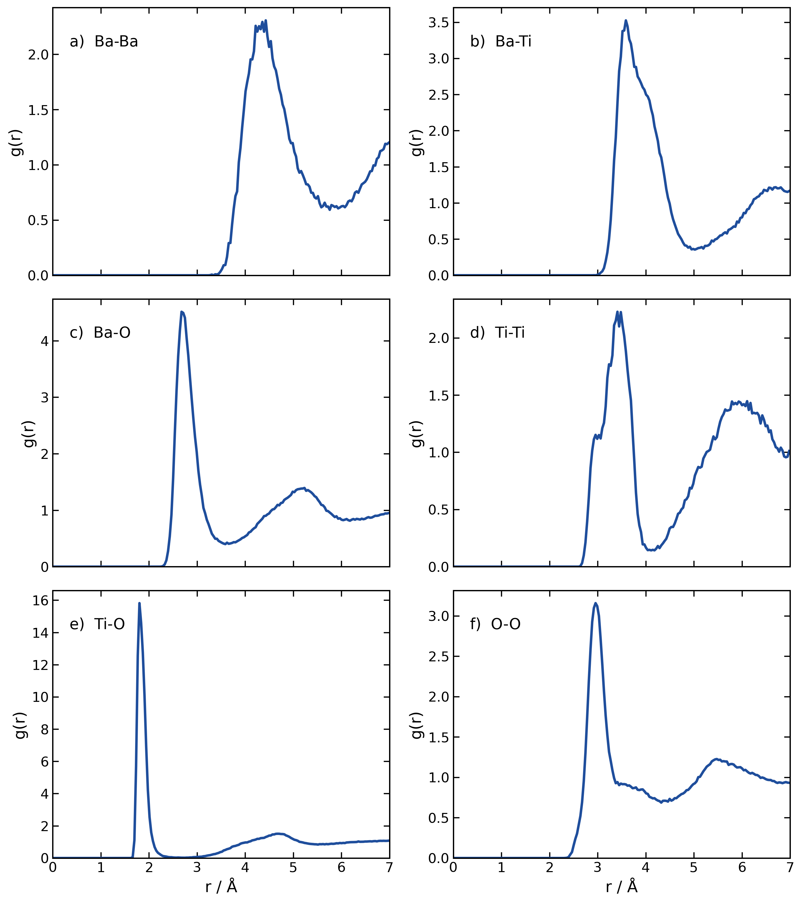
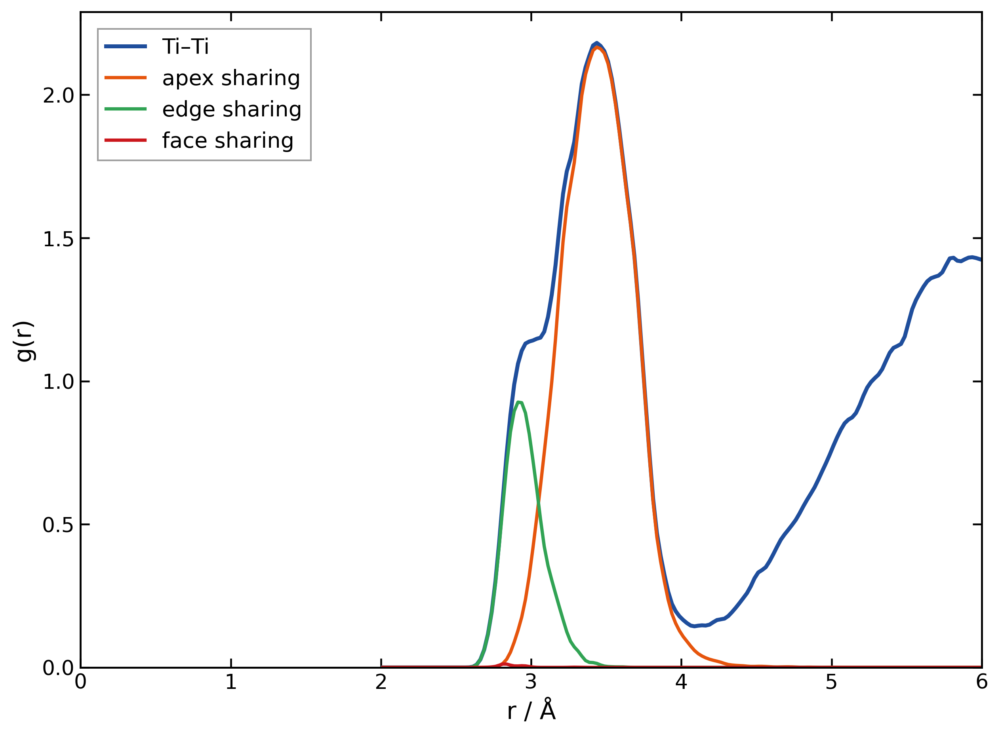

==============================
BaTiO₃構造相転移の計算例
==============================

本節は、BaTiO₃ の構造相転移を Quloud 上の GPU を用いた昇温 MD 計算で調べ、Ti の局所変位と格子定数から相を識別する。R、O、T、C は順に菱面体晶、斜方晶、正方晶、立方晶を表す。相転移は Ti のオフセンタリングと、それに結合した格子ひずみの再配向・消失として現れる :sup:`[1]`。図の温度は有限サイズ、有限時間、有限昇温速度の 1 軌跡で得た**見かけの転移温度**であり、熱力学極限の転移温度と同一視しない。比較ではスーパーセル、保持時間、温度刻み、昇温速度をそろえる必要がある :sup:`[2]`。

Quloud GPU 昇温計算によるモデル比較
----------------------------------------------------------------------

Quloud の GPU を用いた NPT 昇温 MD 計算を比較する。UMA-S（omat）、SevenNet（7net-ompa）、CHGNet の各汎用ポテンシャルについて、8 × 8 × 8 スーパーセル（2560 原子）を 10 K/ps で昇温した。相境界は Ti 変位方向の角度変化と格子定数の異常を併せて読み取った**この昇温軌跡での見かけの値**である。文献の計算とはモデルや昇温条件が異なるため、各相境界を同じ条件での直接比較として扱わない。

   Quloud GPU・UMA-S の Ti 変位方向の角度微分（上）と格子定数（下）。破線は R→O 188 K、O→T 489 K、T→C 824 K。

UMA-S では三つの境界で角度微分に鋭い変化があり、格子定数の分裂・再配列も対応する。R→O は実験値 183 K に近いが、O→T と T→C はそれぞれ 278 K、393 K の実験値より大幅に高い。したがって、四相の順序を再現することと転移温度を定量的に再現することは区別する。

   Quloud GPU・SevenNet の同じ指標。破線は R→O 223 K、O→T 441 K、T→C 851 K。

SevenNet も R→O→T→C の順序を示す。UMA-S と比べると R→O は 35 K 高く、O→T は 48 K 低い一方、T→C は 27 K 高い。同じセルサイズと昇温速度でも相境界のずれ方はモデルごとに一様ではなく、特に T→C は両モデルとも実験値を 400 K 以上上回る。

   Quloud GPU・CHGNet の同じ指標。低温から O 相で、O→T は 390 K、T→C は 827 K。R→O は検出されていない。

CHGNet では 1 K から O 相が割り当てられ、今回の 8 × 8 × 8 軌跡では R 相を確認できない。スライドは 10 × 10 × 10 への拡大と昇温速度の低減でも R 相が得られなかったと報告するが、その追加計算の軌跡・数値はここに示されていない。この結果だけから R 相の熱力学的な不存在を結論せず、初期構造、保持時間、冷却経路、モデルの学習範囲を分けて検証する必要がある。

Ti 変位分布による相の確認
~~~~~~~~~~~~~~~~~~~~~~~~~~~~~~~~~~~~~~~~~~~~~~~~~~~~~~~~~~~~~~~~~~~~~~

次の三図は、それぞれの昇温軌跡から選んだ温度窓における Ti の a、b、c 軸方向変位の確率密度である。Mizoguchi らは、R 相では三方向、O 相では二方向、T 相では一方向の変位が優勢となり、C 相では方向選好が弱くなることを相識別に利用している :sup:`[2]`。正負の符号は選択された分域・座標軸に依存するため、ここではピークの軸方向の組合せを見る。

   UMA-S の Ti 変位分布。R（1–176 K）、O（200–477 K）、T（501–812 K）、C（836–950 K）。

UMA-S の R 相では三軸に有限変位の鋭いピークがあり、O 相では a 軸がゼロ付近へ移る。T 相では b 軸の有限変位が残り、C 相では三軸とも分布が広がる。高温の広い分布は局所 Ti 変位の消失を意味せず、平均的な方向秩序の低下と解釈する。

   SevenNet の Ti 変位分布。R（1–211 K）、O（235–429 K）、T（453–839 K）、C（863–900 K）。

SevenNet でも三軸から二軸、一軸へと有限変位の優勢成分が減る。ただし O 相でゼロ付近となるのは b 軸、T 相で有限変位が残るのは c 軸であり、UMA-S の軸名とは一致しない。これは分極方向の等価な選択を含むため、相識別では特定の軸名より有限変位の成分数を重視する。

   CHGNet の Ti 変位分布。O（1–378 K）、T（402–815 K）、C（839–950 K）。

CHGNet では低温窓で b、c 軸の有限変位と a 軸のゼロ付近のピークが現れ、O 相の割当てと整合する。T 相では主に b 軸に有限変位が残り、C 相では分布が広がる。変位分布も、今回の軌跡に R 相の温度窓を設けられないことを支持する。

サイズ依存性と文献・実験との比較
~~~~~~~~~~~~~~~~~~~~~~~~~~~~~~~~~~~~~~~~~~~~~~~~~~~~~~~~~~~~~~~~~~~~~~

   Quloud GPU 計算のセルサイズ依存性（5 × 5 × 5 ～ 8 × 8 × 8）。破線は R→O 183 K、O→T 278 K、T→C 393 K の実験値。CHGNet では R→O を割り当てられない。

UMA-S の R→O はサイズ間で 154–188 K、SevenNet は 161–223 K に分布する。対して両モデルの T→C はセル拡大とともに概ね上昇し、8 × 8 × 8 でも実験値に近づかない。CHGNet も O→T が 321→390 K、T→C が 646→827 K と上昇する。SevenNet の T→C は 6 × 6 × 6 から 7 × 7 × 7 で一度低下しており、単調増加や 8 × 8 × 8 での収束を全モデルに一般化できない。サイズをそろえることは比較の前提だが、サイズ効果だけで高温側のずれは解消しない。

.. list-table:: 8 × 8 × 8 昇温計算の相境界と参照値（K）
   :header-rows: 1
   :widths: 30 17 17 17 19

   * - 出典・モデル
     - R→O
     - O→T
     - T→C
     - 昇温速度
   * - 本計算・UMA-S
     - 188
     - 489
     - 824
     - 10 K/ps
   * - 本計算・SevenNet
     - 223
     - 441
     - 851
     - 10 K/ps
   * - 本計算・CHGNet
     - 検出なし
     - 390
     - 827
     - 10 K/ps
   * - Mizoguchi ら・微調整 MACE :sup:`[2]`
     - 150
     - 225
     - 290
     - 2.5 K/ps
   * - Sehrawat ら・ACE :sup:`[1]`
     - 約 80
     - 約 240
     - 約 625
     - 1 K/ps
   * - 実験値（Mizoguchi らの引用） :sup:`[2]`
     - 183
     - 278
     - 393
     - —

Mizoguchi らの微調整 MACE は、四相の順序を再現する一方、三つの転移温度を実験より 33、53、103 K 低く予測した :sup:`[2]`。これに対し、Quloud の 8 × 8 × 8 GPU 計算では UMA-S と SevenNet の R→O は実験値に比較的近いが、O→T は 163–211 K、T→C は 431–458 K 高い。CHGNet では R→O が得られず、O→T は 112 K、T→C は 434 K 高い。Sehrawat らの ACE も T→C を約 625 K と報告しており、文献間でも相境界の一致は一様でない :sup:`[1]`。文献のモデルは専用学習・DFT 基準・昇温速度が異なるため、この表は相順序とずれの方向・規模の比較であり、厳密な性能順位ではない。スライドが挙げる微調整は改善候補だが、改善の有無は独立の相転移・構造検証で確かめる必要がある。

融解までの結合秩序
----------------------------------------------------------------------

   **図1.7-7.** 25 K/ps（青）と 100 K/ps（橙）の昇温 MD における結合配向秩序パラメータ \(q_6\)。一点鎖線は各軌跡での見かけの融解温度（1749 K、1818 K）、黒破線は実験値 1893 K。

\(q_6\) の大きな低下は局所近接原子の配向相関、すなわち結晶性の喪失を表す。二つの昇温速度で見かけの融解温度が異なることは、有限速度では平衡化の不足が転移位置を動かし得ることを直接示す。実験との差をポテンシャルの誤差だけに帰属せず、昇温プロトコルの影響を分離して検証すべきである :sup:`[2]`。

局所多面体接続の比較
----------------------------------------------------------------------

   **図1.7-10.** 液相から急冷して得たアモルファス BaTiO₃ の Ba--Ba、Ba--Ti、Ba--O、Ti--Ti、Ti--O、O--O の部分動径分布関数 \(g(r)\)。

有限幅の第一・第二近接ピークと、遠距離の鋭い周期ピークの不在は非晶質状態を示す。Ti--O の鋭い第一ピークは局所 Ti--O 配位が強く保たれることを、広がった陽イオン間相関は中・長距離のネットワーク無秩序を示す。RDF の比較では、温度、時間平均、ビン幅を同一にする必要がある :sup:`[2]`。

   **図1.7-11.** アモルファス BaTiO₃ の Ti--Ti の \(g(r)\) と TiO₆ 多面体接続の局所結合単位への分解。頂点共有が支配的で、辺・面共有の寄与は小さい。

頂点共有の主ピークに加えて、短距離側の辺共有成分が現れ、面共有はごく小さい。すなわち、ガラスは Ti--O 多面体を保持するが、周期的な頂点共有ペロブスカイト秩序を回復せず、混合接続ネットワークを凍結した状態である。RDF と接続統計の併用により、局所構造の保持とネットワーク秩序の喪失を区別できる :sup:`[2]`。

まとめ
----------------------------------------------------------------------

Quloud GPU 計算では、Ti の局所変位と格子異方性から相の変化を追跡した。UMA-S と SevenNet が R → O → T → C を示す一方、CHGNet では R 相を確認できず、三モデルとも高温側の転移温度は実験値を大きく上回った。図1.7-7、10、11 は結晶秩序の低下と急冷後の局所配位を示す。定量的な転移温度の評価には、昇温速度、サイズ・時間収束、および加熱・冷却ヒステリシスの確認が必要である。

参考文献
---------

* :sup:`[1]` Sehrawat, A.; Albe, K.; Rohrer, J.,
  "Machine-learning interatomic potential for BaTiO3: phase transitions,
  domain walls, and grain boundaries,"
  *Journal of Physics: Condensed Matter*, **38**, 015402, 2026.
  `https://doi.org/10.1088/1361-648X/ae2727 <https://doi.org/10.1088/1361-648X/ae2727>`_

* :sup:`[2]` Chen, P.-Y.; Shibata, K.; Mizoguchi, T.,
  "High precision machine learning force field development for BaTiO3 phase
  transitions, amorphous, and liquid structures,"
  *APL Machine Learning*, **3**, 036115, 2025.
  `https://doi.org/10.1063/5.0268149 <https://doi.org/10.1063/5.0268149>`_
