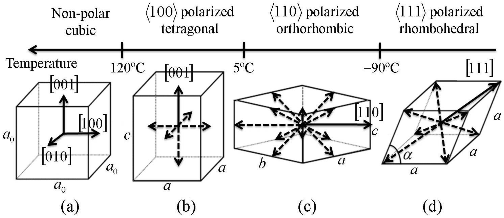
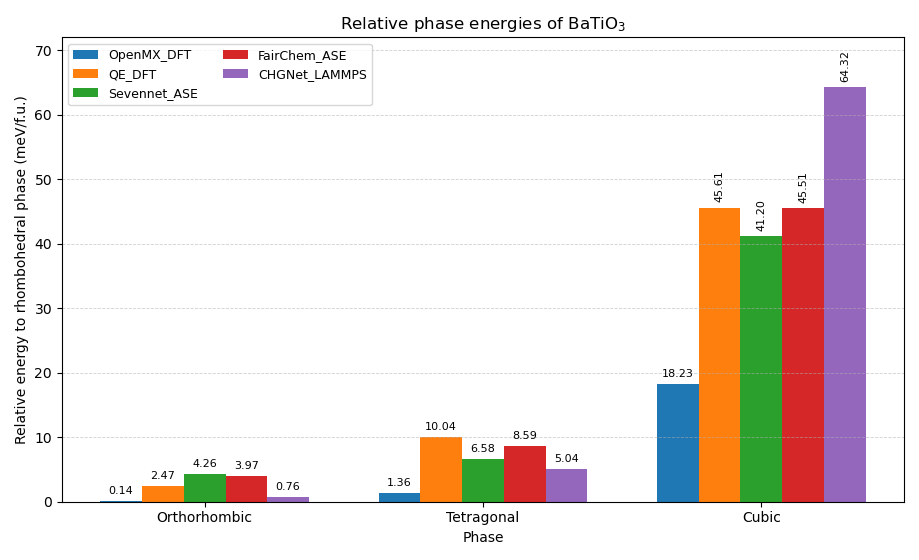

==============================
BaTiO₃の安定基底状態の計算例
==============================

.. _batio3-stability:

   BaTiO₃ の温度依存相系列と分極方向の概略図。Shu と Bhattacharya による整理に基づく :sup:`[1]`。

BaTiO₃ は、ペロブスカイト型強誘電体の代表的な材料であり、温度に応じて
立方晶相、正方晶相、直方晶相、菱面体相の間で相転移を示す。実験的には、
正方晶相、直方晶相、菱面体相の結晶構造および原子変位は、X 線・中性子回折
などにより古くから調べられてきた :sup:`[2,3]`。この相系列は、単なる格子定数の
変化ではなく、Ti 原子と O 八面体の相対変位、すなわち強誘電ソフトモードと
格子歪みの結合により特徴づけられる。

材料計算の観点では、有限温度の相転移を直接扱う前に、まず 0 K における
各多形の静的エネルギー順位を確認することが重要である。第一原理計算に基づく
有効ハミルトニアン研究では、BaTiO₃ の低温側の安定性と相転移系列が、局所的な
極性歪みと長距離相互作用の競合から再現できることが示されている
:sup:`[4,5]`。したがって、DFT および機械学習ポテンシャル（MLIP）を用いた
構造最適化においても、0 K の基底状態で

.. math::

   R < O < T < C

という順序が再現されるかどうかは、BaTiO₃ の相安定性を記述する上で基本的な
検証項目となる。ここで :math:`R`、:math:`O`、:math:`T`、:math:`C` はそれぞれ
菱面体相、直方晶相、正方晶相、立方晶相を表す。

計算手順と代表的な入力ファイル
==============================

本節で示す相対エネルギーは、各相について先に得られた最適化済み格子定数を用いて
計算した。具体的には、まず格子定数だけを最適化し、その後、その格子を固定したまま
原子位置を最適化した。最後に、得られた最終構造の全エネルギーを
1 化学式単位あたりに換算し、菱面体相のエネルギーを基準として相対エネルギーを
評価した。

ここでは、構造最適化に用いた代表例として QE の入力ファイルのみを示す。
Quloud Job では、各相のジョブに含まれる ``QuloudJob.scf.in`` を以下の例で
置き換えることで、同じ形式の固定格子構造最適化を実行できる。入力中の
``calculation = 'relax'`` は格子を固定して原子位置のみを最適化する指定であり、
``ibrav``、``A``、``B``、``C``、``cosAB`` には、直前の格子最適化で得られた
各相の格子定数を用いている。原子位置の固定フラグは付けていないため、
Ti と O を含む内部座標は最適化される。

.. list-table:: 固定格子構造最適化に用いた QE 入力の対応
   :header-rows: 1
   :widths: 18 10 34 38

   * - 相
     - ``ibrav``
     - 最適化済み格子
     - 役割
   * - 立方晶相
     - 1
     - :math:`a=b=c`
     - 非分極立方晶の基準構造
   * - 正方晶相
     - 6
     - :math:`a=b`, :math:`c`
     - :math:`\langle 100\rangle` 型分極をもつ相
   * - 直方晶相
     - 8
     - :math:`a`, :math:`b`, :math:`c`
     - :math:`\langle 110\rangle` 型分極をもつ相
   * - 菱面体相
     - 5
     - :math:`a=b=c`, :math:`\alpha=\beta=\gamma`
     - :math:`\langle 111\rangle` 型分極をもつ相

.. raw:: html

   
   

QE
~~~~~~

.. raw:: html

   

     
立方晶相

     

       

         QuloudJob.scf.in
         <button type="button" class="copy-input-button" onclick="copyInputBlock('qe-cubic-input', this)">Copy</button>
       

       <pre class="input-code"><code id="qe-cubic-input" class="language-text">&amp;control
     calculation    = &#x27;relax&#x27;
     prefix         = &#x27;BaTiO3_cubic_QE_fixedcell_relax_from_latticeopt&#x27;
     pseudo_dir     = &#x27;./&#x27;
     outdir         = &#x27;./work&#x27;
     verbosity      = &#x27;high&#x27;
     tstress        = .true.
     tprnfor        = .true.
     etot_conv_thr  = 1.0d-5
     forc_conv_thr  = 1.0d-4
     nstep          = 100
   /
   &amp;system
     ibrav       = 1
     A           = 4.0242627603
     nat         = 5
     ntyp        = 3
     ecutwfc     = 52.0
     ecutrho     = 575.0
     input_dft   = &#x27;PBE&#x27;
     tot_charge  = 0.0
     occupations = &#x27;fixed&#x27;
     nspin       = 1
   /
   &amp;electrons
     conv_thr         = 1.0d-10
     mixing_beta      = 0.7
     electron_maxstep = 100
   /
   &amp;ions
     ion_dynamics = &#x27;bfgs&#x27;
   /
   ATOMIC_SPECIES
   Ba 137.327 Ba.pbe-spn-rrkjus_psl.1.0.0.UPF
   Ti  47.867 Ti.pbe-spn-rrkjus_psl.1.0.0.UPF
   O   15.999 O.pbe-nl-rrkjus_psl.1.0.0.UPF

   ATOMIC_POSITIONS {crystal}
   Ba  0.000000000000  0.000000000000  0.000000000000
   Ti  0.500000000000  0.500000000000  0.500000000000
   O   0.500000000000  0.500000000000  0.000000000000
   O   0.500000000000  0.000000000000  0.500000000000
   O   0.000000000000  0.500000000000  0.500000000000

   K_POINTS {automatic}
   6 6 6 0 0 0
   </code></pre>
     

   

.. raw:: html

   

     
正方晶相

     

       

         QuloudJob.scf.in
         <button type="button" class="copy-input-button" onclick="copyInputBlock('qe-tetragonal-input', this)">Copy</button>
       

       <pre class="input-code"><code id="qe-tetragonal-input" class="language-text">&amp;control
     calculation    = &#x27;relax&#x27;
     prefix         = &#x27;BaTiO3_tetragonal_QE_fixedcell_relax_from_latticeopt&#x27;
     pseudo_dir     = &#x27;./&#x27;
     outdir         = &#x27;./work&#x27;
     verbosity      = &#x27;high&#x27;
     tstress        = .true.
     tprnfor        = .true.
     etot_conv_thr  = 1.0d-5
     forc_conv_thr  = 1.0d-4
     nstep          = 100
   /
   &amp;system
     ibrav       = 6
     A           = 4.0151174639
     C           = 4.0680532926
     nat         = 5
     ntyp        = 3
     ecutwfc     = 52.0
     ecutrho     = 575.0
     input_dft   = &#x27;PBE&#x27;
     tot_charge  = 0.0
     occupations = &#x27;fixed&#x27;
     nspin       = 1
   /
   &amp;electrons
     conv_thr         = 1.0d-10
     mixing_beta      = 0.7
     electron_maxstep = 100
   /
   &amp;ions
     ion_dynamics = &#x27;bfgs&#x27;
   /
   ATOMIC_SPECIES
   Ba 137.327 Ba.pbe-spn-rrkjus_psl.1.0.0.UPF
   Ti  47.867 Ti.pbe-spn-rrkjus_psl.1.0.0.UPF
   O   15.999 O.pbe-nl-rrkjus_psl.1.0.0.UPF

   ATOMIC_POSITIONS {crystal}
   Ba  0.000000000000  0.000000000000  0.000000000000
   Ti  0.499983187300  0.499983187300  0.519965796700
   O   0.499983187300  0.499983187300  0.984935211100
   O   0.499983187300  0.000000000000  0.484968098900
   O   0.000000000000  0.499983187300  0.484968098900

   K_POINTS {automatic}
   6 6 6 0 0 0
   </code></pre>
     

   

.. raw:: html

   

     
直方晶相

     

       

         QuloudJob.scf.in
         <button type="button" class="copy-input-button" onclick="copyInputBlock('qe-orthorhombic-input', this)">Copy</button>
       

       <pre class="input-code"><code id="qe-orthorhombic-input" class="language-text">&amp;control
     calculation    = &#x27;relax&#x27;
     prefix         = &#x27;BaTiO3_orthorhombic_polar110_QE_fixedcell_relax_from_latticeopt&#x27;
     pseudo_dir     = &#x27;./&#x27;
     outdir         = &#x27;./work&#x27;
     verbosity      = &#x27;high&#x27;
     tstress        = .true.
     tprnfor        = .true.
     etot_conv_thr  = 1.0d-5
     forc_conv_thr  = 1.0d-4
     nstep          = 100
   /
   &amp;system
     ibrav       = 8
     A           = 4.0246783931
     B           = 5.6925106359
     C           = 5.6914525484
     nat         = 10
     ntyp        = 3
     ecutwfc     = 52.0
     ecutrho     = 575.0
     input_dft   = &#x27;PBE&#x27;
     tot_charge  = 0.0
     occupations = &#x27;fixed&#x27;
     nspin       = 1
   /
   &amp;electrons
     conv_thr         = 1.0d-10
     mixing_beta      = 0.7
     electron_maxstep = 100
   /
   &amp;ions
     ion_dynamics = &#x27;bfgs&#x27;
   /
   ATOMIC_SPECIES
   Ba 137.327 Ba.pbe-spn-rrkjus_psl.1.0.0.UPF
   Ti  47.867 Ti.pbe-spn-rrkjus_psl.1.0.0.UPF
   O   15.999 O.pbe-nl-rrkjus_psl.1.0.0.UPF

   ATOMIC_POSITIONS {crystal}
   Ba  0.000000000000  0.000000000000  0.000000000000
   Ba  0.000000000000  0.500008826700  0.500006672400
   Ti  0.502938513500  0.003000053000  0.500006672400
   Ti  0.502938513500  0.503008879700  0.000000000000
   O   0.498439063500  0.248504386900  0.250003336200
   O   0.498439063500  0.748513213600  0.750010008600
   O   0.498439063500  0.248504386900  0.750010008600
   O   0.498439063500  0.748513213600  0.250003336200
   O   0.998377943700  0.998517626900  0.500006672400
   O   0.998377943700  0.498508800200  0.000000000000

   K_POINTS {automatic}
   6 4 4 0 0 0
   </code></pre>
     

   

.. raw:: html

   

     
菱面体相

     

       

         QuloudJob.scf.in
         <button type="button" class="copy-input-button" onclick="copyInputBlock('qe-rhombohedral-input', this)">Copy</button>
       

       <pre class="input-code"><code id="qe-rhombohedral-input" class="language-text">&amp;control
     calculation    = &#x27;relax&#x27;
     prefix         = &#x27;BaTiO3_rhombohedral_QE_fixedcell_relax_from_latticeopt&#x27;
     pseudo_dir     = &#x27;./&#x27;
     outdir         = &#x27;./work&#x27;
     verbosity      = &#x27;high&#x27;
     tstress        = .true.
     tprnfor        = .true.
     etot_conv_thr  = 1.0d-5
     forc_conv_thr  = 1.0d-4
     nstep          = 100
   /
   &amp;system
     ibrav       = 5
     A           = 4.0265564845
     cosAB       = 0.004402895456
     nat         = 5
     ntyp        = 3
     ecutwfc     = 52.0
     ecutrho     = 575.0
     input_dft   = &#x27;PBE&#x27;
     tot_charge  = 0.0
     occupations = &#x27;fixed&#x27;
     nspin       = 1
   /
   &amp;electrons
     conv_thr         = 1.0d-10
     mixing_beta      = 0.7
     electron_maxstep = 100
   /
   &amp;ions
     ion_dynamics = &#x27;bfgs&#x27;
   /
   ATOMIC_SPECIES
   Ba 137.327 Ba.pbe-spn-rrkjus_psl.1.0.0.UPF
   Ti  47.867 Ti.pbe-spn-rrkjus_psl.1.0.0.UPF
   O   15.999 O.pbe-nl-rrkjus_psl.1.0.0.UPF

   ATOMIC_POSITIONS {crystal}
   Ba  0.000000000000  0.000000000000  0.000000000000
   Ti  0.515099343400  0.515099343400  0.515099343400
   O   0.485093556400  0.485093556400  0.000000000000
   O   0.485093556400  0.000000000000  0.485093556400
   O   0.000000000000  0.485093556400  0.485093556400

   K_POINTS {automatic}
   6 6 6 0 0 0
   </code></pre>
     

   

MLIP
~~~~

以下は Quloud の ASE および LAMMPS ジョブで使う入力ファイル例である。ASE では ``ase.in``、LAMMPS では ``in.QuloudJob`` を置き換えて使う。構造データは各相のジョブに含まれるものを利用するため、同じ入力形式を各相に適用できる。

.. list-table:: MLIP入力の対応
   :header-rows: 1
   :widths: 24 26 50

   * - 手法
     - ファイル名
     - 主な設定
   * - ASE SevenNet
     - ``ase.in``
     - ``provider: "7net"``, ``latopt: false``
   * - ASE FairChem
     - ``ase.in``
     - ``provider: "fairchem"``, ``latopt: false``
   * - LAMMPS CHGNet
     - ``in.QuloudJob``
     - CHGNet 用 LAMMPS 入力例

.. raw:: html

   

     
ASE SevenNet

     

       

         ase.in
         <button type="button" class="copy-input-button" onclick="copyInputBlock('input-mlip-sevennet', this)">Copy</button>
       

       <pre class="input-code"><code id="input-mlip-sevennet" class="language-text">{
     &quot;mode&quot;: &quot;opt&quot;,
     &quot;opt&quot;: {
       &quot;fmax&quot;: 0.01,
       &quot;ntime&quot;: 100,
       &quot;latopt&quot;: false
     },
     &quot;provider&quot;: &quot;7net&quot;,
     &quot;model_name&quot;: &quot;7net-mf-ompa&quot;
   }</code></pre>
     

   

   

     
ASE FairChem

     

       

         ase.in
         <button type="button" class="copy-input-button" onclick="copyInputBlock('input-mlip-fairchem', this)">Copy</button>
       

       <pre class="input-code"><code id="input-mlip-fairchem" class="language-text">{
     &quot;mode&quot;: &quot;opt&quot;,
     &quot;opt&quot;: {
       &quot;fmax&quot;: 0.01,
       &quot;ntime&quot;: 100,
       &quot;latopt&quot;: true
     },
     &quot;provider&quot;: &quot;fairchem&quot;,
     &quot;model_name&quot;: &quot;uma-s-1p1&quot;
   }</code></pre>
     

   

   

     
LAMMPS CHGNet

     

       

         in.QuloudJob
         <button type="button" class="copy-input-button" onclick="copyInputBlock('input-mlip-chgnet-lammps', this)">Copy</button>
       

       <pre class="input-code"><code id="input-mlip-chgnet-lammps" class="language-text">
         # Generated from CHGNet/LAMMPS lattice-optimized BaTiO3 structure
         # Fixed-cell structural optimization: atomic positions are relaxed, lattice is held fixed.
         units metal
         boundary p p p
         atom_style atomic
         read_data QuloudJob.lmp
         replicate 1 1 1
         pair_style chgnet ../../../../../../../../CHGNET
         pair_coeff * * 0.3.0 Ba Ti O
         thermo_style custom step etotal temp density vol press
         thermo 10
         dump 1 all atom 5 QuloudJob.lammpstrj
         minimize 1.0e-15 1.0e-7 1000 10000
         write_data QuloudJob.out.lmp
       </code></pre>
     

   

結果の概要
==========

本計算では、BaTiO₃ の代表的な四つの多形を対象とし、0 K における相対安定性を
DFT および MLIP により比較した。ここで示す全エネルギーは、前段階で最適化した
格子定数を固定し、その格子上で原子位置を最適化して得たものである。したがって、
この比較は、格子歪みの特徴を各相に保ったうえで、内部座標の緩和により得られる
0 K の静的エネルギー順位を評価するものである。

   菱面体相を基準にした BaTiO₃ 各相の相対エネルギー。

エネルギーは各手法で得られた菱面体相を基準とし、1 化学式単位あたりの相対エネルギー
:math:`\Delta E = E_{\mathrm{phase}} - E_R` として整理した。OpenMX、Quantum
ESPRESSO、SevenNet、FairChem、CHGNet は、基底関数、擬ポテンシャル、エネルギー基準、
または学習されたエネルギー面が異なるため、絶対エネルギーを手法間で直接比較する
ことはできない。本比較で意味をもつのは、同一手法内での相対エネルギー差と安定性の
順序である。

.. list-table:: BaTiO₃ 各相の相対エネルギー :math:`\Delta E=E_{\mathrm{phase}}-E_R`
   :header-rows: 1
   :widths: 22 16 16 18 20 20

   * - 相
     - OpenMX-DFT
     - QE-DFT
     - SevenNet-ASE
     - FairChem-ASE
     - CHGNet-LAMMPS
   * - 直方晶相 :math:`O`
     - 0.136
     - 2.469
     - 4.260
     - 3.967
     - 0.763
   * - 正方晶相 :math:`T`
     - 1.361
     - 10.041
     - 6.580
     - 8.587
     - 5.043
   * - 立方晶相 :math:`C`
     - 18.232
     - 45.608
     - 41.195
     - 45.510
     - 64.320

すべての手法で、菱面体相が最も低いエネルギーを示し、次に直方晶相、正方晶相、
立方晶相の順にエネルギーが高くなった。したがって、本計算で得られた 0 K の
安定性順序は

.. math::

   \mathrm{Rhombohedral} < \mathrm{Orthorhombic} <
   \mathrm{Tetragonal} < \mathrm{Cubic}

であり、実験的に知られている低温側から高温側への相系列、および第一原理有効
ハミルトニアンに基づく先駆的研究の結果と整合している :sup:`[2,4,5]`。

DFT と MLIP の比較
===================

DFT 計算では、OpenMX-DFT と QE-DFT のいずれも
:math:`R < O < T < C` の順序を与えた。OpenMX-DFT では
:math:`O-R = 0.136~\mathrm{meV/f.u.}` と非常に小さく、菱面体相と直方晶相は
ほぼ縮退している。一方、QE-DFT では :math:`O-R = 2.469~\mathrm{meV/f.u.}`、
:math:`T-R = 10.041~\mathrm{meV/f.u.}`、:math:`C-R = 45.608~\mathrm{meV/f.u.}`
であり、相の対称性が高くなるにつれて相対エネルギーが段階的に上昇する。
これは、0 K の静的エネルギー曲面において、強誘電歪みをもつ低対称相が、
非分極の立方晶相より安定化されることを示している。

MLIP 計算でも同じ順序が得られた。SevenNet-ASE と FairChem-ASE では、
直方晶相は菱面体相より約 :math:`4~\mathrm{meV/f.u.}` 高く、正方晶相は
さらに高い。CHGNet-LAMMPS では :math:`O-R = 0.763~\mathrm{meV/f.u.}` と
小さい一方、立方晶相は :math:`64.320~\mathrm{meV/f.u.}` 高く評価された。
MLIP の種類によってエネルギー差の大きさは異なるが、基底状態の相安定性順序は
DFT と一致している。このことは、MLIP を用いた構造最適化でも、BaTiO₃ の代表的な
多形間の相対安定性を定性的に再現できることを示している。

ただし、:math:`R` と :math:`O` のエネルギー差は、OpenMX-DFT と
CHGNet-LAMMPS では 1 :math:`\mathrm{meV/f.u.}` 以下であり、数値収束、格子拘束、
原子位置最適化の条件に対して敏感である。このため、これら二つの相の順位を
議論する場合には、k 点密度、カットオフ、最終構造の分極方向、力の収束条件を
明記する必要がある。一方で、全手法に共通して立方晶相が最も高いエネルギーを
示す点は明確であり、非分極立方晶相が 0 K の基底状態ではないことをよく表している。

物理的な解釈
============

BaTiO₃ の相安定性は、Ti 原子のオフセンター変位と O 八面体の応答によって生じる
極性ソフトモードと、格子歪みとの結合に強く支配される。正方晶相では分極は
擬立方の :math:`\langle 100\rangle` 型方向、直方晶相では
:math:`\langle 110\rangle` 型方向、菱面体相では :math:`\langle 111\rangle` 型方向に
対応する。このような分極方向の違いは、単に原子位置だけでなく、
:math:`a`、:math:`b`、:math:`c`、および格子角の制約と結びついている。これらの
分極方向と結晶形の関係は、BaTiO₃ のドメイン構造や巨視的応答を議論する上でも
重要である :sup:`[1]`。

Senn らの局所構造解析では、BaTiO₃ の各相において Ti の局所的なオフセンター変位が
菱面体的な性質をもつことが示されている :sup:`[6]`。この見方では、各相の違いは、
局所変位そのものの有無ではなく、それらの相関方向と格子歪みの組み合わせとして
理解できる。したがって、本計算で各相の分極方向と格子の特徴を保ちながら最適化した
ことは、相安定性を比較する上で重要である。

また、Nishimatsu らは、BaTiO₃ の相転移温度や分極歪みが、DFT の交換相関汎関数と
格子定数に強く依存することを示している :sup:`[7]`。本結果でも、手法によって
相対エネルギーの大きさは異なる。しかし、DFT と MLIP の両方で同じ
:math:`R < O < T < C` の順序が得られたことは、今回の構造最適化手順が
BaTiO₃ の 0 K 相安定性を捉える上で妥当であることを支持している。

結論と今後の展望
================

本計算では、OpenMX-DFT、QE-DFT、SevenNet-ASE、FairChem-ASE、CHGNet-LAMMPS の
すべてにおいて、BaTiO₃ の 0 K 安定性順序として

.. math::

   R < O < T < C

が得られた。この結果は、低温で菱面体相が最安定となり、温度上昇に伴って
直方晶相、正方晶相、立方晶相へ移るという実験的な相転移系列と整合する。
また、DFT だけでなく MLIP でも同じ相安定性順序を再現できることから、
MLIP は BaTiO₃ の構造探索や有限温度シミュレーションの初期評価に有用であると
考えられる。

一方で、0 K の静的エネルギー順位だけでは、実際の相転移温度や有限温度安定性を
完全には決定できない。今後は、(i) フォノン分散または Γ 点ソフトモードによる
動的安定性の確認、(ii) 分子動力学またはモンテカルロ法による有限温度効果の評価、
(iii) 自由エネルギー、エントロピー、熱膨張を含む相境界の解析が必要である。
特に BaTiO₃ では、菱面体相と直方晶相のエネルギー差が小さいため、有限温度効果や
零点振動、格子歪みと分極の結合が相転移挙動に大きく寄与する可能性がある。
したがって、本結果は、有限温度相転移、フォノン安定性、ドメイン構造、粒界構造などを
調べるための 0 K 基準データとして位置づけるのが適切である。

参考文献
========

* :sup:`[1]` Shu, Y. C.; Bhattacharya, K.,
  "Domain patterns and macroscopic behaviour of ferroelectric materials,"
  *Philosophical Magazine B*, **81**, 2021--2054, 2001.
  `https://doi.org/10.1080/13642810108208556 <https://doi.org/10.1080/13642810108208556>`_

* :sup:`[2]` Kwei, G. H.; Lawson, A. C.; Billinge, S. J. L.; Cheong, S.-W.,
  "Structures of the ferroelectric phases of barium titanate,"
  *Journal of Physical Chemistry*, **97**, 2368, 1993.
  `https://doi.org/10.1021/j100112a043 <https://doi.org/10.1021/j100112a043>`_

* :sup:`[3]` Shirane, G.; Danner, H.; Pepinsky, R.,
  "Neutron diffraction study of orthorhombic BaTiO₃,"
  *Physical Review*, **105**, 856, 1957.
  `https://doi.org/10.1103/PhysRev.105.856 <https://doi.org/10.1103/PhysRev.105.856>`_

* :sup:`[4]` Zhong, W.; Vanderbilt, D.; Rabe, K. M.,
  "Phase transitions in BaTiO₃ from first principles,"
  *Physical Review Letters*, **73**, 1861--1864, 1994.
  `https://doi.org/10.1103/PhysRevLett.73.1861 <https://doi.org/10.1103/PhysRevLett.73.1861>`_

* :sup:`[5]` Zhong, W.; Vanderbilt, D.; Rabe, K. M.,
  "First-principles theory of ferroelectric phase transitions for perovskites:
  The case of BaTiO₃,"
  *Physical Review B*, **52**, 6301--6312, 1995.
  `https://doi.org/10.1103/PhysRevB.52.6301 <https://doi.org/10.1103/PhysRevB.52.6301>`_

* :sup:`[6]` Senn, M. S.; Keen, D. A.; Lucas, T. C. A.; Hriljac, J. A.;
  Goodwin, A. L., "Emergence of long-range order in BaTiO₃ from local
  symmetry-breaking distortions," *Physical Review Letters*, **116**, 207602, 2016.
  `https://doi.org/10.1103/PhysRevLett.116.207602 <https://doi.org/10.1103/PhysRevLett.116.207602>`_

* :sup:`[7]` Nishimatsu, T.; Iwamoto, M.; Kawazoe, Y.; Waghmare, U. V.,
  "First-principles accurate total-energy surfaces for polar structural distortions
  of BaTiO₃, PbTiO₃, and SrTiO₃: Consequences to structural transition temperatures,"
  *Physical Review B*, **82**, 134106, 2010.
  `https://doi.org/10.1103/PhysRevB.82.134106 <https://doi.org/10.1103/PhysRevB.82.134106>`_
