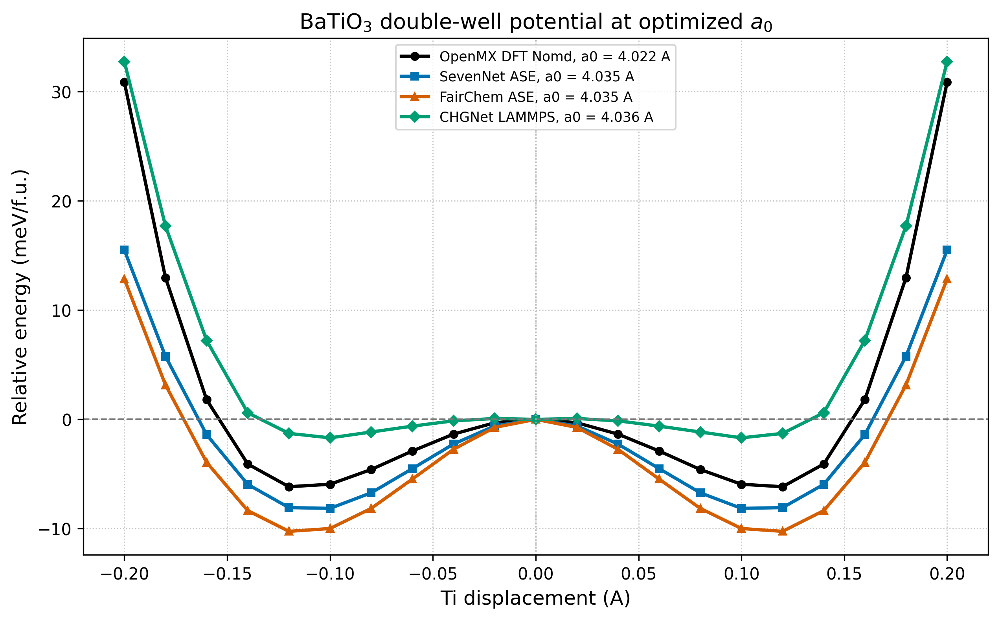
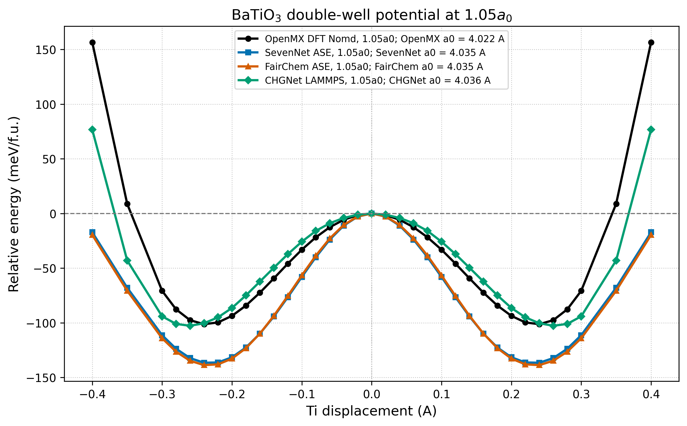

====================================================
BaTiO₃の二重井戸ポテンシャル Part 1
====================================================

計算の動機
----------------------------------------------------------------------

本節では、BaTiO₃立方晶におけるTi原子の [001] 方向変位に対する
double-well potential を、DFTおよび複数のMLIPにより比較する。
Sehrawatらの報告では、立方晶BaTiO₃に対してTi原子のみを
対称位置から [001] 方向へ変位させ、他の原子を理想立方晶位置に固定した
単点エネルギー計算により、double-well potential を評価している。
この評価は、BaTiO₃の強誘電的不安定性、すなわちTi off-centering による
局所的なエネルギー低下を確認するための基本的な検証である :sup:`[1]`。

BaTiO₃の高温常誘電相では、平均構造としては立方晶対称性を示す一方で、
局所的にはTi原子が中心位置から変位し得ることが知られている。
このような局所的な Ti off-centering は、平均立方晶対称性と瞬間的な局所極性が
共存し得る多井戸描像と整合する。ただし、一つの Ti だけを動かした静的エネルギー曲線は、
協同変位、局所相関、および有限温度の自由エネルギーを含む多次元描像の一断面である。
したがって、Ti変位に対するエネルギー曲線を評価することにより、
DFTおよびMLIPがBaTiO₃の強誘電的不安定性をどの程度再現できるかを
検証することができる。

入力ファイル例
----------------------------------------------------------------------

以下は、立方晶 BaTiO₃ の Ti 原子を [001] 方向へ ``+0.08 Å`` 変位させ、
各構造の全エネルギーを評価するための入力ファイル例である。
この入力例を基準として Ti 変位量を正負方向に変更し、各変位点で単点エネルギーを計算することで、
double-well potential のエネルギー曲線を作成できる。

本計算では、Ba 原子および O 原子を理想立方晶位置に固定し、**Ti 原子の z 座標だけを変更する**。
構造最適化やセル緩和を行うと指定した変位座標が変化するため、OpenMX では ``MD.Type Nomd``、
CHGNet では ``run 0`` を用いる。SevenNet では、計算条件を ``ase.in`` に記述し、
実際の Ti 変位は ``rsdft.atoms`` の分率座標で指定する。

.. list-table:: 各手法で変更する入力ファイル
   :header-rows: 1
   :widths: 18 26 27 29

   * - 手法
     - 計算条件ファイル
     - Ti 座標を変更するファイル
     - z 座標の指定方法
   * - OpenMX
     - ``openmx.in``
     - ``openmx.in``
     - Cartesian 座標（Å）
   * - CHGNet / LAMMPS
     - ``in.QuloudJob``
     - ``QuloudJob.lmp``
     - Cartesian 座標（Å）
   * - SevenNet / ASE
     - ``ase.in``
     - ``rsdft.atoms``
     - 分率座標

Ti 変位量を :math:`\Delta z`、立方晶格子定数を :math:`a_0` とすると、
各入力で使用する Ti の z 座標は次式で与えられる。

.. math::

   z_{\mathrm{Ti}}^{\mathrm{Cartesian}} = \frac{a_0}{2} + \Delta z

.. math::

   z_{\mathrm{Ti}}^{\mathrm{fractional}} = 0.5 + \frac{\Delta z}{a_0}

負方向へ変位させる場合は、``+ Δz`` を ``- |Δz|`` に置き換える。
例えば SevenNet の ``a0 = 4.035 Å`` で ``Δz = +0.08 Å`` とする場合、
Ti の分率 z 座標は ``0.51982652`` となる。``Δz = -0.08 Å`` の場合は
``0.48017348`` である。

現在の Quloud 上の手順では、変位量ごとに構造ファイルを複製し、Ti 座標を編集して、
個別にジョブを投入する必要がある。そのため、多数の変位点を走査する作業は単純である一方、
手作業では反復的で煩雑になりやすい。ジョブ名またはフォルダ名に変位量を明記し、
``Ti_m0p08A``、``Ti_0p00A``、``Ti_p0p08A`` のように統一して管理すると、
エネルギー集計時の取り違えを防止できる。

.. raw:: html

   
   

OpenMX：固定構造の単点全エネルギー計算
^^^^^^^^^^^^^^^^^^^^^^^^^^^^^^^^^^^^^^^^^^^^^^^^^^^^^^^^^^^^^^^^^^^^^^

以下は、``a0 = 4.020 Å`` の立方晶 BaTiO₃ において、Ti 原子を
``+0.08 Å`` だけ z 方向へ変位させた OpenMX 入力例である。
理想位置 ``z = 2.01 Å`` に対して、Ti の z 座標を ``2.09 Å`` に変更している。
他の変位量を計算する場合は、``Atoms.SpeciesAndCoordinates`` 内の Ti 行にある
z 座標だけを変更する。``MD.Type Nomd`` により、入力構造を緩和せずに全エネルギーを評価する。

.. raw:: html

   

     
OpenMX openmx.in — Ti displacement = +0.08 Å

     

.. code-block:: text

   #
   # File Name
   #

   System.CurrrentDirectory ./
   System.Name BTO_cubic_PE_Nomd
   DATA.PATH /usr/local/rsdft/DFT_DATA19

   #
   # Definition of Atomic Species
   #

   Species.Number 3
   <Definition.of.Atomic.Species
   Ba  Ba10.0-s3p2d2  Ba_PBE19
   O   O6.0-s2p2d1    O_PBE19
   Ti  Ti7.0-s3p2d1   Ti_PBE19
   Definition.of.Atomic.Species>

   #
   # Atoms
   #

   Atoms.Number 5
   Atoms.SpeciesAndCoordinates.Unit Ang
   <Atoms.SpeciesAndCoordinates
   1 Ba  0.0   0.0   0.0   5.0  5.0
   2 Ti  2.01  2.01  2.09  6.0  6.0
   3 O   2.01  2.01  0.0   3.0  3.0
   4 O   2.01  0.0   2.01  3.0  3.0
   5 O   0.0   2.01  2.01  3.0  3.0
   Atoms.SpeciesAndCoordinates>

   Atoms.UnitVectors.Unit Ang
   <Atoms.UnitVectors
   4.0200000000  0.0000000000  0.0000000000
   0.0000000000  4.0200000000  0.0000000000
   0.0000000000  0.0000000000  4.0200000000
   Atoms.UnitVectors>

   #
   # SCF or Electronic System
   #

   scf.XcType                 GGA-PBE
   scf.SpinPolarization       off
   scf.ElectronicTemperature  300
   scf.energycutoff           500
   scf.maxIter                300
   scf.EigenvalueSolver       band
   scf.Kgrid                  8 8 8
   scf.criterion              1.0e-8
   scf.system.charge          0

   scf.Mixing.Type            rmm-diisk
   scf.Init.Mixing.Weight     0.3
   scf.Min.Mixing.Weight      0.001
   scf.Max.Mixing.Weight      0.4
   scf.Mixing.History         30
   scf.Mixing.StartPulay      6

   scf.Electric.Field         0 0 0

   # Fixed single-point calculation
   MD.Type                    Nomd

.. raw:: html

     

   

CHGNet：LAMMPSによる単点全エネルギー計算
^^^^^^^^^^^^^^^^^^^^^^^^^^^^^^^^^^^^^^^^^^^^^^^^^^^^^^^^^^^^^^^^^^^^^^

以下の ``in.QuloudJob`` は、``QuloudJob.lmp`` に記述された構造を読み込み、
CHGNet により ``run 0`` の単点エネルギー計算を実行する入力例である。
Ti の変位量は ``in.QuloudJob`` ではなく、``QuloudJob.lmp`` の Atoms セクションで変更する。

``a0 = 4.036 Å`` の場合、理想的な Ti の Cartesian z 座標は ``2.018 Å`` である。
したがって、``+0.08 Å`` の変位では Ti の z 座標を ``2.098 Å``、
``-0.08 Å`` の変位では ``1.938 Å`` とする。Quloud が付与した原子 ID はジョブごとに確認し、
元素タイプが Ti に対応する行の z 座標だけを変更する。

.. raw:: html

   

     
CHGNet in.QuloudJob — single-point energy

     

.. code-block:: text

   # CHGNet/LAMMPS single-point total-energy calculation

   units metal
   boundary p p p
   atom_style atomic

   read_data QuloudJob.lmp

   pair_style chgnet ../../../../../../../../CHGNET
   pair_coeff * * 0.3.0 Ba Ti O

   thermo_style custom step pe etotal temp density vol press
   thermo 1

   run 0

   variable Epe equal pe
   variable Etot equal etotal
   variable V equal vol
   variable P equal press

   print "pe_eV ${Epe}" file singlepoint_energy.dat
   print "etotal_eV ${Etot}" append singlepoint_energy.dat
   print "volume_A3 ${V}" append singlepoint_energy.dat
   print "pressure_bar ${P}" append singlepoint_energy.dat

.. raw:: html

     

   

``QuloudJob.lmp`` では、Atoms セクションの基本形式
``atom-ID atom-type x y z`` を確認し、Ti に対応する行のみを編集する。
例えば Ti が atom type 2 である場合、``+0.08 Å`` の z 座標は次のようになる。
この一行は座標変更箇所を示す例であり、実際には Quloud が生成した atom ID と type を優先する。

.. code-block:: text

   2  2  2.018000  2.018000  2.098000

SevenNet：ASE入力と分率座標によるTi変位
^^^^^^^^^^^^^^^^^^^^^^^^^^^^^^^^^^^^^^^^^^^^^^^^^^^^^^^^^^^^^^^^^^^^^^

以下は、添付された SevenNet の ``ase.in`` である。
``latopt`` を ``false`` とし、セルを変化させない最小ステップの計算設定としている。
Ti の変位量は ``ase.in`` ではなく、``rsdft.atoms`` 内の Ti 分率座標で指定する。

.. raw:: html

   

     
SevenNet ase.in — fixed-cell minimal-step evaluation

     

.. code-block:: json

   {
     "mode": "opt",
     "opt": {
       "fmax": 0.01,
       "ntime": 1,
       "latopt": false
     },
     "provider": "7net",
     "model_name": "7net-mf-ompa"
   }

.. raw:: html

     

   

``a0 = 4.035 Å``、``Δz = +0.08 Å`` の場合、Ti の分率座標は
``(0.50000000, 0.50000000, 0.51982652)`` となる。
``Δz = -0.08 Å`` の場合は、z 座標を ``0.48017348`` とする。
``rsdft.atoms`` では、Ba および O の分率座標を変更せず、Ti の z 成分だけを置き換える。

.. code-block:: text

   # Ti fractional coordinate for Δz = +0.08 Å at a0 = 4.035 Å
   Ti  0.50000000  0.50000000  0.51982652

   # Ti fractional coordinate for Δz = -0.08 Å at a0 = 4.035 Å
   Ti  0.50000000  0.50000000  0.48017348

``mode = "opt"`` と ``ntime = 1`` を用いる場合は、出力構造を確認し、
エネルギーを読み取る対象が入力変位構造であること、および Ti 座標が意図せず更新されていないことを確認する。
各変位点で同一のモデル、格子定数、原子順序、および計算設定を維持することが、
相対エネルギー曲線を一貫して比較するために重要である。

変位走査と相対エネルギーの整理
^^^^^^^^^^^^^^^^^^^^^^^^^^^^^^^^^^^^^^^^^^^^^^^^^^^^^^^^^^^^^^^^^^^^^^

1. 基準構造として ``Δz = 0 Å`` の入力を準備する。
2. Ti の z 座標だけを変更し、正負の各変位構造を作成する。
3. 各構造について、原子位置とセルを緩和せずに全エネルギーを計算する。
4. 各変位点の全エネルギーから ``Δz = 0 Å`` の全エネルギーを差し引く。
5. 相対エネルギーを meV/f.u. に変換し、Ti 変位量に対してプロットする。

.. math::

   \Delta E(\Delta z) = E(\Delta z) - E(0)

この走査では、変位量以外の条件を変更してはならない。
特に、各手法の同一曲線内では格子定数、原子順序、モデルまたは擬ポテンシャル、
k 点、カットオフ、および収束条件を固定する必要がある。

計算結果
----------------------------------------------------------------------

   DFT と MLIP による、格子定数 a0 における BaTiO3 の double-well potential。

a0 における計算では、OpenMX DFT は Ti 変位に伴う浅い
double-well potential を示した。これは、立方晶の中心位置にあるTiが
局所的に安定ではなく、わずかな off-centering によってエネルギーが低下する
強誘電的不安定性を反映している。SevenNet および FairChem も
小変位領域でDFTと同じ負の曲率を示しており、a0 における
強誘電的不安定性を定性的に再現している。一方、CHGNet では
小変位領域のエネルギー低下が非常に弱く、a0 における強誘電的不安定性を
過小評価している。

   DFT と MLIP による、格子定数 1.05a0 における BaTiO3 の double-well potential。

1.05a0 に体積を拡大した場合、すべての手法で double-well potential が
より明瞭になった。この傾向は、Sehrawatらの Fig. 2(c) において、
a0 では double-well がほぼ平坦である一方、1.05a0 では明瞭な
double-well が現れるという記述と整合している :sup:`[1]`。
体積拡大によりTi原子の off-centering が促進され、強誘電的不安定性が
強く現れることが確認できる。

.. list-table:: Double-well potential の最小値比較
   :header-rows: 1
   :widths: 24 19 19 19 19

   * - 条件
     - OpenMX DFT
     - SevenNet
     - FairChem
     - CHGNet
   * - a0: 最小位置 (Å)
     - ±0.12
     - ±0.10
     - ±0.12
     - ±0.10
   * - a0: 最小エネルギー (meV/f.u.)
     - -6.16
     - -8.14
     - -10.25
     - -1.69
   * - 1.05a0: 最小位置 (Å)
     - ±0.24
     - ±0.24
     - ±0.24
     - ±0.26
   * - 1.05a0: 最小エネルギー (meV/f.u.)
     - -101.26
     - -136.51
     - -138.66
     - -102.69

MLIP と DFT の相対エネルギー差を定量的に評価するため、各Ti変位点における
相対エネルギーの平均絶対誤差（MAE）を計算した。ここで、DFT には
OpenMX Nomd の結果を用い、各MLIPの相対エネルギー曲線との差を評価した。

.. math::

   \mathrm{MAE} =
   \frac{1}{N}
   \sum_i
   \left|
   E_{\mathrm{MLIP}}(x_i) - E_{\mathrm{DFT}}(x_i)
   \right|

.. list-table:: DFTに対するMLIP相対エネルギーのMAE
   :header-rows: 1
   :widths: 24 20 20 20

   * - 条件
     - SevenNet (meV/f.u.)
     - FairChem (meV/f.u.)
     - CHGNet (meV/f.u.)
   * - a0
     - 3.49
     - 5.14
     - 3.16
   * - 1.05a0
     - 38.51
     - 39.22
     - 13.88

考察
----------------------------------------------------------------------

a0 では、SevenNet と FairChem は DFT と同様に小変位領域で負の曲率を示し、
BaTiO₃の強誘電的不安定性を確認するうえで有効である。
一方、CHGNet は全変位範囲でのMAEは小さいものの、小変位領域の曲率を
十分に再現していないため、a0 における強誘電的不安定性の評価には注意が必要である。

1.05a0 では、すべてのMLIPがTi off-centering に伴うエネルギー低下を示すため、
強誘電的 double-well potential の形成を定性的に再現している。
しかし、SevenNet と FairChem は大変位領域でDFTよりも井戸を深く評価しており、
大振幅変位に対する非調和的なエネルギー壁を過小評価している。
CHGNet は a0 の小変位不安定性には弱いが、1.05a0 の大変位領域では
DFTに比較的近いエネルギー上昇を示す。

Sehrawatらは、BaTiO₃に特化して学習されたACEポテンシャルが、
DFTの double-well potential をよく再現し、特に大きなTi変位
（0.1 Å 以上）においてもDFTとの差が概ね 20 meV/f.u. 以内であることを
報告している :sup:`[1]`。本計算では、a0 の範囲では各MLIPの差は
比較的小さいが、1.05a0 の大変位領域では SevenNet と FairChem の
DFTからのずれが大きくなる。このことは、汎用MLIPでは
小変位の強誘電的不安定性と、大変位の非調和的な反発壁を同時に高精度に
再現することが難しい場合があることを示している。

以上より、a0 における強誘電的不安定性の確認には SevenNet と FairChem が
CHGNet よりも明瞭な負の曲率を与える。一方、1.05a0 ではすべてのMLIPが
double-well potential を示し、高対称位置の周囲に局所極性極小が存在する描像と
整合する。ただし、この一自由度の静的曲線だけでは、高温常誘電相の多次元自由エネルギー面や
局所極小間の遷移頻度を証明できない。DFTとの定量的比較では、
体積拡大および大変位領域におけるMLIP依存性が大きいため、
最終的な基準としてはDFTとの比較が不可欠である。

まとめ
----------------------------------------------------------------------

本計算例では、BaTiO₃立方晶におけるTi原子の [001] 方向変位に対する
double-well potential を、DFTおよび複数のMLIPにより比較した。
a0 では浅いdouble-well potential が得られ、Ti off-centering による
強誘電的不安定性が確認された。1.05a0 ではdouble-well potential が
より明瞭になり、体積拡大によってBaTiO₃の強誘電的不安定性が強く現れることが
示された。

MLIPの比較では、SevenNet と FairChem は a0 における小変位領域の
負の曲率をよく再現し、強誘電的不安定性を確認するうえで有効である。
一方、CHGNet は a0 では不安定性を過小評価するが、1.05a0 では
double-well potential を定性的に再現した。
この結果は、MLIPによるBaTiO₃の強誘電性評価では、平均的なMAEだけでなく、
小変位領域の曲率および大変位領域の非調和性を個別に確認する必要があることを示している。

本節の結果は、BaTiO₃におけるdouble-well potential の直観的理解を与える
導入的な計算例である。また、後続のBaTiO₃強誘電的不安定性の計算例に向けて、
ペロブスカイト酸化物における強誘電性の起源を説明するための橋渡しとなる。
すなわち、Ti off-centering による局所的なエネルギー低下を通して、
BaTiO₃の強誘電性がどのように発現するかを理解するための基礎的な出発点として
位置づけられる。

参考文献
---------

* :sup:`[1]` Sehrawat, A.; Albe, K.; Rohrer, J.,
  "Machine-learning interatomic potential for BaTiO3: phase transitions,
  domain walls, and grain boundaries,"
  *Journal of Physics: Condensed Matter*, **38**, 015402, 2026.
  `https://doi.org/10.1088/1361-648X/ae2727 <https://doi.org/10.1088/1361-648X/ae2727>`_
