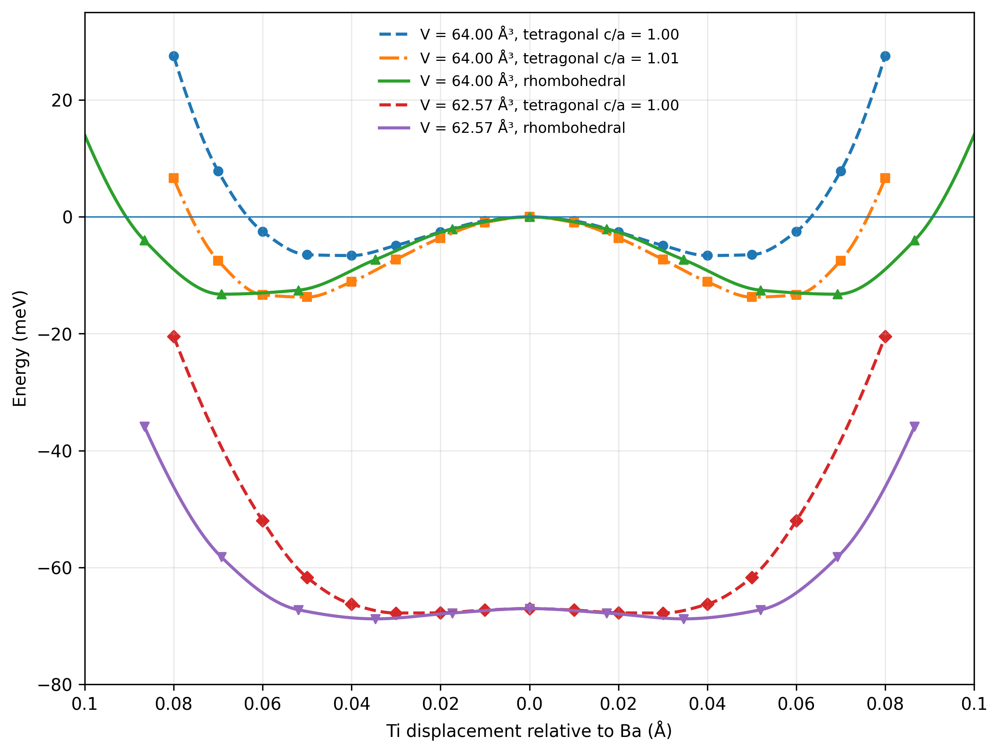

.. _batio3-doc-total-energy:

========================================================
二重井戸ポテンシャル Part 2
========================================================

原子が協同して動くと、分極の向き、格子ひずみ、体積は二重井戸の深さにどう影響するでしょうか。
今回の DFT 計算では、立方晶格子で :math:`[111]` 方向の井戸が :math:`[001]` 方向より深くなりました。
正方晶ひずみを加えると :math:`[001]` 方向の井戸が深くなり、圧縮すると両方向の井戸が浅くなりました。

本計算例の目的
==============

:doc:`Part 1 <total-energy-DFT-MLIP>` では Ti だけを動かしました。
ここでは 5 原子の立方晶セルを出発点とし、Cohen–Krakauer が報告した極性ソフトモードに沿って Ba・Ti・O の相対位置を変えます :sup:`[3]`。
構造を固定したまま各変位で全エネルギーを計算し、Cohen の電子構造の解釈 :sup:`[4]` と照らし合わせます。

計算では、Cohen–Krakauer が求めた協同的な Ba–Ti–O 変位を
:math:`[001]` および :math:`[111]` 方向へ適用し、次の点を検証します。

* 立方晶 :math:`Q=0` が極性ソフトモードに対して不安定か。
* 無ひずみ :math:`[001]`、無ひずみ :math:`[111]`、および
  正方晶ひずみ :math:`c/a=1.01` の井戸深さがどのように異なるか。
* 体積を :math:`64.00` ų から :math:`62.57` ų へ圧縮したとき、
  強誘電的不安定性がどの程度抑制されるか。
* DOS/PDOS に現れる Ti :math:`3d`–O :math:`2p` 混成が、
  二重井戸ポテンシャルとどのように対応するか。

BaTiO₃ の強誘電性の背景には、局所電場の描像 :sup:`[1]` と\ `ソフトモード <https://technical-notes.quemix.com/solid/soft_mode.html>`__\ 理論 :sup:`[2]` があります。
第一原理計算では、極性変位を促す長距離 Coulomb 相互作用と、立方晶を安定にする短距離の反発の競合から強誘電不安定性が生じ、
Ti :math:`3d`–O :math:`2p` 混成がこの短距離反発を弱めると説明されます :sup:`[4]`。
この機構は技術ノートの\ `長距離のクーロン相互作用と短距離の反発 <https://technical-notes.quemix.com/solid/ferroelectric_origin.html#ferroelectric-instability-origin>`__\ で説明しています。
ここでは、二重井戸の深さから、中心からずれた構造がどれだけ安定化するかを評価します。
電子状態密度（DOS）と軌道に射影した状態密度（`PDOS <https://technical-notes.quemix.com/electronic/pdos.html>`__）から、Ti と O の軌道成分がどのエネルギー範囲で重なるかを見ます。

.. _batio3-mode-method:

計算モデルと解析方法
=======================

ソフトモード座標
----------------

Cohen–Krakauer は、立方晶 BaTiO₃ の :math:`\Gamma` 点において、
約 :math:`-72\ \mathrm{cm^{-1}}` の不安定な極性モードを報告しました :sup:`[3]`。
負の符号は虚数振動数、すなわち立方晶構造のエネルギー曲率が負であることを表します
（技術ノートの\ `虚数振動数と動的安定性 <https://technical-notes.quemix.com/solid/phonon.html#imaginary-frequency>`__）。
このモードの固有ベクトルに沿って原子を動かし、各変位で全エネルギーを計算します
（`frozen phonon 法 <https://technical-notes.quemix.com/solid/soft_mode.html#frozen-phonon>`__）。

O(2) 原子を固定し、Ti 変位を 1 とした公表固有ベクトルは

.. math::

   \mathrm{Ba:Ti:O(1)}=0.53:1.00:-0.29

です。実験的な正方晶変位パターン
:math:`0.53:1.00:-0.28` とよく一致しています :sup:`[3]`。
本計算では Ba を固定し、Ti の Ba に対する変位を :math:`Q` と定義します。
このとき、変位係数は

.. math::

   C_{\parallel}
   =\frac{-0.29-0.53}{1.00-0.53}
   =-1.744680851,

.. math::

   C_{\perp}
   =\frac{0-0.53}{1.00-0.53}
   =-1.127659574

となります。

:math:`[001]` 正方晶方向では、

.. math::

   \Delta z_{\mathrm{Ba}} &= 0,\\
   \Delta z_{\mathrm{Ti}} &= Q,\\
   \Delta z_{O_{\parallel}} &= C_{\parallel}Q,\\
   \Delta z_{O_{\perp}} &= C_{\perp}Q

を用います。例えば :math:`Q=0.04` Å では、Ti は
:math:`+0.0400` Å、軸方向 O は :math:`-0.0698` Å、
二つの垂直方向 O はそれぞれ :math:`-0.0451` Å 変位します。
この協同変位により、一方の Ti–O 結合が短くなり、反対側が長くなります。

:math:`[111]` 菱面体晶方向では、同じ固有ベクトルを立方体の体対角線方向へ回転します。
全 Ti 変位の大きさを :math:`Q`、各 Cartesian 成分を
:math:`d=Q/\sqrt{3}` とすると、

.. math::

   \Delta\mathbf r_{\mathrm{Ti}}=(d,d,d),

.. math::

   \Delta\mathbf r_{O_z}
   =(C_{\perp}d,C_{\perp}d,C_{\parallel}d),

.. math::

   \Delta\mathbf r_{O_y}
   =(C_{\perp}d,C_{\parallel}d,C_{\perp}d),

.. math::

   \Delta\mathbf r_{O_x}
   =(C_{\parallel}d,C_{\perp}d,C_{\perp}d)

となります。本計算で用いた入力値 :math:`\delta` は Ti の各成分に加える値であるため、
図の横軸に用いる実際の変位量は

.. math::

   Q=\sqrt{3}\,\delta

です。したがって、入力 :math:`\delta=0.04` Å は
:math:`Q=0.069282` Å に対応します。
この主系列は cubic-metric cell 内の :math:`[111]` 内部変位であり、
菱面体晶の格子角ひずみは含みません。Cohen–Krakauer は、菱面体晶の
格子角ひずみが静的井戸深さへ与える影響は小さいことを示しています。

全エネルギーおよび DOS/PDOS
----------------------------

基準構造は 5 原子立方晶 BaTiO₃ とし、理想分率座標を

.. code-block:: text

   Ba  0.000000  0.000000  0.000000
   Ti  0.500000  0.500000  0.500000
   O1  0.500000  0.500000  0.000000
   O2  0.500000  0.000000  0.500000
   O3  0.000000  0.500000  0.500000

とします。各変位点ではセルと原子座標を固定し、OpenMX の
``MD.Type Nomd`` による\ `単点計算 <https://technical-notes.quemix.com/electronic/structure_optimization.html#structure-optimization>`__\ を行います。比較するすべての点で、
交換相関汎関数、擬ポテンシャル、PAO、エネルギーカットオフ、
:math:`k` 点メッシュ、電子温度、および SCF 収束条件を統一します。
本結果では、参照論文との整合性を重視して LDA/CA19、500 Ry、
:math:`8\times8\times8` :math:`k` 点を基本条件としました。

各体積では、同じ体積の :math:`Q=0` を基準として

.. math::

   \Delta E(Q;V)=E(Q;V)-E(0;V)

を meV/f.u. 単位で評価します。異なる体積の絶対エネルギー差は、
その体積における局所的な強誘電不安定性とは区別する必要があります。

DOS/PDOS は、次の三構造について比較します。

* :math:`Q=0.00` Å、:math:`c/a=1.00`
* :math:`Q=0.04` Å、:math:`c/a=1.00`
* :math:`Q=0.05` Å、:math:`c/a=1.01`

エネルギーは各構造の VBM を :math:`0` eV として整列し、
Gaussian 幅 :math:`\sigma=0.08` eV を用います
（技術ノートの\ `ガウス関数によるぼかし <https://technical-notes.quemix.com/electronic/pdos.html#dos-broadening>`__）。主な解析範囲は、
O :math:`2p` が支配的な占有価電子帯
:math:`-6\le E-E_{\mathrm{VBM}}\le0` eV です。

.. _batio3-mode-results:

計算結果と考察
=================

二重井戸、方向依存性、ひずみ、および体積効果
------------------------------------------------

   BaTiO₃ の :math:`[001]` および :math:`[111]` ソフトモードに沿った
   二重井戸ポテンシャル。 :math:`V=64.00` ų における無ひずみ・ひずみ系列と、
   :math:`V=62.57` ų における圧縮系列を比較します。

計算値を以下にまとめます。

.. list-table:: BaTiO₃ の二重井戸ポテンシャルの主要結果
   :header-rows: 1
   :widths: 22 20 18 20 20
   :class: wrap-table

   * - 体積
     - 分極方向
     - 格子条件
     - 最小変位
     - 井戸深さ
   * - :math:`64.00` ų
     - :math:`[001]`
     - :math:`c/a=1.00`
     - :math:`Q\approx0.04` Å
     - :math:`-6.621` meV/f.u.
   * - :math:`64.00` ų
     - :math:`[001]`
     - :math:`c/a=1.01`
     - :math:`Q\approx0.05` Å
     - :math:`-13.732` meV/f.u.
   * - :math:`64.00` ų
     - :math:`[111]`
     - cubic metric
     - :math:`Q\approx0.069282` Å
     - :math:`-13.237` meV/f.u.
   * - :math:`62.57` ų
     - :math:`[001]`
     - :math:`c/a=1.00`
     - :math:`Q\approx0.03` Å
     - :math:`-0.761` meV/f.u.
   * - :math:`62.57` ų
     - :math:`[111]`
     - cubic metric
     - :math:`Q\approx0.034641` Å
     - :math:`-1.759` meV/f.u.

:math:`V=64.00` ų、:math:`c/a=1` の :math:`[001]` 系列で
有限変位のエネルギーが :math:`Q=0` より低いため、立方晶は
極性ソフトモード方向に不安定です。反転対称性により、
:math:`+Q` と :math:`-Q` は反対向きの分極を持つ等価な極小に対応します
（技術ノートの\ `+Qと−Qの等価性と反転対称性 <https://technical-notes.quemix.com/solid/soft_mode.html#sm-inversion-equivalence>`__）。

無ひずみ条件では、:math:`[111]` 井戸（:math:`-13.237` meV/f.u.）が
:math:`[001]` 井戸（:math:`-6.621` meV/f.u.）より深いです。
これは Cohen–Krakauer が報告した方向依存性と一致します。
一方、:math:`c/a=1.01` の正方晶ひずみを導入すると、
:math:`[001]` 井戸は :math:`-13.732` meV/f.u. まで深くなり、
無ひずみ :math:`[111]` 井戸とほぼ同程度になります。
したがって、内部ソフトモード変位が不安定性を生み、
正方晶ひずみが :math:`[001]` 状態を追加的に安定化すると解釈できます。

体積を :math:`62.57` ų へ圧縮すると、両方向の井戸深さは
約 :math:`1`–:math:`2` meV/f.u. まで減少します。この結果は、
強誘電不安定性が体積と圧力に極めて敏感であるという
Cohen–Krakauer の結論を再現します。ただし、両系列に小さな負の井戸が残るため、
本結果は「不安定性のほぼ完全な抑制」を示すが、「完全な消失」を直接示すものではありません。

.. _batio3-mode-dos:

DOS/PDOS と Cohen 1992 Figure 2 との比較
-----------------------------------------

.. figure:: ../Figure/BaTiO3/BTO_gaussian_DOS_PDOS.png
   :alt: BaTiO3 Gaussian DOS and Ti 3d O 2p PDOS
   :align: center
   :width: 92%

   :math:`Q=0.00` Å、:math:`Q=0.04` Å、および
   :math:`Q=0.05` Å、:math:`c/a=1.01` の BaTiO₃ に対する
   Gaussian total DOS と Ti :math:`3d` / O :math:`2p` PDOS。
   エネルギーは各構造の VBM を :math:`0` eV としています。

三構造の価電子帯は主として O :math:`2p` から構成されますが、
同じ :math:`-6`–:math:`0` eV 領域に有限の Ti :math:`3d` 成分が存在します。
これは、占有価電子状態が純粋な O :math:`2p` 状態ではなく、Ti :math:`3d` の混じった混成状態であることを示します
（PDOS の重なりと混成の関係は技術ノートの\ `軌道の混成とスペクトルの重なり <https://technical-notes.quemix.com/electronic/pdos.html#orbital-hybridization>`__）。
すなわち、Ti–O 混成は
立方晶 :math:`Q=0` ですでに存在し、強誘電変位は混成をゼロから生成するのではなく、
短い Ti–O 結合と長い Ti–O 結合の間で非対称化します。

本解析で得た占有価電子帯の指標は次の通りです。

.. list-table:: Ti 3d–O 2p 混成の補助指標
   :header-rows: 1
   :widths: 28 22 22 28
   :class: wrap-table

   * - 構造
     - 占有 Ti :math:`3d` 重み
     - 規格化重なり :math:`H_{pd}`
     - Ti :math:`3d`+O :math:`2p` 重心
   * - :math:`Q=0.00` Å、:math:`c/a=1.00`
     - 2.14599
     - 0.76965
     - :math:`-2.207` eV
   * - :math:`Q=0.04` Å、:math:`c/a=1.00`
     - 2.15145
     - 0.77974
     - :math:`-2.234` eV
   * - :math:`Q=0.05` Å、:math:`c/a=1.01`
     - 2.15381
     - 0.78414
     - :math:`-2.269` eV

占有 Ti :math:`3d` 重みと :math:`H_{pd}` は変位とひずみに伴ってわずかに増加し、
Ti :math:`3d`–O :math:`2p` スペクトルの重なりが系統的に変化します。
ただし、これらは局在基底への射影量および DOS 形状の重なり指標であり、
形式的な Ti :math:`d` 電子数や Hamiltonian の混成行列要素そのものではありません
（技術ノートの\ `非直交基底での射影 <https://technical-notes.quemix.com/electronic/pdos.html#pdos-nonorthogonal>`__）。
また、各構造を独立に VBM 整列しているため、重心の低エネルギー側への移動は
全エネルギーの分解としては読めません（`エネルギーの基準と価電子帯上端 <https://technical-notes.quemix.com/electronic/pdos.html#pdos-energy-alignment>`__）。

Cohen 1992 の Figure 2(a) は、強誘電 PbTiO₃ と立方晶 PbTiO₃ を比較し、
強誘電変位によって Ti :math:`3d`–O :math:`2p` 混成が増強され、
バンド固有値和が低下することを示しました。Figure 2(b) は、
PbTiO₃ の実験構造を両方に用いて PbTiO₃ と BaTiO₃ を比較し、
A サイト元素の化学的違いを分離しています :sup:`[4]`。

PbTiO₃ では Pb :math:`6s`–O :math:`2p` 混成が大きな正方晶ひずみを安定化するのに対し、
BaTiO₃ では Ba–O 相互作用はよりイオン的で、主要な共有結合成分は Ti :math:`3d`–O :math:`2p` です :sup:`[4]`。
本計算は PbTiO₃ を含まないため Figure 2 の直接再現ではありませんが、
BaTiO₃ における Ti :math:`3d` と O :math:`2p` の価電子帯重なりと、
極性変位に伴う系統的な PDOS 変化を再現しています。

Ti 3d の除外試験と価電子密度に関する解釈
-----------------------------------------

Cohen は、混成を含まないイオン模型（potential-induced-breathing モデル）と、Ti :math:`3d` の寄与を抑えた LAPW 計算の二つの方法で、
Ti–O 混成を抑えると強誘電不安定性が消えることを示しました :sup:`[3]`, :sup:`[4]`。
この結果は、混成が短距離 Ti–O 反発を緩めて極性変位を安定にするという因果関係を支持します
（技術ノートの\ `Ti 3d–O 2pの混成の役割 <https://technical-notes.quemix.com/solid/ferroelectric_origin.html#fo-hybridization>`__）。
本計算では Ti :math:`3d` 除外試験を行っていないため、
この因果的証明は参照論文に基づきます。一方、二重井戸ポテンシャルと DOS/PDOS は、
同じ機構に整合する構造的・軌道的証拠を与えます。

現在の Quloud 計算例では価電子密度出力を利用できません。
したがって、以下は本計算の直接結果ではなく、Cohen–Krakauer の
実空間解析から予想される挙動です。

* Ba 周囲の価電子密度変形は小さいです。
* Ti 周囲には O :math:`2p`–Ti :math:`3d` 混成に由来する価電子密度が現れます。
* 強誘電変位の増加に伴い、短い Ti–O 結合上で結合電荷が増加します。
* 長い Ti–O 結合側では結合電荷が相対的に減少し、Ti 周囲に双極子的な密度変形が生じます。
* 軸方向 O と垂直方向 O の電子状態が非等価になります。

この期待される実空間像は、本計算で観測された Ti :math:`3d` と
O :math:`2p` の占有価電子帯重なり、および変位に伴う PDOS の系統的変化と整合します。
ただし、静的な価電子密度差だけから Born 有効電荷や動的分極を直接決定することはできず、
その評価には Berry-phase 分極、線形応答、または対応する有限変位解析が必要です
（技術ノートの\ `分極の評価 <https://technical-notes.quemix.com/solid/ferroelectric_origin.html#polarization-evaluation>`__）。

有限温度 MD 計算への接続
===========================

本計算で得られる二重井戸ポテンシャルは、0 K における局所的な
ポテンシャルエネルギー面です。有限温度相転移では、局所井戸に加えて、
セル間の分極相関、格子ひずみ、エントロピー、および熱揺らぎを考慮する必要があります。
井戸の深さだけでは、相転移が変位型か秩序–無秩序型かも決まりません
（技術ノートの\ `変位型と秩序–無秩序型の相転移 <https://technical-notes.quemix.com/solid/soft_mode.html#displacive-order-disorder>`__）。
次の :doc:`構造相転移 <phase_transition>` では、Ti の局所変位分布と格子定数が温度とともにどう変わるかを調べます。
:math:`[111]` 型の局所変位が高温立方晶でも残るか、静的 DFT の井戸深さと MD の温度依存構造が整合するかが、
二つの計算をつなぐ点です。
静的 DFT は「なぜ局所的な極性不安定性が存在するか」を示し、
有限温度 MD は「その局所不安定性が温度下でどのように秩序化・無秩序化するか」を示します。

まとめ
======

本 OpenMX/Quloud 計算は、Cohen–Krakauer の極性ソフトモードを用いて、
BaTiO₃ の強誘電不安定性を構造と電子状態の両面から再現しました。

* 不安定モードは約 :math:`-72\ \mathrm{cm^{-1}}` で、変位比は
  :math:`\mathrm{Ba:Ti:O(1)}=0.53:1.00:-0.29` です。
* 同じソフトモードを :math:`[001]` と :math:`[111]` へ適用すると、
  それぞれ正方晶型と菱面体晶型の二重井戸ポテンシャルが得られます。
* :math:`V=64.00` ų では、無ひずみ :math:`[111]` 井戸が
  無ひずみ :math:`[001]` 井戸より深いです。
* :math:`c/a=1.01` の正方晶ひずみは :math:`[001]` 井戸を約 2 倍深くし、
  :math:`[111]` 井戸とほぼ同程度に安定化します。
* :math:`V=62.57` ų への圧縮は両井戸を約 :math:`1`–:math:`2` meV/f.u. まで浅くし、
  強い体積依存性を示します。
* DOS/PDOS では、O :math:`2p` 価電子帯内に有限の Ti :math:`3d` 成分が存在し、
  極性変位とひずみに伴ってそのスペクトル重なりが系統的に変化します。

以上から、本結果は

.. math::

   \text{極性ソフトモード}
   \;\longrightarrow\;
   \text{非対称な Ti–O 結合}
   \;\longrightarrow\;
   \mathrm{Ti}\,3d\text{–}\mathrm O\,2p\text{ 混成の変化}
   \;\longrightarrow\;
   \text{短距離反発の緩和}
   \;\longrightarrow\;
   \text{二重井戸の形成}

という Cohen の機構を支持します。現在の計算は、構造的不安定性と軌道空間における
Ti–O 混成を示しています。一方、Ti :math:`3d` の直接除外試験と価電子密度の実空間可視化は
未実施であり、その因果的・実空間的証拠は参照論文に基づくものとして明確に区別します。

参考文献
---------

* :sup:`[1]` Slater, J. C.,
  "The Lorentz Correction in Barium Titanate,"
  *Physical Review*, **78**, 748--761, 1950.
  `https://doi.org/10.1103/PhysRev.78.748 <https://doi.org/10.1103/PhysRev.78.748>`_

* :sup:`[2]` Cochran, W.,
  "Crystal Stability and the Theory of Ferroelectricity,"
  *Advances in Physics*, **9**, 387--423, 1960.
  `https://doi.org/10.1080/00018736000101229 <https://doi.org/10.1080/00018736000101229>`_

* :sup:`[3]` Cohen, R. E.; Krakauer, H.,
  "Lattice dynamics and origin of ferroelectricity in BaTiO₃:
  Linearized-augmented-plane-wave total-energy calculations,"
  *Physical Review B*, **42**, 6416--6423, 1990.
  `https://doi.org/10.1103/PhysRevB.42.6416 <https://doi.org/10.1103/PhysRevB.42.6416>`_

* :sup:`[4]` Cohen, R. E.,
  "Origin of ferroelectricity in perovskite oxides,"
  *Nature*, **358**, 136--138, 1992.
  `https://doi.org/10.1038/358136a0 <https://doi.org/10.1038/358136a0>`_
