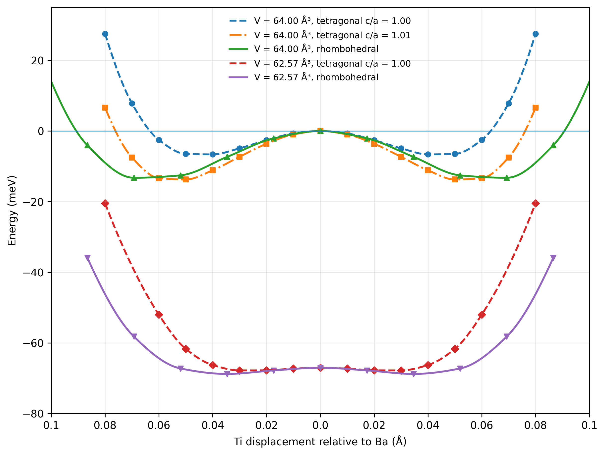

========================================================
BaTiO₃の二重井戸ポテンシャル Part 2
========================================================

本計算例の目的
==============

本計算例では、5 原子立方晶 BaTiO₃ に対する静的な第一原理計算から、
強誘電的不安定性の構造的・電子的起源を評価する。主な参照は、
Cohen–Krakauer による極性ソフトモードと frozen-phonon 全エネルギー面
:sup:`[3]`、および Cohen によるペロブスカイト酸化物の強誘電性の
電子構造的解釈 :sup:`[4]` である。

計算では、Cohen–Krakauer が求めた協同的な Ba–Ti–O 変位を
:math:`[001]` および :math:`[111]` 方向へ適用し、次の点を検証する。

* 立方晶 :math:`Q=0` が極性ソフトモードに対して不安定か。
* 無ひずみ :math:`[001]`、無ひずみ :math:`[111]`、および
  正方晶ひずみ :math:`c/a=1.01` の井戸深さがどのように異なるか。
* 体積を :math:`64.00` ų から :math:`62.57` ų へ圧縮したとき、
  強誘電的不安定性がどの程度抑制されるか。
* DOS/PDOS に現れる Ti :math:`3d`–O :math:`2p` 混成が、
  double-well potential とどのように対応するか。

BaTiO₃ の強誘電性に関する概念的背景として、局所電場の描像 :sup:`[1]` と
ソフトモード理論 :sup:`[2]` がある。第一原理的には、長距離 Coulomb 相互作用が
極性変位を促進する一方、短距離重なり反発が非極性立方晶を安定化するという競合から
強誘電不安定性が生じる。
Ti :math:`3d`–O :math:`2p` 混成は、この短距離反発を実効的に弱め、
Ti off-centering を可能にする重要な電子構造要因である :sup:`[4]`。
本計算例では、double-well potential を構造的不安定性の直接的指標、
DOS/PDOS を Ti–O 混成の軌道空間における指標として用いる。

計算モデルと解析方法
=======================

ソフトモード座標
----------------

Cohen–Krakauer は、立方晶 BaTiO₃ の :math:`\Gamma` 点において、
約 :math:`-72\ \mathrm{cm^{-1}}` の不安定な極性モードを報告した。
負の符号は、調和近似における虚数振動数、すなわち立方晶構造の
負のエネルギー曲率を表す :sup:`[3]`。

O(2) 原子を固定し、Ti 変位を 1 とした公表固有ベクトルは

.. math::

   \mathrm{Ba:Ti:O(1)}=0.53:1.00:-0.29

である。実験的な正方晶変位パターン
:math:`0.53:1.00:-0.28` とよく一致している :sup:`[3]`。
本計算では Ba を固定し、Ti の Ba に対する変位を :math:`Q` と定義する。
このとき、変位係数は

.. math::

   C_{\parallel}
   =\frac{-0.29-0.53}{1.00-0.53}
   =-1.744680851,

.. math::

   C_{\perp}
   =\frac{0-0.53}{1.00-0.53}
   =-1.127659574

となる。

:math:`[001]` 正方晶方向では、

.. math::

   \Delta z_{\mathrm{Ba}} &= 0,\\
   \Delta z_{\mathrm{Ti}} &= Q,\\
   \Delta z_{O_{\parallel}} &= C_{\parallel}Q,\\
   \Delta z_{O_{\perp}} &= C_{\perp}Q

を用いる。例えば :math:`Q=0.04` Å では、Ti は
:math:`+0.0400` Å、軸方向 O は :math:`-0.0698` Å、
二つの垂直方向 O はそれぞれ :math:`-0.0451` Å 変位する。
この協同変位により、一方の Ti–O 結合が短くなり、反対側が長くなる。

:math:`[111]` 菱面体晶方向では、同じ固有ベクトルを立方体の体対角線方向へ回転する。
全 Ti 変位の大きさを :math:`Q`、各 Cartesian 成分を
:math:`d=Q/\sqrt{3}` とすると、

.. math::

   \Delta\mathbf r_{\mathrm{Ti}}=(d,d,d),

.. math::

   \Delta\mathbf r_{O_z}
   =(C_{\perp}d,C_{\perp}d,C_{\parallel}d),

.. math::

   \Delta\mathbf r_{O_y}
   =(C_{\perp}d,C_{\parallel}d,C_{\perp}d),

.. math::

   \Delta\mathbf r_{O_x}
   =(C_{\parallel}d,C_{\perp}d,C_{\perp}d)

となる。本計算で用いた入力値 :math:`\delta` は Ti の各成分に加える値であるため、
図の横軸に用いる実際の変位量は

.. math::

   Q=\sqrt{3}\,\delta

である。したがって、入力 :math:`\delta=0.04` Å は
:math:`Q=0.069282` Å に対応する。
この主系列は cubic-metric cell 内の :math:`[111]` 内部変位であり、
菱面体晶の格子角ひずみは含まない。Cohen–Krakauer は、菱面体晶の
格子角ひずみが静的井戸深さへ与える影響は小さいことを示している。

全エネルギーおよび DOS/PDOS
----------------------------

基準構造は 5 原子立方晶 BaTiO₃ とし、理想分率座標を

.. code-block:: text

   Ba  0.000000  0.000000  0.000000
   Ti  0.500000  0.500000  0.500000
   O1  0.500000  0.500000  0.000000
   O2  0.500000  0.000000  0.500000
   O3  0.000000  0.500000  0.500000

とする。各変位点ではセルと原子座標を固定し、OpenMX の
``MD.Type Nomd`` による単点計算を行う。比較するすべての点で、
交換相関汎関数、擬ポテンシャル、PAO、エネルギーカットオフ、
:math:`k` 点メッシュ、電子温度、および SCF 収束条件を統一する。
本結果では、参照論文との整合性を重視して LDA/CA19、500 Ry、
:math:`8\times8\times8` :math:`k` 点を基本条件とした。

各体積では、同じ体積の :math:`Q=0` を基準として

.. math::

   \Delta E(Q;V)=E(Q;V)-E(0;V)

を meV/f.u. 単位で評価する。異なる体積の絶対エネルギー差は、
その体積における局所的な強誘電不安定性とは区別する必要がある。

DOS/PDOS は、次の三構造について比較する。

* :math:`Q=0.00` Å、:math:`c/a=1.00`
* :math:`Q=0.04` Å、:math:`c/a=1.00`
* :math:`Q=0.05` Å、:math:`c/a=1.01`

エネルギーは各構造の VBM を :math:`0` eV として整列し、
Gaussian 幅 :math:`\sigma=0.08` eV を用いる。主な解析範囲は、
O :math:`2p` が支配的な占有価電子帯
:math:`-6\le E-E_{\mathrm{VBM}}\le0` eV である。

計算結果と考察
=================

二重井戸、方向依存性、ひずみ、および体積効果
------------------------------------------------

   BaTiO₃ の :math:`[001]` および :math:`[111]` ソフトモードに沿った
   double-well potential。:math:`V=64.00` ų における無ひずみ・ひずみ系列と、
   :math:`V=62.57` ų における圧縮系列を比較する。

計算値を以下にまとめる。

.. list-table:: BaTiO₃ double-well potential の主要結果
   :header-rows: 1
   :widths: 22 20 18 20 20

   * - 体積
     - 分極方向
     - 格子条件
     - 最小変位
     - 井戸深さ
   * - :math:`64.00` ų
     - :math:`[001]`
     - :math:`c/a=1.00`
     - :math:`Q\approx0.04` Å
     - :math:`-6.621` meV/f.u.
   * - :math:`64.00` ų
     - :math:`[001]`
     - :math:`c/a=1.01`
     - :math:`Q\approx0.05` Å
     - :math:`-13.732` meV/f.u.
   * - :math:`64.00` ų
     - :math:`[111]`
     - cubic metric
     - :math:`Q\approx0.069282` Å
     - :math:`-13.237` meV/f.u.
   * - :math:`62.57` ų
     - :math:`[001]`
     - :math:`c/a=1.00`
     - :math:`Q\approx0.03` Å
     - :math:`-0.761` meV/f.u.
   * - :math:`62.57` ų
     - :math:`[111]`
     - cubic metric
     - :math:`Q\approx0.034641` Å
     - :math:`-1.759` meV/f.u.

:math:`V=64.00` ų、:math:`c/a=1` の :math:`[001]` 系列で
有限変位のエネルギーが :math:`Q=0` より低いため、立方晶は
極性ソフトモード方向に不安定である。反転対称性により、
:math:`+Q` と :math:`-Q` は反対向きの分極を持つ等価な極小に対応する。

無ひずみ条件では、:math:`[111]` 井戸（:math:`-13.237` meV/f.u.）が
:math:`[001]` 井戸（:math:`-6.621` meV/f.u.）より深い。
これは Cohen–Krakauer が報告した方向依存性と一致する。
一方、:math:`c/a=1.01` の正方晶ひずみを導入すると、
:math:`[001]` 井戸は :math:`-13.732` meV/f.u. まで深くなり、
無ひずみ :math:`[111]` 井戸とほぼ同程度になる。
したがって、内部ソフトモード変位が不安定性を生み、
正方晶ひずみが :math:`[001]` 状態を追加的に安定化すると解釈できる。

体積を :math:`62.57` ų へ圧縮すると、両方向の井戸深さは
約 :math:`1`–:math:`2` meV/f.u. まで減少する。この結果は、
強誘電不安定性が体積と圧力に極めて敏感であるという
Cohen–Krakauer の結論を再現する。ただし、両系列に小さな負の井戸が残るため、
本結果は「不安定性のほぼ完全な抑制」を示すが、「完全な消失」を直接示すものではない。

DOS/PDOS と Cohen 1992 Figure 2 との比較
-----------------------------------------

.. figure:: ../Figure/BaTiO3/BTO_gaussian_DOS_PDOS.png
   :alt: BaTiO3 Gaussian DOS and Ti 3d O 2p PDOS
   :align: center
   :width: 92%

   :math:`Q=0.00` Å、:math:`Q=0.04` Å、および
   :math:`Q=0.05` Å、:math:`c/a=1.01` の BaTiO₃ に対する
   Gaussian total DOS と Ti :math:`3d` / O :math:`2p` PDOS。
   エネルギーは各構造の VBM を :math:`0` eV としている。

三構造の価電子帯は主として O :math:`2p` から構成されるが、
同じ :math:`-6`–:math:`0` eV 領域に有限の Ti :math:`3d` 成分が存在する。
これは、占有価電子状態が純粋な O :math:`2p` 状態ではなく、

.. math::

   |\psi_{\mathrm{val}}\rangle
   \simeq a|\mathrm O\,2p\rangle
   +b|\mathrm{Ti}\,3d\rangle,
   \qquad b\ne0

という混成状態であることを示す。すなわち、Ti–O 混成は
立方晶 :math:`Q=0` ですでに存在し、強誘電変位は混成をゼロから生成するのではなく、
短い Ti–O 結合と長い Ti–O 結合の間で非対称化する。

本解析で得た占有価電子帯の指標は次の通りである。

.. list-table:: Ti 3d–O 2p 混成の補助指標
   :header-rows: 1
   :widths: 28 22 22 28

   * - 構造
     - 占有 Ti :math:`3d` 重み
     - 規格化重なり :math:`H_{pd}`
     - Ti :math:`3d`+O :math:`2p` 重心
   * - :math:`Q=0.00` Å、:math:`c/a=1.00`
     - 2.14599
     - 0.76965
     - :math:`-2.207` eV
   * - :math:`Q=0.04` Å、:math:`c/a=1.00`
     - 2.15145
     - 0.77974
     - :math:`-2.234` eV
   * - :math:`Q=0.05` Å、:math:`c/a=1.01`
     - 2.15381
     - 0.78414
     - :math:`-2.269` eV

占有 Ti :math:`3d` 重みと :math:`H_{pd}` は変位とひずみに伴ってわずかに増加し、
Ti :math:`3d`–O :math:`2p` スペクトルの重なりが系統的に変化する。
ただし、これらは局在基底への射影量および DOS 形状の重なり指標であり、
形式的な Ti :math:`d` 電子数や Hamiltonian の混成行列要素そのものではない。
また、各構造を独立に VBM 整列しているため、重心の低エネルギー側への移動を
全エネルギー分解として解釈してはならない。

Cohen 1992 の Figure 2(a) は、強誘電 PbTiO₃ と立方晶 PbTiO₃ を比較し、
強誘電変位によって Ti :math:`3d`–O :math:`2p` 混成が増強され、
バンド固有値和が低下することを示した。Figure 2(b) は、
PbTiO₃ の実験構造を両方に用いて PbTiO₃ と BaTiO₃ を比較し、
A サイト元素の化学的違いを分離している :sup:`[4]`。

PbTiO₃ では Pb :math:`6s`–O :math:`2p` 混成が大きく、
この A サイト共有結合性が大きな正方晶ひずみを安定化する。
一方、BaTiO₃ では Ba–O 相互作用はよりイオン的であり、
主要な共有結合成分は Ti :math:`3d`–O :math:`2p` である。
本計算は PbTiO₃ を含まないため Figure 2 の直接再現ではないが、
BaTiO₃ における Ti :math:`3d` と O :math:`2p` の価電子帯重なりと、
極性変位に伴う系統的な PDOS 変化を再現している。

Ti 3d の除外試験と価電子密度に関する解釈
-----------------------------------------

Cohen は、Ti–O 混成を抑制すると強誘電不安定性が消失することを二つの方法で示した。
球対称イオンと非共有結合性を仮定した potential-induced-breathing モデルでは、
長距離 Coulomb エネルギーが極性変位を好んでも、短距離反発が立方晶を安定化した。
さらに LAPW 計算で Ti :math:`d` のエネルギーパラメータを上げ、
Ti :math:`3d` の変分自由度を実効的に除くと、強誘電状態が失われ、
不安定モードは安定な高振動数モードへ変化した :sup:`[3]`, :sup:`[4]`。

この結果は、

.. math::

   \mathrm{Ti}\,3d\text{–}\mathrm O\,2p\text{ 混成}
   \;\longrightarrow\;
   \text{短距離 Ti–O 反発の緩和}
   \;\longrightarrow\;
   \text{極性変位の安定化}

という因果関係を支持する。本計算では Ti :math:`3d` 除外試験を行っていないため、
この因果的証明は参照論文に基づく。一方、double-well potential と DOS/PDOS は、
同じ機構に整合する構造的・軌道的証拠を与える。

現在の Quloud 計算例では価電子密度出力を利用できない。
したがって、以下は本計算の直接結果ではなく、Cohen–Krakauer の
実空間解析から予想される挙動である。

* Ba 周囲の価電子密度変形は小さい。
* Ti 周囲には O :math:`2p`–Ti :math:`3d` 混成に由来する価電子密度が現れる。
* 強誘電変位の増加に伴い、短い Ti–O 結合上で結合電荷が増加する。
* 長い Ti–O 結合側では結合電荷が相対的に減少し、Ti 周囲に双極子的な密度変形が生じる。
* 軸方向 O と垂直方向 O の電子状態が非等価になる。

この期待される実空間像は、本計算で観測された Ti :math:`3d` と
O :math:`2p` の占有価電子帯重なり、および変位に伴う PDOS の系統的変化と整合する。
ただし、静的な価電子密度差だけから Born 有効電荷や動的分極を直接決定することはできず、
その評価には Berry-phase 分極、線形応答、または対応する有限変位解析が必要である。

有限温度 MD 計算への接続
===========================

本計算で得られる double-well potential は、0 K における局所的な
ポテンシャルエネルギー面である。有限温度相転移では、局所井戸に加えて、
セル間の分極相関、格子ひずみ、エントロピー、および熱揺らぎを考慮する必要がある。
後続の MD 計算では、次の点を検証する。

* Ti 局所変位分布が温度とともにどのように変化するか。
* :math:`[111]` 型の局所変位が高温立方晶でも残るか。
* セル間の分極相関が相転移温度付近でどのように消失するか。
* 相転移が変位型、秩序–無秩序型、または両者の混合として記述されるか。
* 静的 DFT の井戸深さと MD の温度依存構造が整合するか。

静的 DFT は「なぜ局所的な極性不安定性が存在するか」を示し、
有限温度 MD は「その局所不安定性が温度下でどのように秩序化・無秩序化するか」を示す。

まとめ
======

本 OpenMX/Quloud 計算は、Cohen–Krakauer の極性ソフトモードを用いて、
BaTiO₃ の強誘電不安定性を構造と電子状態の両面から再現した。

* 不安定モードは約 :math:`-72\ \mathrm{cm^{-1}}` で、変位比は
  :math:`\mathrm{Ba:Ti:O(1)}=0.53:1.00:-0.29` である。
* 同じソフトモードを :math:`[001]` と :math:`[111]` へ適用すると、
  それぞれ正方晶型と菱面体晶型の double-well potential が得られる。
* :math:`V=64.00` ų では、無ひずみ :math:`[111]` 井戸が
  無ひずみ :math:`[001]` 井戸より深い。
* :math:`c/a=1.01` の正方晶ひずみは :math:`[001]` 井戸を約 2 倍深くし、
  :math:`[111]` 井戸とほぼ同程度に安定化する。
* :math:`V=62.57` ų への圧縮は両井戸を約 :math:`1`–:math:`2` meV/f.u. まで浅くし、
  強い体積依存性を示す。
* DOS/PDOS では、O :math:`2p` 価電子帯内に有限の Ti :math:`3d` 成分が存在し、
  極性変位とひずみに伴ってそのスペクトル重なりが系統的に変化する。

以上から、本結果は

.. math::

   \text{極性ソフトモード}
   \;\longrightarrow\;
   \text{非対称な Ti–O 結合}
   \;\longrightarrow\;
   \mathrm{Ti}\,3d\text{–}\mathrm O\,2p\text{ 混成の変化}
   \;\longrightarrow\;
   \text{短距離反発の緩和}
   \;\longrightarrow\;
   \text{強誘電 double well}

という Cohen の機構を支持する。現在の計算は、構造的不安定性と軌道空間における
Ti–O 混成を示している。一方、Ti :math:`3d` の直接除外試験と価電子密度の実空間可視化は
未実施であり、その因果的・実空間的証拠は参照論文に基づくものとして明確に区別する。

参考文献
---------

* :sup:`[1]` Slater, J. C.,
  "The Lorentz Correction in Barium Titanate,"
  *Physical Review*, **78**, 748--761, 1950.
  `https://doi.org/10.1103/PhysRev.78.748 <https://doi.org/10.1103/PhysRev.78.748>`_

* :sup:`[2]` Cochran, W.,
  "Crystal Stability and the Theory of Ferroelectricity,"
  *Advances in Physics*, **9**, 387--423, 1960.
  `https://doi.org/10.1080/00018736000101229 <https://doi.org/10.1080/00018736000101229>`_

* :sup:`[3]` Cohen, R. E.; Krakauer, H.,
  "Lattice dynamics and origin of ferroelectricity in BaTiO₃:
  Linearized-augmented-plane-wave total-energy calculations,"
  *Physical Review B*, **42**, 6416--6423, 1990.
  `https://doi.org/10.1103/PhysRevB.42.6416 <https://doi.org/10.1103/PhysRevB.42.6416>`_

* :sup:`[4]` Cohen, R. E.,
  "Origin of ferroelectricity in perovskite oxides,"
  *Nature*, **358**, 136--138, 1992.
  `https://doi.org/10.1038/358136a0 <https://doi.org/10.1038/358136a0>`_
