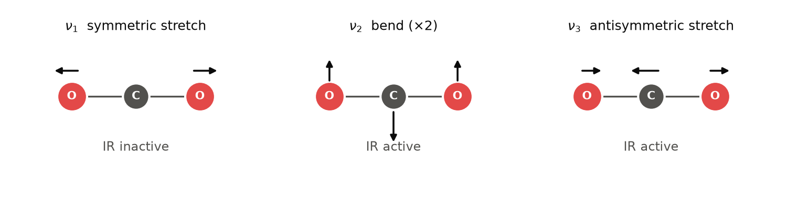
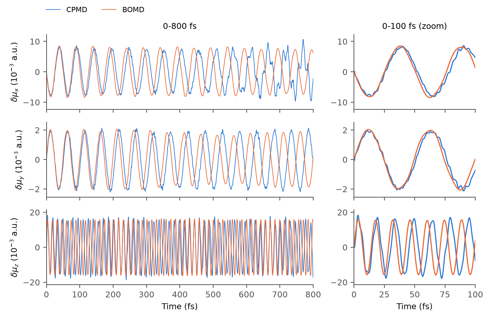
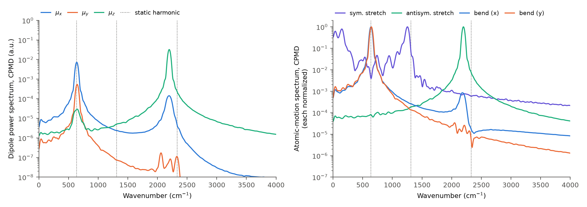
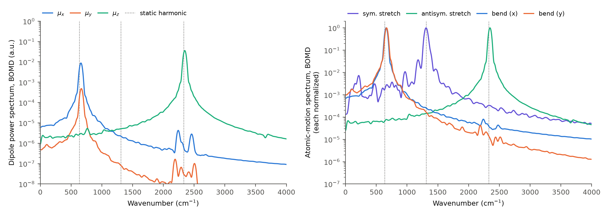
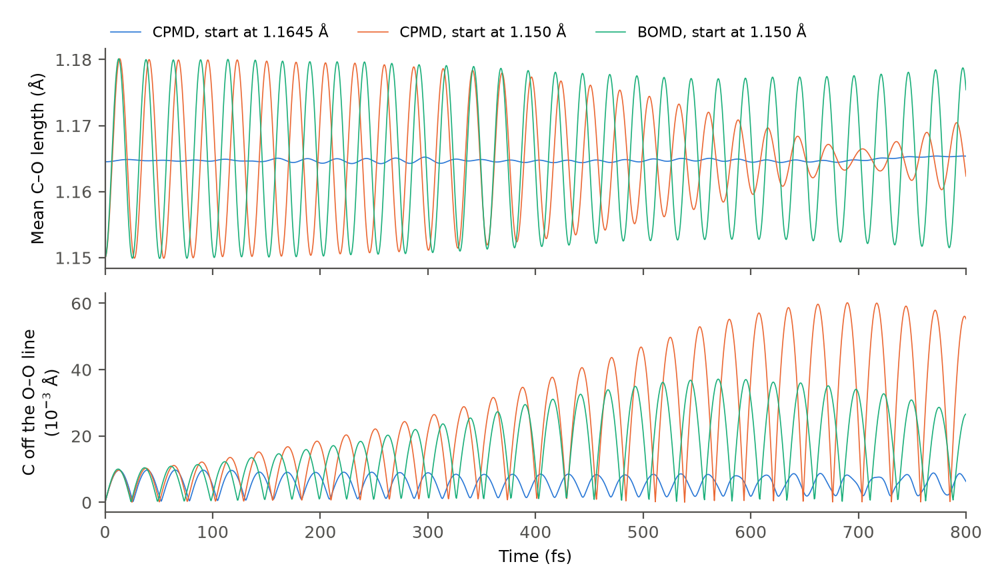
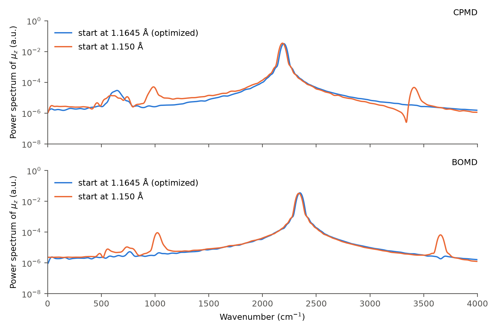

=============================================
CO₂分子の振動は赤外スペクトルにどう現れるか
=============================================

分子に赤外光を当てると、分子固有の振動モードと同じ振動数の光が吸収されます。\
ただし、すべての振動が光を吸収するわけではありません。\
振動によって分子の電気双極子モーメントが変化するときだけ、その振動は赤外吸収として観測されます（赤外活性）。

一方、分子や固体が熱で振動するという話もあります。こちらは特定の振動モードだけが励起されるのではなく、複数の振動モードが同時に\
混ざりあって励起される状態です。\
このページでは、二酸化炭素（CO₂）分子の原子の動きを第一原理分子動力学（FPMD）法で計算し、\
双極子モーメントの時間変化から、どの振動が赤外スペクトルに現れ、どの振動が現れないかを調べます。\
外部から電場をかけない計算でも、双極子の自発的な揺らぎを解析すれば、赤外吸収に関係する情報を取り出せるはずです。

.. .. note::

..    このページの計算は、2026年10月に、WSL上のDockerで実空間差分法の第一原理計算コードRSDFT [1]_ を直接実行したものです。Quloudの画面から実行した結果ではありません。入力ファイル、数値データ、図の再生成手順は :doc:`reproduction` にまとめています。

計算対象と計算条件
==================

計算するのは、1辺10.6 Åの立方体セルの中央に置いた1個のCO₂分子です。\
分子軸を :math:`z` 軸に合わせて置きます。\
セルは周期境界条件で繰り返されますが、隣のセルの分子とは8 Å以上離れているので、ほぼ孤立した分子とみなせます。

計算は次の2段階で行いました。

1. 構造最適化で、エネルギーが最小になるC–O結合長を求めます。結果は1.1645 Åでした（実験値は1.162 Å [7]_ ）。
2. 最適化した構造から、各原子に温度10 Kに相当するランダムな初速度を与え、Born-Oppenheimer MD（BOMD）法、および Car–Parrinello MD（CPMD）法 [2]_ で0.8 ps（800 fs）の時間発展を計算します。熱浴は使わず、全エネルギーを一定に保つNVE条件です。

BOMD では、原子を動かすたびに電子状態を収束するまで計算し直します。時間刻みを比較的大きく取れて、今回の計算では 0.5 fs に設定しています。\
CPMD では、電子の波動関数にも仮想的な質量を与え、原子と一緒に運動方程式で時間発展させます。\
各ステップで電子状態を収束させる必要がない代わりに、時間刻みを小さくする必要があります。\
今回の条件では、時間刻み0.1 fsでは計算が発散したため、0.05 fsとしました。

その他の条件は、RSDFTとQuloudの既定値に合わせました。\
今回の計算条件を :numref:`tab-co2-conditions` にまとめておきます。

.. list-table:: 計算条件
   :name: tab-co2-conditions
   :header-rows: 1
   :widths: 30 70

   * - 項目
     - 条件
   * - 計算コード
     - RSDFT（実空間差分法） [1]_
   * - 交換相関汎関数
     - PBE [3]_
   * - 擬ポテンシャル
     - FHI形式のノルム保存型擬ポテンシャル [4]_
   * - セル
     - 1辺10.6 Åの立方体、周期境界条件、Γ点のみ
   * - 実空間格子
     - :math:`64^3` 点（格子間隔0.166 Å）
   * - MD法
     - CPMD（電子の仮想質量400 a.u.）。比較としてBOMD
   * - 時間刻み・ステップ数
     - CPMD：0.05 fs、16000ステップ。BOMD：0.5 fs、1600ステップ（いずれも800 fs）
   * - アンサンブル
     - NVE（熱浴なし）、初期温度10 K
   * - 初期構造
     - 構造最適化後の直線分子（C–O 1.1645 Å）

MDの各ステップでは、原子核（価電子分の電荷）と電子密度 :math:`\rho(\mathbf{r})` から、分子の双極子モーメント

.. math::
   :label: dipole-moment

   \boldsymbol{\mu}(t) = \sum_I Z_I \mathbf{R}_I(t) - \int \mathbf{r}\,\rho(\mathbf{r},t)\,d\mathbf{r}

を計算して記録します。\
電子密度は原子の動きに応じて変わるので、 :math:`\boldsymbol{\mu}(t)` には電子状態の変化も反映されます。

.. admonition:: 注

   :eq:`dipole-moment` 式は、分子の電子密度がセルの境界に届く前に十分に減衰していること、つまり電子密度がセルの外にはみ出さないことを前提にしています。\
   この前提が成り立てば、中性の分子の双極子は、位置 :math:`\mathbf{r}` の原点の選び方によりません。\
   一方、固体や液体のように電子密度がセル全体に広がった周期系では、この積分の値がセルの区切り方によって変わってしまい、双極子（分極）をこの式で定義できません。\
   そのような系では、ベリー位相を使った分極の理論 [9]_ [10]_ などにもとづく方法が必要です。

  ..  RSDFTがこの式を使う条件は、 :doc:`reproduction` に記しています。

振動モードからの予想
====================

3原子の直線分子には、 :math:`3\times 3-5=4` 個の基準振動があります（\ :numref:`fig-co2-modes`\ ）。

   CO₂の基準振動の模式図。矢印の長さは実際の振幅の比を表していません。変角振動ν₂は、分子軸に垂直な2方向（ :math:`x` と :math:`y` ）に1つずつあり、振動数が等しい（二重に縮退している）ので、まとめて1つの図にしています。

* **対称伸縮振動ν₁**：2つの酸素原子が炭素原子に対して逆向きに動きます。分子の対称性が保たれるので、双極子モーメントは生じません。赤外不活性です。
* **変角振動ν₂**：分子が折れ曲がる振動で、分子軸に垂直な方向に双極子が生じます。 :math:`z` 軸に沿った分子なら、 :math:`\mu_x` と :math:`\mu_y` に現れるはずです。
* **逆対称伸縮振動ν₃**：一方のC–O結合が伸びるとき、もう一方が縮みます。分子軸方向の双極子 :math:`\mu_z` に現れるはずです。

比較の目安として、同じ条件で原子を各モードに沿って少しずつ動かした静的な計算からエネルギーの曲率を求め、調和振動数を見積もりました（\ :numref:`tab-co2-harmonic`\ ）。\
原子の変位 :math:`u` に対する全エネルギーを、 :math:`u` の4次までの多項式と、変位の小さい点だけを使った2次式の2通りでフィットしています。\
2つの値の差は、フィットに使う変位の範囲による違いです。

.. list-table:: 静的な計算から求めた調和振動数（cm⁻¹）
   :name: tab-co2-harmonic
   :header-rows: 1
   :widths: 34 33 33

   * - モード
     - 4次までのフィット（ :math:`|u|\le` 0.06 bohr）
     - 2次式のフィット（ :math:`|u|\le` 0.02 bohr）
   * - ν₁ 対称伸縮
     - 1311
     - 1311
   * - ν₂ 変角
     - 637
     - 644
   * - ν₃ 逆対称伸縮
     - 2330
     - 2337

:math:`u` は酸素原子の変位で、重心が動かないように炭素原子も動かしています。\
変角振動とν₃では、 :math:`u` の正負でエネルギーが等しいことを使っています。

.. admonition:: 注

   実空間の格子を使う計算では、原子と格子点の相対的な位置によって、全エネルギーがわずかに変わります（egg-box効果）。\
   今回の条件で、分子の形を変えずに :math:`x` 方向へ格子間隔1つ分（0.313 bohr）平行移動させると、全エネルギーは最大91 μHa（温度に換算して約29 K）変化しました。\
   これは、変角振動で :math:`u` = 0.01 bohr動かしたときのエネルギー変化（97 μHa）と同程度です。\
   そのため、柔らかい振動の調和振動数は、変位の選び方に敏感です。\
   :math:`u` = 0.0025〜0.01 bohrの1点ずつから求めると、変角振動ν₂は615〜661 cm⁻¹、対称伸縮振動ν₁は1194〜1298 cm⁻¹とばらつきます。\
   逆対称伸縮振動ν₃は、同じ範囲でも2327〜2338 cm⁻¹と安定しています。\
   :numref:`tab-co2-harmonic` のν₁とν₂の値には、数 %の不確かさがあると考えてください。

予想をまとめると、MDの双極子からは「 :math:`x,y` 成分に約640 cm⁻¹、 :math:`z` 成分に約2300 cm⁻¹の振動が現れ、約1300 cm⁻¹の対称伸縮振動は現れない」はずです。

双極子モーメントの時間変化
==========================

CPMD および BOMD で得た :eq:`dipole-moment` 式の双極子モーメントの時間変化を :numref:`fig-co2-dipole` に示します。

   双極子モーメントの各成分の、計算全体の平均値からのずれ :math:`\delta\mu_\alpha(t)=\mu_\alpha(t)-\langle\mu_\alpha\rangle`。青はCPMD、橙はBOMDで、初期構造と初速度は同じです。左は計算全体、右は最初の100 fsの拡大です。縦軸は原子単位（1 a.u. = 2.54 D）で、成分ごとに範囲が異なります。

:math:`x` と :math:`y` 成分は周期約52 fsのゆっくりした振動、 :math:`z` 成分は周期約15 fsの速い振動を示しています。\
波数に直すと、それぞれ約640 cm⁻¹と約2200 cm⁻¹です。\
予想どおり、前者が変角振動、後者が逆対称伸縮振動に対応すると考えられます。\
BOMDの振動はCPMDより少し速く、2つの曲線の位相は時間とともにずれていきます。\
これらの違いは :numref:`{number}節 <sec-co2-exp>` で調べます。

:math:`x` 成分と :math:`y` 成分では振幅が約4倍違いますが、これは分子の性質ではありません。\
初速度をランダムに与えたため、 :math:`x` 方向と :math:`y` 方向の変角振動に、たまたま異なる大きさのエネルギーが入ったためです（後の節で確かめます）。

自己相関関数
====================

双極子の時間変化から振動数成分を取り出すため、各成分の自己相関関数のフーリエ変換（パワースペクトル）を計算します。

.. math::
   :label: co2-power

   C_\alpha(\omega) = \int_{-T}^{T} w(\tau)\,
   \left\langle \delta\mu_\alpha(t+\tau)\,\delta\mu_\alpha(t)\right\rangle_t \cos(\omega\tau)\,d\tau

ここで :math:`\langle\cdots\rangle_t` は時刻 :math:`t` についての平均、 :math:`T` = 800 fsは計算時間、 :math:`w(\tau)` は有限の計算時間で打ち切ったことによる振動（漏れ）を抑える窓関数（Hann窓）です。\
計算時間が有限なので、波数の分解能はおよそ :math:`1/(cT)\approx` 42 cm⁻¹です。

平衡状態の古典系では、揺動散逸定理により、赤外吸収係数は :math:`\omega^2 C(\omega)` に比例します [6]_ 。\
今回のような鋭いピークでは、 :math:`\omega^2` を掛けてもピークの位置はほとんど変わらないので、ここではまず :math:`C(\omega)` でピークの位置を調べます。\
ピークの高さについては、後の節で改めて考えます。

比較のため、振動座標の時間発展についても、同じようにパワースペクトルを計算しました。\
対称伸縮は2つのC–O結合長の平均、逆対称伸縮は2つの結合長の差の半分、変角は2つの酸素原子の中点から炭素原子までの変位の :math:`x` 、 :math:`y` 成分です。

   CPMDの結果。左：双極子モーメントの各成分のパワースペクトル :math:`C_\alpha(\omega)` （式 :eq:`co2-power` ）。右：原子の座標から求めた振動の座標のパワースペクトル。右の図は、300〜4000 cm⁻¹での最大値が1になるように、曲線ごとに規格化しています。そのため、曲線の高さからモードの間の振動の大きさは比べられません（\ :numref:`{number}節 <sec-co2-shifted-start>`\ ）。縦軸はどちらも対数です。縦の点線は、静的な計算から求めた調和振動数（ :numref:`tab-co2-harmonic` の4次までのフィットの値。左からν₂、ν₁、ν₃）です。

   BOMDの結果。図の作り方と軸の意味は :numref:`fig-co2-spectra` と同じです。

上図から、次のことが読み取れます。

* 双極子の :math:`x` , :math:`y` 成分には640 :math:`\sim` 670 cm⁻¹ 付近、 :math:`z` 成分には2200 :math:`\sim` 2300  cm⁻¹ 付近にピークがあります。右の図で同じ位置にピークを持つのは、変角振動と逆対称伸縮振動です。
* 双極子には、1200 :math:`\sim` 1300 cm⁻¹ 付近にピークは見当たりありません。 :math:`z` 成分の裾が、この付近にかかっていますが、値は主ピークの1万分の1以下です。
* ところが、右の図を見ると、対称伸縮振動が 1200 :math:`\sim` 1300 cm⁻¹ 付近にピークを持ちます。原子は確かにこの振動数で振動していることを示しています。

つまり、\ **対称伸縮振動は、原子が振動していても双極子には現れない**\ 、すなわち赤外不活性である事が、MD計算の結果から直接確かめられました。

ただし、この計算では対称伸縮振動の振幅が0.5 mÅ以下と小さく、右の図では低波数側にゆっくりした変化の成分も見えています。\
対称伸縮振動を大きく励起した場合は :numref:`{number}節 <sec-co2-shifted-start>` で調べます。

なお、CPMD の双極子スペクトルの :math:`x` 成分にも2195 cm⁻¹にピークが見られます（\ :math:`z` 成分の約200分の1）。\
これは、計算の間に分子軸が :math:`z` 軸から最大13°傾くため、逆対称伸縮振動による双極子の一部が :math:`x` 成分に混ざったものです。\
分子の向きは、初速度に含まれる回転の成分によって変わります。\
ただし、この計算では分子の角運動量も一定に保たれていませんでした。\
原子と格子の相対位置によってエネルギーが変わる効果（\ :numref:`tab-co2-harmonic` の後の注）は、温度に換算して約29 Kと、10 Kの運動エネルギーより大きいので、これが分子の向きに影響している可能性があります。\
同じ初速度から始めたBOMDでは、分子軸の傾きは最大1.2°にとどまり、 :math:`x` 成分の2200 cm⁻¹付近のピークもほとんど見えません。\
傾きの原因は、ここでは詳しく調べていません。

.. _sec-co2-exp:

各計算手法および実験との比較
============================

:numref:`fig-co2-spectra`\ 、\ :numref:`fig-co2-spectra-bomd` のピーク位置から読み取った、CPMD、BOMDの振動数、\
:numref:`tab-co2-harmonic` の静的計算による調和振動数、および実験値をそれぞれ比較します（\ :numref:`tab-co2-freq`\ ）。\

BOMDでも、双極子にはν₂とν₃のピークだけが現れ、ν₁は原子の運動のスペクトルにだけ現れます。\
どのピークも CPMD（\ :numref:`fig-co2-spectra`\ ） より高い波数にずれています。\
対称伸縮のスペクトルは、CPMD で見えていた低波数側のゆっくりした変化の成分が、BOMD ではほとんどなく、1309 cm⁻¹のピークがはっきりしています。

.. list-table:: CO₂の振動数（cm⁻¹）
   :name: tab-co2-freq
   :header-rows: 1
   :widths: 16 17 17 18 16 16

   * - モード
     - CPMDのピーク位置
     - BOMDのピーク位置
     - 静的計算による調和振動数（\ :numref:`tab-co2-harmonic`\ ）
     - 実験の基本振動数 [7]_
     - 実験の調和振動数 [7]_
   * - ν₁ 対称伸縮
     - 1253†
     - 1309†
     - 1311
     - 1333\*
     - 1351
   * - ν₂ 変角
     - 638（ :math:`x` ）、646（ :math:`y` ）
     - 660（ :math:`x` ）、667（ :math:`y` ）
     - 637
     - 667
     - 672
   * - ν₃ 逆対称伸縮
     - 2198
     - 2348
     - 2330
     - 2349
     - 2396

† 双極子にはピークがないため、原子の座標から求めた対称伸縮のスペクトル（ :numref:`fig-co2-spectra` と :numref:`fig-co2-spectra-bomd` の右）のピークの位置です。BOMDでも、双極子のスペクトルにν₁のピークは現れませんでした。

\* ν₁は2ν₂とほぼ同じエネルギーにあるため、両者が混ざり合い（フェルミ共鳴 [8]_ ）、ラマンスペクトルでは1285 cm⁻¹と1388 cm⁻¹の2本に分かれて観測されます。1333 cm⁻¹は、混ざり合いがない場合の推定値です。

MDのピークの位置は、計算時間で決まる分解能（約42 cm⁻¹）の精度で読み取った値です。\
BOMDの時間刻み0.5 fsでは、時間積分の誤差のためにν₃が約0.2 %高めに出ますが、分解能よりずっと小さい差です。

この表から、次のことが読み取れます。

1. **CPMDの振動数は、すべてのモードでBOMDより低くなっています。** 低下の割合は、ν₁で4.3 %、ν₂で約3 %、ν₃で6.4 %です。2つの計算の違いは電子の扱いだけなので、これはCPMDの仮想質量の影響です。CPMDでは、電子の波動関数が仮想的な質量を持つために原子の動きに少し遅れてついていき、原子が実際より重くなったように振る舞います。このため振動数が低めに出ることが知られています [5]_ 。
2. **BOMDの振動数は、実験の調和振動数より1〜3 %低くなっています。** 原子核を古典的に扱う低温のMDで得られる振動数は、ほぼ調和振動数に相当します。そのため、非調和性を含む実験の基本振動数ではなく、実験から求めた調和振動数（表の右端の列）と比べるのが適切です。BOMDのν₃（2348 cm⁻¹）は基本振動数（2349 cm⁻¹）とほぼ一致していますが、これは計算の誤差と非調和性の効果がたまたま打ち消し合ったものです。調和振動数との差（ν₁で3.1 %、ν₂で1〜2 %、ν₃で2.0 %）が、PBE、擬ポテンシャル、格子などの今回の計算条件による誤差です。
3. **静的計算は、ν₁とν₃ではBOMDとほぼ一致しています。** 変角振動ν₂だけは、静的計算がBOMDより約4 %低くなっています。 :numref:`tab-co2-harmonic` の後の注で述べたとおり、静的計算の変角の値は、原子と格子の相対位置によるエネルギーの揺らぎのために不確かです。

CPMDの結果だけを静的計算と比べると、変角振動の振動数はほぼ一致するので、仮想質量の影響は伸縮振動だけに現れるように見えます。\
BOMDと直接比べると、実際にはすべてのモードの振動数が下がっていたことが分かります。

吸収強度
========================

.. ピークの位置の次に気になるのは、ピークの高さ、つまり赤外吸収の強さです。\
.. しかし、この計算のスペクトルの高さには注意が必要です。

.. RSDFTの出力するスペクトル
.. -------------------------

.. RSDFTは、双極子を記録したMDの終了後に、双極子のスペクトルを自動で計算して出力します（\ :numref:`fig-co2-rsdft`\ ）。

.. .. figure:: figures/rsdft_output.png
..    :name: fig-co2-rsdft
..    :width: 90%

..    RSDFTがMDの終了後に出力するスペクトル（ ``dfxi.json`` 、 ``dfyi.json`` 、 ``dfzi.json`` ）と同じ方法で、今回の双極子から計算したもの。数字はピークの波数（cm⁻¹）です。

.. この出力は、各成分について :math:`\mu_\alpha(t)-\mu_\alpha(0)` に減衰因子 :math:`e^{-\pi t/T}` を掛けてフーリエ変換し、その絶対値の2乗に :math:`\omega/2` を掛けたものです。\
.. その際、 :math:`x` 、 :math:`y` 、 :math:`z` の各成分を、それぞれの揺らぎの大きさで別々に規格化しています。

.. このため、どの成分も揺らぎの大きさが1にそろい、ピークの線幅も減衰因子で決まって全成分で同じになります。\
.. 実際、 :math:`z` と :math:`x` のピークの高さの比は3.40で、波数の比 2199/640 = 3.44とほぼ同じです。\
.. つまり、この図のピークの高さは主に :math:`\omega/2` の因子を表していて、どの振動が強く光を吸収するかという情報は含まれていません。\
.. 後の節の計算のように、時間とともに振幅が変わってピークの形が崩れると、高さの比は波数の比からも外れます。

.. 規格化しないスペクトル
.. ----------------------

:numref:`fig-co2-spectra` および :numref:`fig-co2-spectra-bomd` の双極子スペクトルの強度は、\
残念ながらそのままでは実際の赤外吸収強度に対応するものにはなっていません。\
各ピークの面積は、その成分の双極子の揺らぎの分散に比例します。\
変角振動の基準座標を :math:`Q` とすると、分散は :math:`(\partial\mu_x/\partial Q)^2\langle Q^2\rangle` で、\
分子固有の性質である双極子の変化率 :math:`\partial\mu/\partial Q` と、そのモードの振幅 :math:`\langle Q^2\rangle` の積です。

今回の計算は、孤立した分子1個の短いNVE計算なので、各モードの振幅は初速度の配分で偶然に左右されてしまいます。\
実際、 :math:`x` 方向と :math:`y` 方向の変角振動は、振幅が3.7倍違い、 :math:`C_x` と :math:`C_y` のピークの高さは約14倍違います。\
十分に長い熱平衡の計算や多数の計算の平均で、各モードに同じエネルギーが入っていれば、 :math:`\omega^2 C(\omega)` のバンドの面積は赤外強度に比例するのですが、\
今回の計算はその条件を満たしていません。

.. 双極子の変化率から求める赤外強度
.. --------------------------------

そこで、振幅によらない量として、双極子の変化率 :math:`\partial\mu/\partial Q` をMDシミュレーションの軌跡から直接求めます。\
各時刻の原子座標から質量で重みをつけた基準座標 :math:`Q` を求め、双極子との間で線形回帰を行いました。\
分子軸の傾きが小さい最初の400 fsを使っています。\
赤外強度（吸収バンドの積分強度）は

.. math::

   A = \frac{N_\mathrm{A}\pi}{3c^2}\left(\frac{\partial\mu}{\partial Q}\right)^2
     = 42.256 \left(\frac{\partial\mu}{\partial Q}\right)^2\ \mathrm{km/mol}

で計算できます（\ :math:`\partial\mu/\partial Q` の単位はD Å⁻¹ amu⁻¹ᐟ²）。

.. list-table:: 双極子の変化率と赤外強度
   :name: tab-co2-intensity
   :header-rows: 1
   :widths: 18 18 18 15 15 16

   * - モード
     - :math:`\partial\mu/\partial Q` （D Å⁻¹ amu⁻¹ᐟ²）、CPMD
     - :math:`\partial\mu/\partial Q` （D Å⁻¹ amu⁻¹ᐟ²）、BOMD
     - 赤外強度（km/mol）、CPMD
     - 赤外強度（km/mol）、BOMD
     - 実験値（km/mol） [7]_
   * - ν₃ 逆対称伸縮
     - −3.88
     - −3.63
     - 636
     - 556
     - 665
   * - ν₂ 変角
     - −0.72（ :math:`x` 、 :math:`y` とも）
     - −0.72（ :math:`x` 、 :math:`y` とも）
     - 44（2成分の合計）
     - 44（2成分の合計）
     - 54
   * - ν₁ 対称伸縮
     - 0.005
     - 0.004
     - 0.0
     - 0.0
     - （赤外不活性）

:math:`x` 方向と :math:`y` 方向の変角振動は、振幅が大きく違っていても、 :math:`\partial\mu/\partial Q` は−0.723と−0.722で一致しました。\
1.150 Åから始めた計算（ :numref:`{number}節 <sec-co2-shifted-start>` ）で振幅を大きく変えても、値はほぼ変わりません（CPMDでν₃が633 km/mol、ν₂が22 km/mol×2、BOMDでν₃が553 km/mol、ν₂が22 km/mol×2）。

CPMDとBOMDを比べると、変角振動の :math:`\partial\mu/\partial Q` は一致しますが、ν₃ではCPMDが7 %大きく、赤外強度は14 %大きくなっています。\
CPMDで電子が原子の動きに遅れてついていくことが、双極子の応答にも影響していると考えられますが、ここでは詳しく調べていません。\
BOMDの赤外強度は、ν₃、ν₂とも実験値より小さめですが、ν₃とν₂の強度の比（約13）は実験（約12）に近い値です。\
赤外吸収の強さを議論するなら、 :math:`C_\alpha(\omega)` のピークの高さではなく、この方法で求めた値を使うのが適切です。

.. _sec-co2-shifted-start:

構造をずらして始めると
======================

ここまでの計算では、最適化した構造から計算を始めたので、対称伸縮振動はほとんど励起されていませんでした。\
:numref:`fig-co2-spectra` と :numref:`fig-co2-spectra-bomd` の右の図では、曲線ごとに規格化しているので他のモードと同じ高さに見えますが、対称伸縮の振幅は0.001 Å程度以下です。\
振動の座標の運動エネルギーを温度に換算すると、対称伸縮はCPMDで0.2 K、BOMDで0.6 Kで、逆対称伸縮（10〜14 K）や :math:`x` 方向の変角（6〜7 K）の数十分の一しかありません。\
そこで、両方のC–O結合を1.150 Åに縮めた構造から、同じ条件でCPMDとBOMDを計算しました。\
平衡長より0.0145 Å短いので、計算開始とともに対称伸縮振動が大きく振動し始めます（\ :numref:`fig-co2-energy-flow` の上）。\
初速度は前の計算と同じで、解放されたエネルギーのため、平均温度は約4 KからCPMDで43 K、BOMDで49 Kに上がりました。

   上：2つのC–O結合長の平均。下：2つの酸素原子を結ぶ直線からの炭素原子のずれの大きさ（ :math:`x` 、 :math:`y` 成分を合わせたもの）。青は最適化構造から始めたCPMD、橙と緑はC–O 1.150 Åから始めたCPMDとBOMDです。

差音と結合音
------------

これらの計算の双極子の :math:`z` 成分のスペクトルを、最適化構造から始めた計算と比べたのが :numref:`fig-co2-sidebands` です。

   双極子の :math:`z` 成分のパワースペクトル（縦軸は対数）。上はCPMD、下はBOMDです。青は最適化構造（C–O 1.1645 Å）から、橙はC–O 1.150 Åから始めた計算です。

CPMDでは、主ピーク（2185 cm⁻¹）の両側の985 cm⁻¹と3410 cm⁻¹に、新しく弱いピークが現れました。\
この計算での対称伸縮振動の振動数は1218 cm⁻¹なので、ν₃−ν₁ = 967 cm⁻¹とν₃+ν₁ = 3403 cm⁻¹に、分解能の範囲で一致します。\
それぞれ差音、結合音と呼ばれるものです。\
BOMDでも、主ピーク（2339 cm⁻¹）の両側の1022 cm⁻¹と3656 cm⁻¹に弱いピークが現れ、BOMDのν₁（1319 cm⁻¹）から求めたν₃−ν₁ = 1020 cm⁻¹、ν₃+ν₁ = 3658 cm⁻¹と一致します。\
ピークの位置は、CPMDによる振動数の低下の分だけずれていますが、現象は同じです。\
一方、ν₁そのものには、振幅を30倍にしても、どちらの計算でもピークが現れません。

ピークの高さは、CPMDでは主ピークの約700分の1、BOMDでは約360分の1（差音）と約500分の1（結合音）です。\
和と差の振動数が生じる仕組みは2つ考えられます。

1. **原子の運動そのものが変調される（力学的な非調和性）。** C–O結合が縮んでいるときと伸びているときでは、逆対称伸縮振動のばね定数が異なります。ポテンシャルに :math:`Q_1 Q_3^2` に比例する項があると、逆対称伸縮の座標 :math:`Q_3` の振動がν₁の周期で変調され、 :math:`Q_3` 自身にν₃±ν₁の成分が生じます。
2. **双極子の変化率が結合長で変わる（電気的な非調和性）。** 双極子 :math:`\mu_z` に :math:`Q_1 Q_3` に比例する項があると、 :math:`\cos\omega_1 t\cos\omega_3 t` から和と差の振動数が生じます。 :math:`Q_1` は対称、 :math:`Q_3` は反対称な変位なので、その積は反対称で、 :math:`z` 方向の双極子に現れることができます。

どちらが効いているかを調べるため、CPMDの計算で、原子の座標から求めた :math:`Q_3` のスペクトルを見ると、984 cm⁻¹と3411 cm⁻¹に、それぞれ主ピークの約440分の1と約1400分の1のピークがありました。\
原子の運動そのものが変調されている（仕組み1）ことになります。\
さらに、双極子を :math:`\mu_z = aQ_3 + bQ_1Q_3 + c` で近似して係数をフィットすると、 :math:`bQ_1Q_3` の項（仕組み2）は単独では :math:`aQ_3` の項より小さいものの、 :math:`aQ_3` の側帯波と干渉して、低波数側のピークを弱め、高波数側のピークを強めていました。\
2つの項を足すと、ピークの高さは主ピークの約580分の1と約900分の1になり、実際の双極子（約690分の1と約750分の1）をおおむね説明できます。\
この近似式では双極子の揺らぎの15 %ほどが説明できずに残るので、この分解は目安です。

実際のCO₂でも、ν₃に関係する差音・結合音は観測されています。\
例えば、CO₂レーザーが発振する約960 cm⁻¹と約1060 cm⁻¹の光は、ν₃の励起状態から、ν₁と2ν₂が混ざった準位への遷移によるものです。\
古典的なMDで現れる差音のピークは、量子力学的な準位間の遷移と同じものではありませんが、同じ非調和性に由来する現象です。

対称伸縮から変角へのエネルギーの移動
------------------------------------

これらの計算では、もう一つ興味深いことが起きていました。\
:numref:`fig-co2-energy-flow` に、C–O結合長の平均（対称伸縮）と、炭素原子の分子軸からのずれ（変角）の時間変化を示します。

.. list-table:: 100 fsごとの振幅（1.150 Åから始めた計算、単位は10⁻³ Å）。対称伸縮は結合長平均の振幅、変角は炭素原子のずれの最大値
   :name: tab-co2-energy-flow
   :header-rows: 1
   :widths: 20 20 20 20 20

   * - 時間（fs）
     - CPMD、対称伸縮
     - CPMD、変角
     - BOMD、対称伸縮
     - BOMD、変角
   * - 0〜100
     - 15.1
     - 12.2
     - 15.1
     - 11.4
   * - 200〜300
     - 14.5
     - 24.3
     - 14.7
     - 22.0
   * - 400〜500
     - 11.9
     - 46.8
     - 13.2
     - 35.0
   * - 600〜700
     - 5.0
     - 60.2
     - 12.6
     - 36.3
   * - 700〜800
     - 5.1
     - 60.1
     - 13.6
     - 32.8

CPMDでは、対称伸縮振動の振幅は600 fsまでに3分の1に減り、その間に変角振動の振幅は5倍に増えています。\
対称伸縮振動のエネルギーが、変角振動に移っていったのです。\
最適化構造から始めた計算（青）では、変角振動の振幅はほぼ一定でした。

BOMDでも変角振動の振幅は増えますが、500 fsごろに約3倍になったところで頭打ちになり、その後は減り始めます。\
対称伸縮振動の振幅も、2割ほど減ったところで増加に転じます。\
エネルギーは一方的に移るのではなく、2つの振動の間を行き来しているように見えます。

CPMDの振動数は、ν₁が1218 cm⁻¹、ν₂が約610 cm⁻¹で、ν₁ ≈ 2ν₂の関係がほぼ成り立っています。\
変角の座標の2乗 :math:`Q_2^2` は2ν₂の振動数で変化するので、ポテンシャルに :math:`Q_1 Q_2^2` の項（非調和項）があると、ν₁の振動と共鳴してエネルギーを効率よくやり取りできます。\
これは、表の脚注で触れたフェルミ共鳴と同じ組み合わせです。\
フェルミは、この非調和項による2つの準位の混ざり合いで、CO₂のラマンスペクトルが2本に分かれることを説明しました [8]_ 。\
ここで見ているのは、同じ結合の古典力学版です。

実際のCO₂でも、ν₁（混ざり合いがない場合の推定値1333 cm⁻¹）と2ν₂（2×667 cm⁻¹）はほぼ等しくなっています。

BOMDでは、ν₁が1319 cm⁻¹、ν₂が約651 cm⁻¹で、2ν₂はν₁より約15 cm⁻¹低くなっています。\
この差は分解能（約42 cm⁻¹）より小さいので目安ですが、共鳴から少しずれているとエネルギーは行き来するだけになるので、BOMDの振る舞いと整合します。\
CPMDでは、仮想質量による振動数の低下に加え、電子の仮想的な運動エネルギーが最大1.3×10⁻⁴ Haまで増えていて、振動のエネルギーの一部が電子の仮想的な運動に移っています（平均温度がBOMDより低いのもこのためと考えられます）。\
どちらがエネルギーの移り方の違いの原因なのかは切り分けていませんが、CPMDで見えたエネルギーの移動の速さや量を、実際の分子の性質として読むことはできません。

この数値実験から分かること
==========================

* 外部電場をかけない第一原理MDでも、双極子モーメントの揺らぎから、赤外活性な振動（変角ν₂と逆対称伸縮ν₃）の振動数を取り出せました。
* 対称伸縮振動ν₁は、原子が振動していても双極子には現れず、赤外不活性であることを直接確かめられました。
* CPMDでは、同じ初期条件のBOMDより、すべてのモードの振動数が3〜6 %低く出ました。BOMDの振動数は実験の調和振動数より1〜3 %低く、これがPBEと今回の計算条件による誤差です。実験と比べるときは、両者を分けて考える必要があります。
* RSDFTが出力するスペクトルのピークの高さは、成分ごとの規格化のため、赤外吸収の強さを表しません。強さを議論するには、双極子の変化率 :math:`\partial\mu/\partial Q` を求めるか、熱平衡で十分に統計をとる必要があります。
* 対称伸縮振動を大きく励起すると、CPMDでもBOMDでも、差音・結合音が双極子に現れました。フェルミ共鳴によるエネルギーの移動も見えましたが、その大きさはCPMDとBOMDで大きく異なりました。

今回の計算は、原子核を古典的に扱った、3原子の分子1個・800 fsの計算です。\
零点振動などの量子効果は含まれず、熱平衡の統計平均でもありません。\
得られた振動数や強度は、この条件での計算結果として読んでください。

参考文献
========

.. [1] J\.-I. Iwata, D. Takahashi, A. Oshiyama, T. Boku, K. Shiraishi, S. Okada, and K. Yabana, "A massively-parallel electronic-structure calculations based on real-space density functional theory," *Journal of Computational Physics* **229**, 2339–2363 (2010). https://doi.org/10.1016/j.jcp.2009.11.038
.. [2] R\. Car and M. Parrinello, "Unified Approach for Molecular Dynamics and Density-Functional Theory," *Physical Review Letters* **55**, 2471 (1985). https://doi.org/10.1103/PhysRevLett.55.2471
.. [3] J\. P. Perdew, K. Burke, and M. Ernzerhof, "Generalized Gradient Approximation Made Simple," *Physical Review Letters* **77**, 3865 (1996). https://doi.org/10.1103/PhysRevLett.77.3865
.. [4] M\. Fuchs and M. Scheffler, "Ab initio pseudopotentials for electronic structure calculations of poly-atomic systems using density-functional theory," *Computer Physics Communications* **119**, 67–98 (1999). https://doi.org/10.1016/S0010-4655(98)00201-X
.. [5] P\. Tangney and S. Scandolo, "How well do Car–Parrinello simulations reproduce the Born–Oppenheimer surface? Theory and examples," *The Journal of Chemical Physics* **116**, 14–24 (2002). https://doi.org/10.1063/1.1423940
.. [6] P\. L. Silvestrelli, M. Bernasconi, and M. Parrinello, "Ab initio infrared spectrum of liquid water," *Chemical Physics Letters* **277**, 478–482 (1997). https://doi.org/10.1016/S0009-2614(97)00930-5
.. [7] NIST Computational Chemistry Comparison and Benchmark Database (CCCBDB), "Experimental data for CO2." https://cccbdb.nist.gov/exp2x.asp?casno=124389 （振動数はG. Herzberg, *Molecular Spectra and Molecular Structure II*, 1945、ν₃の赤外強度はP. R. Davies and W. J. Orville-Thomas, *J. Mol. Struct.* **4**, 163 (1969)、ν₂の赤外強度はW. B. Person and G. Zerbi eds., *Vibrational Intensities in Infrared and Raman Spectroscopy*, 1982による）
.. [8] E\. Fermi, "Über den Ramaneffekt des Kohlendioxyds," *Zeitschrift für Physik* **71**, 250–259 (1931). https://doi.org/10.1007/BF01341712
.. [9] R\. D. King-Smith and D. Vanderbilt, "Theory of polarization of crystalline solids," *Physical Review B* **47**, 1651 (1993). https://doi.org/10.1103/PhysRevB.47.1651
.. [10] R\. Resta, "Macroscopic polarization in crystalline dielectrics: the geometric phase approach," *Reviews of Modern Physics* **66**, 899 (1994). https://doi.org/10.1103/RevModPhys.66.899
