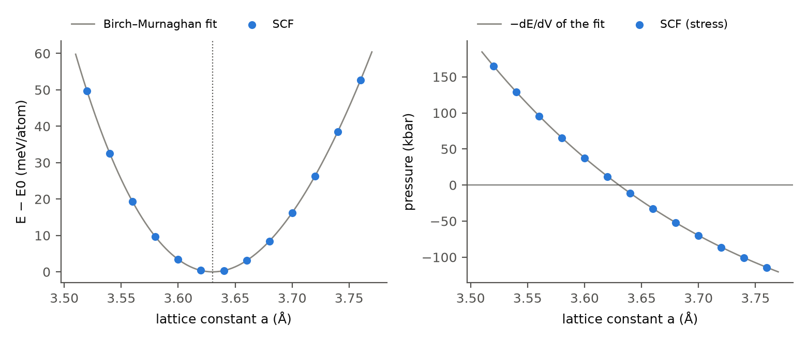
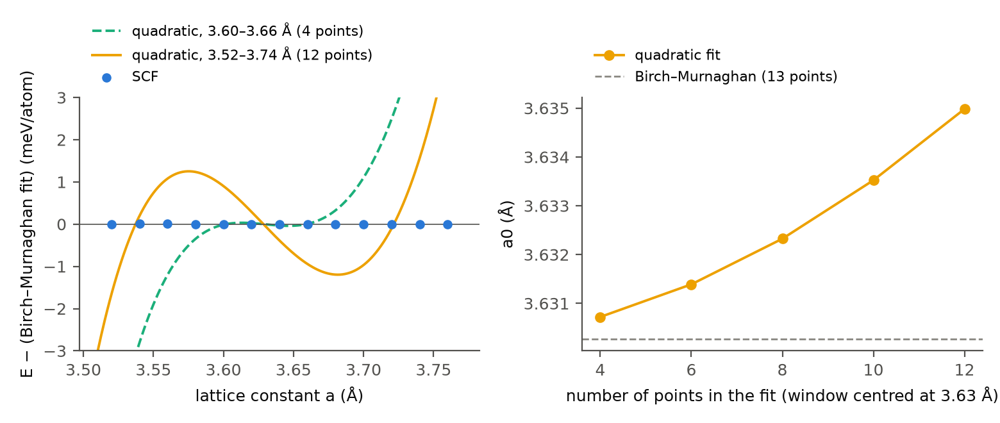
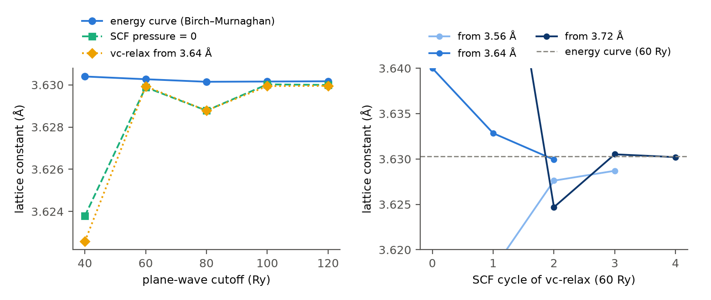

=================================================
格子定数をどう求めるか：Cuのエネルギー曲線と応力
=================================================

結晶の格子定数は、全エネルギーが最小になる格子の大きさとして求めます。\
よく使われる求め方は2つあります。\
1つは、格子定数を少しずつ変えて全エネルギーを計算し、その曲線の極小を探す方法です。\
もう1つは、1回の計算で求まる応力（圧力）を手がかりに、圧力が0になるまで格子を自動で動かす方法（QEの ``vc-relax`` 、Quloudの計算機能「格子定数最適化」）です。

どちらも同じ極小を目指しているはずですが、曲線の当てはめ方や計算の条件によって、得られる値は少しずつ違います。\
本稿では、面心立方（fcc）構造の銅（Cu）について、2つの求め方で格子定数を0.001 Åの桁まで求め、値がどれだけ、なぜ違うのかを調べます。

計算対象と計算条件
==================

計算するのは、fccのCuの原始胞（1原子）です。\
原始胞は、3辺の長さが立方晶の格子定数 :math:`a` の :math:`1/\sqrt{2}` で、辺のなす角がすべて60°のセルです（慣用胞と原始胞の関係は、技術ノートの `格子基底と座標系の変換 <https://technical-notes.quemix.com/solid/lattice_transform.html>`__ を参照してください）。\
以下では、格子の大きさを立方晶の格子定数 :math:`a` で表し、エネルギーは1原子あたりの値、圧力はQEの出力どおりkbar（10 kbar = 1 GPa）で示します。\
計算条件を :numref:`tab-cl-conditions` にまとめます。

.. list-table:: 計算条件
   :name: tab-cl-conditions
   :header-rows: 1
   :widths: 35 65

   * - 項目
     - 設定
   * - 計算コード
     - Quantum ESPRESSO（QE）7.5 [1]_ [2]_
   * - 交換相関汎関数
     - PBE [3]_
   * - 擬ポテンシャル
     - PAW（pslibrary 1.0.0 [4]_ ）
   * - カットオフエネルギー
     - 波動関数 60 Ry、電荷密度 600 Ry
   * - k点メッシュ
     - :math:`24\times24\times24` （Γ点を含む）
   * - 占有数
     - MVスメアリング [5]_ 、幅0.02 Ry
   * - SCF収束閾値
     - :math:`10^{-12}` Ry

擬ポテンシャルのファイルは ``Cu.pbe-dn-kjpaw_psl.1.0.0.UPF`` です。\
k点メッシュとスメアリング幅は、 :doc:`../kpoints/kpoint_convergence` で決めた条件です。\
このメッシュでは、格子定数を変えたときのエネルギー差が0.1 meV、圧力が0.2 kbarの精度で収束しています。\
カットオフエネルギーの影響を調べるため、 :numref:`{number}節 <sec-cl-cutoff>` では波動関数のカットオフを40、80、100、120 Ry（電荷密度はその10倍）にした計算も行います。

.. _sec-cl-scan:

エネルギー曲線
==============

格子定数を3.52 Åから3.76 Åまで0.02 Åずつ変えた13点で、全エネルギーと圧力を計算しました（ :numref:`fig-cl-eos` ）。\
1点のSCF計算は、MPI 4並列で約20秒です。

   Cuの格子定数 :math:`a` と全エネルギー（左）、圧力（右）。青い点はSCF計算、灰色の曲線は13点にBirch–Murnaghanの式（ :numref:`{number}節 <sec-cl-eos>` ）を当てはめた結果で、右はその曲線を体積で微分した圧力 :math:`-\mathrm{d}E/\mathrm{d}V` です。左の縦軸は、当てはめた曲線の極小値 :math:`E_0` からのエネルギー、点線は極小の位置です。

エネルギーは3.62 Åと3.64 Åでほぼ等しく（差0.05 meV）、極小はこの間にあります。\
曲線は左右対称ではありません。\
極小から0.12 Å離れた3.52 Åと3.76 Åを比べると、どちらも約50 meV高くなっていますが、極小がおよそ3.63 Åにあることを考えると、縮めた側（3.52 Å、極小から0.11 Å）のほうが、伸ばした側（3.76 Å、0.13 Å）より少ない変化で同じだけエネルギーが上がっています。\
原子どうしが近づくと反発が急に強くなるため、縮める側のほうが硬いのです。\
右の圧力も、格子定数に対して直線ではなく、縮めた側で傾きが急になっています。

.. _sec-cl-quadratic:

2次式の当てはめ
================

最も簡単な求め方は、極小付近の点に2次式 :math:`E(a)=c_0+c_1a+c_2a^2` を当てはめ、その頂点 :math:`a_0=-c_1/(2c_2)` を格子定数とする方法です。\
当てはめる範囲を、3.63 Åを中心に広げていったときの :math:`a_0` を :numref:`tab-cl-quadratic` と :numref:`fig-cl-quadratic` に示します。

.. list-table:: 2次式で求めた格子定数 :math:`a_0` と当てはめた範囲
   :name: tab-cl-quadratic
   :header-rows: 1
   :widths: 40 30 30

   * - 範囲
     - 点の数
     - :math:`a_0` （Å）
   * - 3.60〜3.66 Å
     - 4
     - 3.6307
   * - 3.58〜3.68 Å
     - 6
     - 3.6314
   * - 3.56〜3.70 Å
     - 8
     - 3.6323
   * - 3.54〜3.72 Å
     - 10
     - 3.6335
   * - 3.52〜3.74 Å
     - 12
     - 3.6350

   左：2次式（破線は4点、実線は12点で当てはめたもの）と、SCFのエネルギー（青い点）の、Birch–Murnaghanの式の曲線からの差。右：2次式で求めた :math:`a_0` と当てはめた点の数。破線はBirch–Murnaghanの式（13点）の :math:`a_0` です。

範囲を広げるほど、 :math:`a_0` は大きい側へずれていき、12点では4点より0.004 Å大きくなります。\
左の図のように、2次式は左右対称な放物線なので、縮めた側の急な立ち上がりと伸ばした側のゆるやかな立ち上がりの両方に合わせようとして、頂点が伸ばした側へずれます。\
範囲を狭めればずれは小さくなりますが、点が少なく、エネルギー差も小さくなるので、1点ごとの数値誤差の影響を受けやすくなります。\
2次式で求めた値は、どの範囲で当てはめたかを添えないと意味がありません。

.. _sec-cl-eos:

状態方程式
==========

非対称な曲線を表すために、固体の圧縮についての状態方程式を使います。\
ここでは、体積 :math:`V` （1原子あたり、fccでは :math:`V=a^3/4` ）の関数として、よく使われる2つの式を当てはめます。\
:math:`E_0` は極小のエネルギー、 :math:`V_0` は極小の体積、 :math:`B_0` は体積弾性率、 :math:`B_0'` はその圧力微分です。

Murnaghanの式 [6]_ は、体積弾性率が圧力に比例して増える（ :math:`B=B_0+B_0'P` ）と仮定したものです。

.. math::
   :label: cl-murnaghan

   E(V)=E_0+\frac{B_0V}{B_0'}\left[\frac{(V_0/V)^{B_0'}}{B_0'-1}+1\right]-\frac{B_0V_0}{B_0'-1}

3次のBirch–Murnaghanの式 [7]_ は、有限ひずみ :math:`f=\frac12\left[(V_0/V)^{2/3}-1\right]` の3次までの展開です。

.. math::
   :label: cl-bm3

   E(V)=E_0+\frac{9V_0B_0}{16}\left\{\left[\left(\frac{V_0}{V}\right)^{2/3}-1\right]^3B_0'
   +\left[\left(\frac{V_0}{V}\right)^{2/3}-1\right]^2\left[6-4\left(\frac{V_0}{V}\right)^{2/3}\right]\right\}

式 :eq:`cl-bm3` は :math:`x=V^{-2/3}` の3次多項式なので、通常の多項式の最小二乗で当てはめられます。\
式 :eq:`cl-murnaghan` は、 :math:`V_0` と :math:`B_0'` を決めると :math:`E_0` と :math:`B_0` について1次式になるので、 :math:`V_0` と :math:`B_0'` だけを探索しました（解析スクリプトはNumPyだけで動きます。 :doc:`reproduction` ）。

.. list-table:: 状態方程式の当てはめで求めた格子定数 :math:`a_0` 、体積弾性率 :math:`B_0` 、その圧力微分 :math:`B_0'`
   :name: tab-cl-eos
   :header-rows: 1
   :widths: 34 16 16 12 22

   * - 式と点
     - :math:`a_0` （Å）
     - :math:`B_0` （GPa）
     - :math:`B_0'`
     - 残差の最大（meV）
   * - Birch–Murnaghan、13点
     - 3.6303
     - 141.3
     - 5.05
     - 0.005
   * - Murnaghan、13点
     - 3.6302
     - 140.7
     - 5.08
     - 0.04
   * - Birch–Murnaghan、7点
     - 3.6303
     - 141.4
     - 5.06
     - —

表の7点は、13点のうち3.58〜3.70 Åの範囲の点です。\
2つの式の :math:`a_0` の差は0.0001 Åで、当てはめる範囲を13点から7点に狭めても :math:`a_0` は変わりません。\
Birch–Murnaghanの式のほうが残差が1桁小さく、13点のエネルギーを0.005 meV以内で再現します。\
2次式と違い、状態方程式は範囲を広げても値がずれないので、極小から離れた点も含めて安定に :math:`a_0` を決められます。\
以下では、Birch–Murnaghanの式の値 :math:`a_0=3.6303` Åを、エネルギー曲線から求めた格子定数とします。

.. _sec-cl-pressure:

圧力とエネルギー曲線
====================

SCF計算の出力の圧力 :math:`P` （ ``P=`` ）は、波動関数から直接計算した応力で、エネルギーの体積微分 :math:`P=-\mathrm{d}E/\mathrm{d}V` にあたります。\
:numref:`fig-cl-eos` の右の図で、SCFの圧力（青い点）と、当てはめた曲線を微分した圧力（灰色の曲線）はよく重なっています。\
差をとると、13点すべてで −0.33〜−0.67 kbar、極小付近では −0.44 kbarで、SCFの圧力がわずかに小さくなっています。\
SCFの圧力が0になる格子定数は3.6298 Åで、エネルギー曲線の極小（3.6303 Å）より0.0005 Å小さくなります。\
極小付近では、圧力は格子定数1 Åあたり約1100 kbar変わるので、0.44 kbarの差が格子定数の0.0004 Åに相当します。

この差は、平面波の数が有限であることから生じます。\
エネルギー曲線は、カットオフエネルギーを一定にして計算しているので、格子を変えると平面波の数が変わります。\
一方、SCFの応力は、平面波の組を固定したまま格子をわずかに変えたときのエネルギー変化として計算されます。\
平面波が十分に多ければ両者は一致しますが、そうでなければ差が残ります。この差を **Pulay応力** （有限基底による応力の補正）と呼びます [8]_ 。\
:numref:`{number}節 <sec-cl-cutoff>` で、この差がカットオフエネルギーとともにどう変わるかを調べます。

.. _sec-cl-vcrelax:

vc-relax（格子定数最適化）
==========================

QEの ``vc-relax`` は、SCF計算で求めた応力を使い、BFGS法で圧力が0になる格子を探します。\
Quloudでは、計算機能「格子定数最適化」がこの計算です。\
応力の収束閾値は0.01 GPa（0.1 kbar）にしました。\
3.56、3.64、3.72 Åの3つから始めたときの格子定数の変化を :numref:`fig-cl-cutoff` の右に、結果を :numref:`tab-cl-vcrelax` に示します。

.. list-table:: vc-relax（60 Ry）の開始点と結果
   :name: tab-cl-vcrelax
   :header-rows: 1
   :widths: 22 18 26 34

   * - 開始点
     - SCFの回数
     - 最適化後の :math:`a` （Å）
     - 最後のSCFの圧力（kbar）
   * - 3.56 Å
     - 4
     - 3.6287
     - 1.39
   * - 3.64 Å
     - 3
     - 3.6299
     - −0.06
   * - 3.72 Å
     - 5
     - 3.6302
     - −0.37
   * - 3.6287 Å（やり直し）
     - 3
     - 3.6299
     - 0.02

SCFの回数は、最後に平面波を選び直したSCF計算を除いた回数です。\
3.64 Åから始めると、3回のSCF計算で3.6299 Åに収束し、SCFの圧力が0になる格子定数（3.6298 Å）とほぼ一致しました。\
しかし、開始点を変えると、最適化後の格子定数は3.6287〜3.6302 Åと0.0015 Åの幅で散らばります。

この散らばりも、平面波の扱いによるものです。\
``vc-relax`` では、格子を動かしている間、開始時の格子で選んだ平面波の組をそのまま使います。\
開始点が極小から離れていると、最適化後の格子では、カットオフエネルギーで本来選ぶべき組と違う平面波で計算していることになります。\
QEは、最適化が終わったあとに、最後の格子で平面波を選び直してもう一度SCF計算を行います（出力の ``The G-vectors are recalculated for the final unit cell`` ）。\
その圧力（表の右端）は、3.56 Åから始めた場合で1.39 kbarと、収束閾値（0.1 kbar）より大きく残っています。\
3.56 Åから始めた結果（3.6287 Å）を開始点にして ``vc-relax`` をやり直すと、3.6299 Åに収束し、最後のSCFの圧力は0.02 kbarになりました（表の最後の行）。\
3.64 Åから始めた結果と一致します。\
最後のSCFの圧力が閾値より大きいときは、得られた格子から ``vc-relax`` をやり直すと、開始点による違いがなくなります。

.. _sec-cl-cutoff:

カットオフエネルギーと格子定数
==============================

エネルギー曲線と応力のどちらで求めた格子定数が、カットオフエネルギーに対して早く収束するかを調べます。\
カットオフを40〜120 Ryに変え、それぞれ3.60〜3.68 Åの5点でエネルギー曲線と圧力を計算し、3.64 Åから ``vc-relax`` を行いました（ :numref:`tab-cl-cutoff` 、 :numref:`fig-cl-cutoff` の左）。\
エネルギー曲線の格子定数は、この5点にBirch–Murnaghanの式を当てはめて求めました。

.. list-table:: カットオフエネルギーと、3つの方法で求めた格子定数
   :name: tab-cl-cutoff
   :header-rows: 1
   :widths: 16 22 20 20 22

   * - カットオフ（Ry）
     - 全エネルギー（meV）
     - エネルギー曲線（Å）
     - 圧力0（Å）
     - vc-relax（Å）
   * - 40
     - 59.88
     - 3.6304
     - 3.6238
     - 3.6226
   * - 60
     - 5.78
     - 3.6303
     - 3.6299
     - 3.6299
   * - 80
     - 1.84
     - 3.6301
     - 3.6288
     - 3.6288
   * - 100
     - 0.73
     - 3.6302
     - 3.6300
     - 3.6299
   * - 120
     - 0
     - 3.6302
     - 3.6300
     - 3.6300

全エネルギーは3.64 Åでの値を、120 Ryの値からの差で示しています。\
圧力0は、SCFの圧力が0になる格子定数です。

   左：カットオフエネルギーと、エネルギー曲線（Birch–Murnaghanの式、5点）、SCFの圧力が0になる点、3.64 Åからの ``vc-relax`` で求めた格子定数。右： ``vc-relax`` （60 Ry）の各SCF計算での格子定数。0回目が開始点で、3.56 Åと3.72 Åから始めた最初の点は縦軸の範囲外です。破線はエネルギー曲線の格子定数（60 Ry、13点）です。

全エネルギーそのものは、60 Ryでもまだ120 Ryより5.8 meV高く、カットオフに対してゆっくり収束します。\
それでも、エネルギー曲線から求めた格子定数は40〜120 Ryで3.6301〜3.6304 Åと、0.0003 Åの範囲に収まります。\
格子定数を少し変えた計算どうしでは、カットオフによる誤差がほぼ同じだけ入り、エネルギー差では打ち消し合うためです（ :doc:`../kpoints/kpoint_convergence` でk点について見たのと同じことです）。

一方、応力から求めた格子定数は、カットオフに敏感です。\
40 Ryでは、エネルギー曲線の値より0.007〜0.008 Å小さくなります。\
60 Ryでは0.0004 Åまで近づきますが、80 Ryでは再び0.0013 Å離れ、100 Ry以上でようやく0.0003 Å以内にそろいます。\
Pulay応力はカットオフを上げると小さくなりますが、この計算では単調には減りませんでした。\
60 Ryで差が小さかったのは、たまたまだと考えるべきでしょう。

``vc-relax`` の結果は、どのカットオフでもSCFの圧力が0になる格子定数とよく一致しています（40 Ryを除いて0.0001 Å以内）。\
``vc-relax`` は応力が0になる格子を正しく見つけていて、その応力自体にPulay応力が含まれていることが、エネルギー曲線との差の原因です。\
応力で格子定数を0.001 Åの精度で求めるには、エネルギー曲線で求める場合より高いカットオフが必要です。

.. _sec-cl-experiment:

実験値との比較
==============

Cuの格子定数の実験値は、25 °Cで3.61491 Å（X線回折） [9]_ です。\
PBEで求めた3.6303 Åは、これより0.0154 Å（0.43%）大きくなっています。\
体積弾性率の計算値141 GPaは、室温の実験値137 GPa [10]_ より3%大きい値です。

ただし、この差をそのままPBEの誤差と見ることはできません。\
今回の計算は、原子が静止した絶対零度の結晶のエネルギーを求めたもので、原子の零点振動も熱膨張も含んでいません。\
実験値は室温での値で、どちらの効果も格子を広げる向きにはたらきます。\
零点振動と熱膨張を差し引いた「静止した格子」の実験値は3.61491 Åより小さいはずなので、PBEの格子定数の過大評価は0.43%より大きいことになります。\
体積弾性率も温度とともに小さくなるので、同じように比べるには温度の違いを考える必要があります。\
今回の計算の範囲では、どの効果がどれだけ差に寄与しているかは分けられません。

この数値実験から分かること
==========================

* エネルギー曲線は、縮めた側で急に立ち上がる非対称な形をしていました。2次式で極小を求めると、当てはめる範囲を広げるほど格子定数が大きい側へずれ、3.60〜3.66 Åの4点と3.52〜3.74 Åの12点で0.004 Å違いました。
* 状態方程式（Birch–Murnaghanの式、Murnaghanの式）を当てはめると、範囲を変えても格子定数は0.0001 Åの範囲で変わらず、Birch–Murnaghanの式は13点のエネルギーを0.005 meV以内で再現しました。
* エネルギー曲線から求めた格子定数は、カットオフ40〜120 Ryで0.0003 Åの範囲に収まりました。全エネルギーそのものが数meV変わる条件でも、エネルギー差から求める量は早く収束します。
* 応力から求めた格子定数（ ``vc-relax`` 、SCFの圧力が0になる点）は、平面波の数が有限であることによるPulay応力のため、カットオフに敏感でした。0.001 Åの精度には100 Ry以上が必要で、カットオフに対して単調には収束しませんでした。また、 ``vc-relax`` は開始時の平面波の組を使い続けるので、開始点によって結果が0.0015 Å散らばりました。最後のSCFで残った圧力を確かめ、大きければ得られた格子からやり直すと、この散らばりはなくなりました。

今回の結果は、Cuと :numref:`tab-cl-conditions` の計算条件（PBE、PAW擬ポテンシャル、k点メッシュ、スメアリング）についてのものです。\
ほかの物質や擬ポテンシャルでは、Pulay応力の大きさや必要なカットオフは変わるので、同じように確かめてください。

参考文献
========

.. [1] P\. Giannozzi *et al.*, "QUANTUM ESPRESSO: a modular and open-source software project for quantum simulations of materials," *Journal of Physics: Condensed Matter* **21**, 395502 (2009). https://doi.org/10.1088/0953-8984/21/39/395502
.. [2] P\. Giannozzi *et al.*, "Advanced capabilities for materials modelling with Quantum ESPRESSO," *Journal of Physics: Condensed Matter* **29**, 465901 (2017). https://doi.org/10.1088/1361-648X/aa8f79
.. [3] J\. P. Perdew, K. Burke, and M. Ernzerhof, "Generalized Gradient Approximation Made Simple," *Physical Review Letters* **77**, 3865 (1996). https://doi.org/10.1103/PhysRevLett.77.3865
.. [4] A\. Dal Corso, "Pseudopotentials periodic table: From H to Pu," *Computational Materials Science* **95**, 337–350 (2014). https://doi.org/10.1016/j.commatsci.2014.07.043
.. [5] N\. Marzari, D. Vanderbilt, A. De Vita, and M. C. Payne, "Thermal Contraction and Disordering of the Al(110) Surface," *Physical Review Letters* **82**, 3296 (1999). https://doi.org/10.1103/PhysRevLett.82.3296
.. [6] F\. D. Murnaghan, "The Compressibility of Media under Extreme Pressures," *Proceedings of the National Academy of Sciences* **30**, 244–247 (1944). https://doi.org/10.1073/pnas.30.9.244
.. [7] F\. Birch, "Finite Elastic Strain of Cubic Crystals," *Physical Review* **71**, 809–824 (1947). https://doi.org/10.1103/PhysRev.71.809
.. [8] G\. P. Francis and M. C. Payne, "Finite basis set corrections to total energy pseudopotential calculations," *Journal of Physics: Condensed Matter* **2**, 4395–4404 (1990). https://doi.org/10.1088/0953-8984/2/19/007
.. [9] M\. E. Straumanis and L. S. Yu, "Lattice parameters, densities, expansion coefficients and perfection of structure of Cu and of Cu–In α phase," *Acta Crystallographica Section A* **25**, 676–682 (1969). https://doi.org/10.1107/S0567739469001549
.. [10] C\. Kittel, *Introduction to Solid State Physics*, 8th ed. (Wiley, 2005), Chap. 3.
