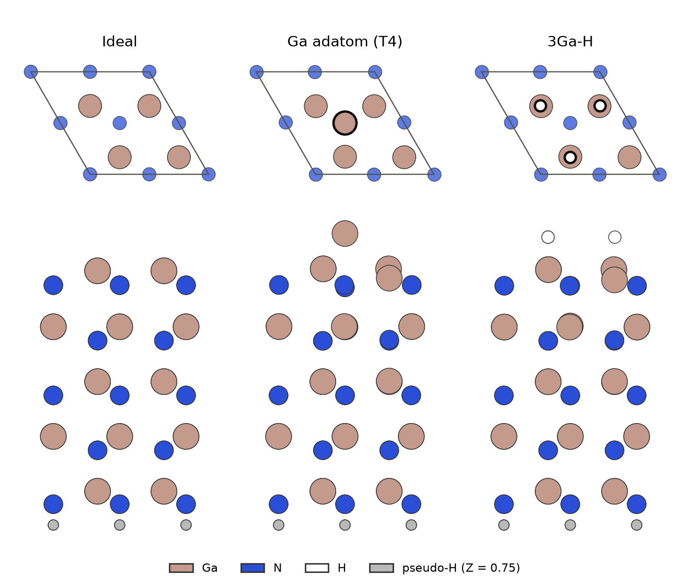
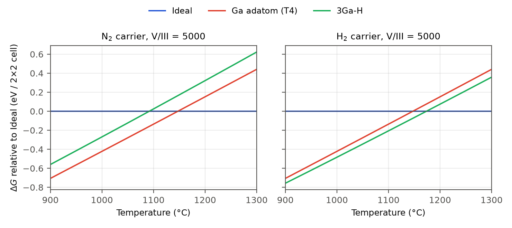
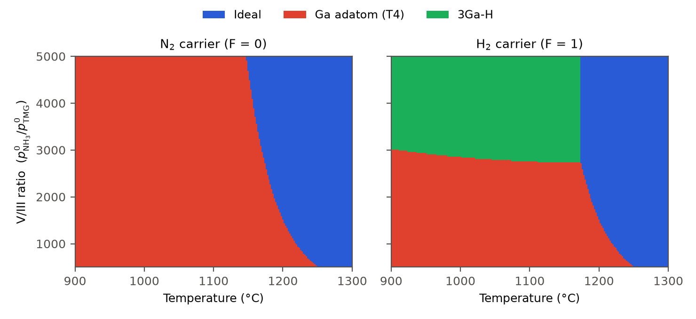
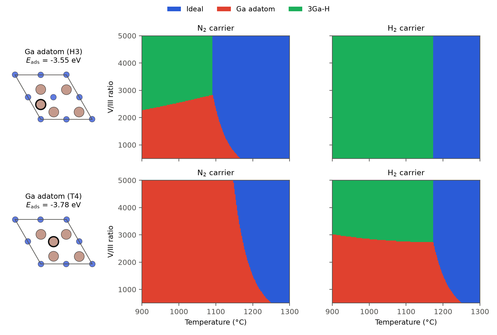

=====================================================
気相の化学ポテンシャルで描くGaN(0001)の表面相図
=====================================================

窒化ガリウム（GaN）の結晶は、有機金属気相成長（MOVPE）で、トリメチルガリウム（TMG）とアンモニア（NH₃）をキャリアガス（N₂またはH₂）で基板へ運んで成長させます。\
成長中の表面には、気相から来た原子が吸着したり、離れたりしています。\
どのような表面構造が現れるかは、表面の原子配置のエネルギーだけでなく、成長温度や原料ガスの分圧、キャリアガスの種類によって変わります。

第一原理計算で求められるのは、絶対零度での表面のエネルギーです。\
一方、吸着した原子は、1000 °Cを超える気相と原子をやりとりしています。\
そこで、表面のエネルギーを第一原理計算で求め、気相の分子の化学ポテンシャルを統計力学で求めて組み合わせると、成長条件ごとに安定な表面構造を予測できます [1]_ [2]_ 。

このページでは、Kusabaらの論文 [2]_ にならい、GaN(0001)面について、表面のエネルギーをQuantum ESPRESSO（QE）、気相のH₂の振動数と回転定数をPsi4で計算し、成長温度とV/III比（原料の供給比）に対する表面相図を描きます。\
キャリアガスをN₂からH₂に替えると、表面に何が起こるでしょうか。

.. note::

   このページの計算は、Quloudと同じ計算コードを使い、Quloudの外で実行したものです。\
   表面スラブの底面の擬水素（価数0.75）は、現在のQuloudの画面では設定できません。\
   計算条件と再現手順は :doc:`reproduction` にまとめています。

表面モデルと計算条件
====================

論文 [2]_ は(0001)面について9通りの表面構造を比べています。\
このページでは、そのうちの3つを計算します（ :numref:`fig-gan-models` ）。

* **Ideal** ：最上層がGaで終わる理想表面です。これをエネルギーの基準にします。
* **Ga adatom** ：Ideal の上にGa原子が1個吸着した表面です。吸着位置は、最上層のN原子の真上（T4サイト）です。
* **3Ga-H** ：最上層の4個のGa原子のうち3個にH原子が1個ずつ結合した表面です。

   計算した3つの表面モデル（QEで構造を最適化した後の原子配置）。上段は最上層のGa–N層と吸着原子を上から見た図で、平行四辺形が2×2の表面セル、太い輪郭が吸着原子です。下段はスラブ全体を横から見た図で、最下層のN原子に擬水素（灰色）が結合しています。

表面は、Ga–Nの層を5組重ねたスラブで表します。\
スラブの下面には、N原子の結合の手（ダングリングボンド）が余ります。\
この手を、価数0.75の擬水素で終端します [3]_ 。\
ウルツ鉱型のGaNで、N原子の1本の結合の手には1.25個の電子があるので、0.75個の電子を足すと2個になり、結合が閉じます。\
底面のN原子と擬水素は固定し、それ以外の原子の位置を最適化しました。\
計算条件を :numref:`tab-gan-conditions` にまとめます。

.. list-table:: 計算条件
   :name: tab-gan-conditions
   :header-rows: 1
   :widths: 28 72
   :class: wrap-table

   * - 項目
     - 条件
   * - 表面スラブ
     - 2×2表面セル、Ga–N層5組、真空層20 Å。格子定数 :math:`a` = 3.189 Å、 :math:`c` = 5.185 Å（固定）
   * - 計算コード（スラブとGa原子・H₂の全エネルギー）
     - Quantum ESPRESSO（スラブは7.6、Ga原子とH₂は7.5）
   * - 交換相関汎関数
     - GGA-PBE
   * - 擬ポテンシャル
     - PAW（pslibrary 1.0.0）。Ga ``Ga.pbe-dn-kjpaw_psl.1.0.0.UPF`` 、N ``N.pbe-n-kjpaw_psl.1.0.0.UPF`` 、H ``H.pbe-kjpaw_psl.1.0.0.UPF`` 。底面の擬水素はノルム保存型（価数0.75、自作）
   * - カットオフエネルギー
     - 波動関数70 Ry、電荷密度400 Ry
   * - k点
     - スラブ3×3×1、Ga原子とH₂はΓ点のみ
   * - 構造最適化
     - BFGS、力の収束閾値 :math:`10^{-3}` Ry/bohr
   * - 電子の占有
     - Ideal はGaussianスメアリング（幅0.01 Ry）\ :sup:`†`\ 、それ以外のスラブは固定占有。いずれもスピン分極なし
   * - Ga原子
     - 一辺24 bohrの立方体セル、スピン分極あり（全磁化1 :math:`\mu_\mathrm{B}` ）
   * - 計算コード（H₂の振動数と回転定数）
     - Psi4 1.10、PBE/cc-pVTZ、構造最適化の後に振動数解析

:sup:`†` Ideal の2×2セルは電子数が奇数（363個）で、固定占有では計算できないため、スメアリングを使いました。\
スメアリングを使った全エネルギー（自由エネルギー :math:`F` ）には、電子のエントロピーの項 :math:`-TS` （ここでは −0.095 eV）が含まれます。\
他のスラブと比べるため、 :math:`F` と内部エネルギー :math:`E = F + TS` の平均 :math:`(F+E)/2` を、スメアリング幅を0にしたときのエネルギーの近似として使いました。

論文 [2]_ は全電子計算コードDMol3（数値基底DNP）を使っており、このページの計算とは計算コードと基底関数が異なります。\
スラブの層数、真空層の厚さ、表面セル、k点は論文に合わせました。

表面のギブズエネルギー
======================

吸着した原子の数が違う表面どうしは、全エネルギーをそのまま比べることができません。\
吸着した原子が気相にあるときのエネルギーまで含めて比べます。\
Ideal を基準にした表面 :math:`j` のギブズエネルギーは

.. math::
   :label: gan-delta-g

   \Delta G_j(T, p) = E_{\mathrm{ads},j}
   - n_{\mathrm{Ga},j}\,\tilde{\mu}_{\mathrm{Ga}}(T, p_{\mathrm{Ga}})
   - \frac{n_{\mathrm{H},j}}{2}\,\tilde{\mu}_{\mathrm{H_2}}(T, p_{\mathrm{H_2}})

です [2]_ 。\
:math:`n_{\mathrm{Ga},j}` 、 :math:`n_{\mathrm{H},j}` は吸着したGa原子とH原子の数、 :math:`E_{\mathrm{ads},j}` は絶対零度での吸着エネルギー

.. math::
   :label: gan-eads

   E_{\mathrm{ads},j} = E_{\mathrm{slab}}(j) - E_{\mathrm{slab}}(\mathrm{Ideal})
   - n_{\mathrm{Ga},j}\,E_{\mathrm{Ga}} - \frac{n_{\mathrm{H},j}}{2}\,E_{\mathrm{H_2}}

です。\
:math:`E_{\mathrm{Ga}}` 、 :math:`E_{\mathrm{H_2}}` は孤立したGa原子とH₂分子の全エネルギーで、スラブと同じ擬ポテンシャル・カットオフのQEで計算します。\
:math:`\tilde{\mu}` は気相の分子の化学ポテンシャルのうち温度と分圧に依存する部分で、 :math:`\mu = E + \tilde{\mu}` です。\
表面の原子の振動によるエントロピーは無視しています。\
:math:`\Delta G_j` が負なら、その成長条件では表面 :math:`j` が Ideal より安定です。

吸着エネルギー
--------------

式 :eq:`gan-eads` で求めた吸着エネルギーを :numref:`tab-gan-eads` に示します。

.. list-table:: 吸着エネルギー（2×2表面セルあたり）
   :name: tab-gan-eads
   :header-rows: 1
   :widths: 30 20 20 30

   * - 表面
     - :math:`n_\mathrm{Ga}`
     - :math:`n_\mathrm{H}`
     - :math:`E_\mathrm{ads}` （eV）
   * - Ga adatom
     - 1
     - 0
     - −3.78
   * - 3Ga-H
     - 0
     - 3
     - −3.41

どちらも負なので、絶対零度ではGa原子もH原子も表面に吸着した方が安定です。\
3Ga-H の値はH原子3個分で、1個あたりでは−1.14 eVです。\
吸着した原子が離れるかどうかは、気相の化学ポテンシャル :math:`\tilde{\mu}` との競合で決まります。

気相の化学ポテンシャル
----------------------

気相の分子を理想気体とみなすと、化学ポテンシャルは並進・回転・振動の分配関数から

.. math::
   :label: gan-mu

   \begin{aligned}
   \tilde{\mu} &= -k_\mathrm{B}T \ln\left(g\,\frac{k_\mathrm{B}T}{p}\,\zeta_\mathrm{trans}\,\zeta_\mathrm{rot}\,\zeta_\mathrm{vib}\right),\\
   \zeta_\mathrm{trans} &= \left(\frac{2\pi m k_\mathrm{B}T}{h^2}\right)^{3/2},
   \quad
   \zeta_\mathrm{rot} = \frac{k_\mathrm{B}T}{\sigma h c B},
   \quad
   \zeta_\mathrm{vib} = \frac{1}{1 - e^{-h c\,\omega / k_\mathrm{B}T}}
   \end{aligned}

と書けます [2]_ 。\
:math:`m` は分子の質量、 :math:`g` は電子状態の縮重度、 :math:`\sigma` は対称数（H₂では2）、 :math:`B` は回転定数、 :math:`\omega` は振動数（いずれも波数単位）です。\
論文にならい、振動の分配関数には零点振動の因子を含めていません。\
Ga原子は並進だけで、基底状態 :sup:`2`\ P\ :sub:`1/2` の縮重度 :math:`g` = 2を使います。

H₂の回転定数と振動数は、Psi4で構造を最適化した後の振動数解析から取ります（ :numref:`tab-gan-h2` ）。\
PBEの値は実験値より振動数が約2 %、回転定数が約2.5 %小さくなっています。

.. list-table:: H₂の振動数と回転定数
   :name: tab-gan-h2
   :header-rows: 1
   :widths: 40 30 30

   * -
     - :math:`\omega` （cm⁻¹）
     - :math:`B` （cm⁻¹）
   * - Psi4（PBE/cc-pVTZ）
     - 4317.0
     - 59.35
   * - 実験値 [4]_
     - 4401.2
     - 60.853

この値で式 :eq:`gan-mu` を計算すると、H₂の化学ポテンシャルにはどの自由度が効いているかが分かります（ :numref:`tab-gan-mu-parts` ）。

.. list-table:: H₂の化学ポテンシャル :math:`\frac{3}{2}\tilde{\mu}_\mathrm{H_2}` の内訳（1100 °C、V/III = 3000、単位eV）
   :name: tab-gan-mu-parts
   :header-rows: 1
   :widths: 34 22 22 22

   * - キャリアガス（ :math:`p_\mathrm{H_2}` ）
     - 並進
     - 回転
     - 振動
   * - N₂（0.167 atm）
     - −3.06
     - −0.37
     - −0.002
   * - H₂（0.611 atm）
     - −2.83
     - −0.37
     - −0.002

3Ga-H の :math:`\Delta G` には、 :math:`\frac{3}{2}\tilde{\mu}_\mathrm{H_2}` が入ります。\
その大半は並進の寄与で、分圧によって変わるのもこの項です。\
回転の寄与は約−0.37 eVあり、無視できません。\
一方、振動の寄与は−0.002 eVしかありません。\
H₂の振動数（約4300 cm⁻¹）は1100 °Cの熱エネルギー :math:`k_\mathrm{B}T` （約950 cm⁻¹）よりずっと大きく、振動はほとんど励起されないからです。\
Psi4の値を実験値に置き換えても、 :math:`\frac{3}{2}\tilde{\mu}_\mathrm{H_2}` は5 meVしか変わりません。

成長条件と分圧
==============

式 :eq:`gan-delta-g` に入れる分圧は、成長部での分圧です。\
原料のTMGはGa原子にほぼ完全に分解しますが、NH₃は一部しか分解しません。\
論文 [2]_ は、NH₃の分解率を :math:`\alpha` = 0.25とし、

.. math::

   \mathrm{(CH_3)_3Ga + \tfrac{3}{2}H_2 \rightarrow Ga + 3CH_4}, \qquad
   \mathrm{NH_3 \rightarrow \tfrac{\alpha}{2}N_2 + \tfrac{3\alpha}{2}H_2 + (1-\alpha)NH_3}

の分解の後の分圧を

.. math::
   :label: gan-pressure

   \begin{aligned}
   p_\mathrm{Ga} &= c\,p^0_\mathrm{TMG}, \qquad
   p_\mathrm{NH_3} = c\,(1-\alpha)\,p^0_\mathrm{NH_3}, \\
   p_\mathrm{H_2} &= c\left(F\,p^0_\mathrm{carrier} + \tfrac{3\alpha}{2}p^0_\mathrm{NH_3}\right), \qquad
   p_\mathrm{N_2} = c\left((1-F)\,p^0_\mathrm{carrier} + \tfrac{\alpha}{2}p^0_\mathrm{NH_3}\right)
   \end{aligned}

としています。\
:math:`p^0` は入口での分圧で、キャリアガスの分圧は :math:`p^0_\mathrm{carrier} = p^0_\mathrm{tot} - p^0_\mathrm{NH_3} - p^0_\mathrm{TMG}` です。\
:math:`F` はキャリアガスのうちH₂の割合（N₂キャリアで0、H₂キャリアで1）、 :math:`c` は全圧を保つための規格化定数です。\
このページでも論文と同じく、全圧 :math:`p^0_\mathrm{tot}` = 1 atm、 :math:`p^0_\mathrm{NH_3}` = 0.5 atmとし、V/III比 :math:`p^0_\mathrm{NH_3}/p^0_\mathrm{TMG}` を500〜5000の範囲で変えます。\
Gaの分圧はV/III比に反比例し、V/III = 500で約 :math:`9\times10^{-4}` atm、5000で約 :math:`9\times10^{-5}` atmです。\
H₂の分圧は、N₂キャリアでもNH₃の分解で約0.17 atmあり、H₂キャリアでは約0.61 atmになります。

:numref:`fig-gan-delta-g` に、V/III = 5000での各表面の :math:`\Delta G` を温度に対して示します。

   V/III = 5000での各表面のギブズエネルギー（Ideal 基準、2×2表面セルあたり）。左がN₂キャリア、右がH₂キャリアです。各温度で最も低い線の表面が安定です。

温度が上がると、 :math:`-\tilde{\mu}` は大きくなるので、吸着した表面の :math:`\Delta G` は上がっていきます。\
:math:`\Delta G` が0を横切る温度で、吸着した原子が離れて Ideal が安定になります。\
N₂キャリアでは、Ga adatom の線が全温度で 3Ga-H の線より下にあり、Ga adatom から Ideal へ移ります。\
H₂キャリアでは、H₂の分圧が高い分だけ :math:`\frac{3}{2}\tilde{\mu}_\mathrm{H_2}` が上がり（ :numref:`tab-gan-mu-parts` ）、3Ga-H の線が下がって Ga adatom の線と入れ替わります。\
Ga adatom の線はキャリアガスによって変わりません。

表面相図
========

温度とV/III比のそれぞれの点で、 :math:`\Delta G` が最も低い表面を塗り分けたのが :numref:`fig-gan-phase` です。

   GaN(0001)面の表面相図。全圧1 atm、 :math:`p^0_\mathrm{NH_3}` = 0.5 atm、 :math:`\alpha` = 0.25。各点で式 :eq:`gan-delta-g` の :math:`\Delta G` が最も低い表面の色で塗っています（温度2 °C、V/III比25刻み）。

相図から次のことが読み取れます。

* N₂キャリアでは、低温で Ga adatom、高温で Ideal が現れます。境界の温度は、V/III = 500で1252 °C、5000で1148 °Cです。V/III比が大きいほどGaの分圧が低く、Ga原子が離れやすいので、境界は低温側へ移ります。
* H₂キャリアでは、V/III比が約2750以上の領域に 3Ga-H が現れます。3Ga-H と Ideal の境界は約1174 °Cで、V/III比にほとんどよりません。H₂の分圧はNH₃の分解とキャリアガスで決まり、V/III比ではほとんど変わらないからです。
* V/III比が小さい側では、H₂キャリアでも Ga adatom が現れ、Ideal との境界はN₂キャリアと同じです。

論文 [2]_ のFig. 2と比べると、現れる表面の種類と並び方は同じです。\
N₂キャリアで Ga adatom から Ideal へ移り、V/III比が大きいほど境界が低温になること、H₂キャリアで高V/III側に 3Ga-H が現れ、約1160 °Cで Ideal に移ることが一致しています。\
一方、境界の位置はずれています。\
N₂キャリアの境界は、論文の図ではV/III = 5000で約1110 °C、500で約1200 °Cで、このページの計算は40〜50 °C高温側にあります。\
H₂キャリアで 3Ga-H が現れるV/III比の下限は、論文の図では約1200で、このページでは約2750です。

境界の温度は吸着エネルギーに敏感です。\
:math:`\tilde{\mu}_\mathrm{Ga}` の温度変化は約−2.8 meV/Kなので、 :math:`E_\mathrm{ads}` の0.1 eVの違いは、境界の温度で約35 °Cに当たります。\
このページの :math:`\tilde{\mu}` を使い、論文の図の境界を逆にたどると、論文の吸着エネルギーは Ga adatom で約−3.65 eV、3Ga-H で約−3.37 eVと推定されます。\
このページの値（ :numref:`tab-gan-eads` ）は、それぞれ約0.13 eV、0.04 eV安定側にあり、境界のずれと整合します。\
計算コードと基底関数（DMol3の数値基底とQEの平面波・PAW）、Ga原子の参照の取り方などの違いが、この程度の差になって現れていると考えられます。

.. _gan-site-check:

吸着位置の確認
==============

Ga adatom のGa原子をどこに置くかで、結果は変わります。\
最初にこの計算を組んだときは、Ga原子を「T4サイトの候補」として置いたつもりで、実際にはH3サイト（真下にスラブを通して原子が1つもない位置）に置いていました。\
構造最適化は収束し、相図も描けたため、すぐには気づきませんでした。\
:numref:`fig-gan-site` に、H3サイトとT4サイトに置いた場合の相図を比べます。

   Ga adatom の吸着位置による違い。上段がH3サイト、下段がT4サイトです。左端の図は最上層を上から見た図で、太い輪郭がGa adatom です。相図の条件は :numref:`fig-gan-phase` と同じです。

T4サイトはH3サイトより0.226 eV安定です（ :math:`E_\mathrm{ads}` = −3.78 eVと−3.55 eV）。\
H3サイトのままでは、N₂キャリアでも高V/III側に 3Ga-H が現れ、H₂キャリアでは Ga adatom が全く現れません。\
どちらも論文の相図とは異なります。

構造最適化（BFGS）は、原子に働く力に沿って原子を動かします。\
高い対称性の位置に置いた原子には、その対称性を破る向きの力が働かないので、原子は別のサイトへ移りません。\
構造最適化が収束しても、「その位置が最も安定」の証拠にはなりません。\
吸着位置は、最適化した後の座標から、吸着原子の真下に何の原子があるかで確かめます。\
:doc:`reproduction` の解析スクリプトは、この判定をしてから表面の名前を付けます。

.. _gan-scope:

適用範囲
========

このページの相図は、次の近似と条件の下でのものです。

* 論文の9通りの表面構造 [2]_ のうち3つだけを比べています。ここで比べていない表面構造（Ga adlayer、N adatom など）の方が安定な条件では、相図は変わります。
* (000−1)面は扱っていません。N面のスラブの底面には、価数1.25の擬水素が要ります。
* 表面の原子の振動と、零点振動のエネルギーは、気相・表面とも含めていません（論文と同じ）。
* スラブの計算はスピン分極を考えていません。Ga原子の参照エネルギーはスピン分極ありで計算しました。Ga原子をスピン分極なしで計算すると全エネルギーが0.245 eV高くなり、Ga adatom の吸着エネルギーが同じだけ変わります。
* 底面の擬水素は、QEの ``ld1.x`` で作ったノルム保存型の擬ポテンシャルです。原子の自己無撞着計算と ``pw.x`` での1原子の計算は通りましたが、表面での転移性やカットオフエネルギーへの収束は確かめていません。
* スラブの計算はQE 7.6、Ga原子とH₂の計算はQE 7.5で行いました（ :numref:`tab-gan-conditions` ）。
* 成長部の分圧は、論文の分解モデル（式 :eq:`gan-pressure` ）によります。分解率 :math:`\alpha` を変えると、特にH₂の分圧と 3Ga-H の領域が変わります。

.. note::

   quemix.com の `Quloudの紹介ページ <https://www.quemix.com/quloud>`__ に掲載した同じ計算の相図は、このページの計算条件のうち2点が揃っていない段階のものでした（H₂のQEの計算のカットオフが50 Ry、Ideal のスメアリングの補正なし）。\
   そのときの吸着エネルギーは Ga adatom で−3.73 eV、3Ga-H で−3.36 eVで、相境界はこのページより約17 °C低温側にありました。相図の形は同じです。

参考文献
========

.. [1] Y. Kangawa, T. Ito, A. Taguchi, K. Shiraishi, and T. Ohachi, Surf. Sci. **493**, 178 (2001).

.. [2] A. Kusaba, Y. Kangawa, P. Kempisty, H. Valencia, K. Shiraishi, Y. Kumagai, K. Kakimoto, and A. Koukitu, "Thermodynamic analysis of (0001) and (000−1) GaN metalorganic vapor phase epitaxy," Jpn. J. Appl. Phys. **56**, 070304 (2017). `doi:10.7567/JJAP.56.070304 <https://doi.org/10.7567/JJAP.56.070304>`__ 。著者稿は `九州大学学術情報リポジトリ <https://hdl.handle.net/2324/7183509>`__ にあります。

.. [3] K. Shiraishi, J. Phys. Soc. Jpn. **59**, 3455 (1990).

.. [4] K. P. Huber and G. Herzberg, *Molecular Spectra and Molecular Structure IV. Constants of Diatomic Molecules* (Van Nostrand Reinhold, 1979)。 `NIST Chemistry WebBook <https://webbook.nist.gov/cgi/cbook.cgi?ID=C1333740&Mask=1000>`__ に収録された値です。
