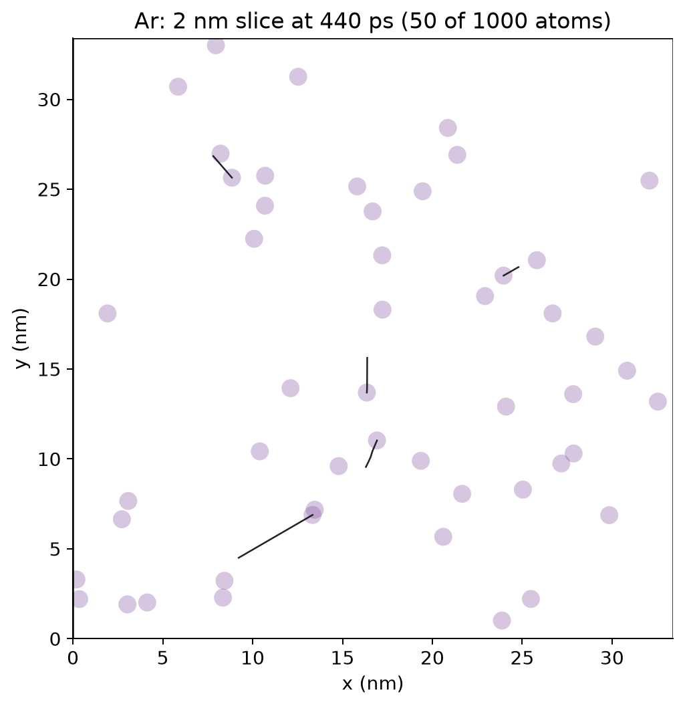
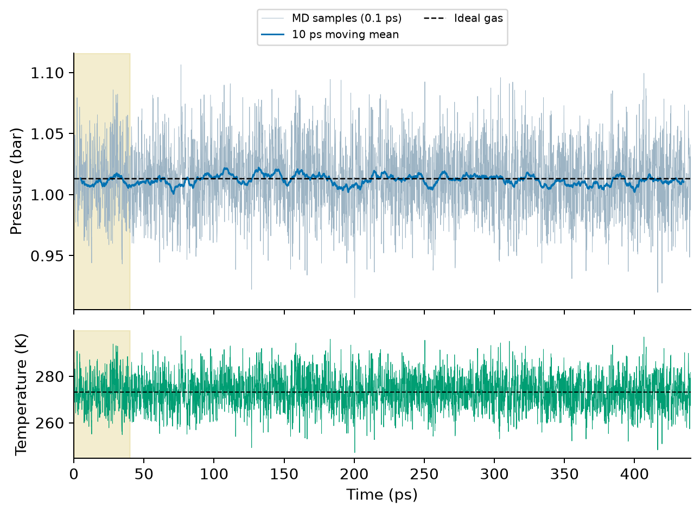
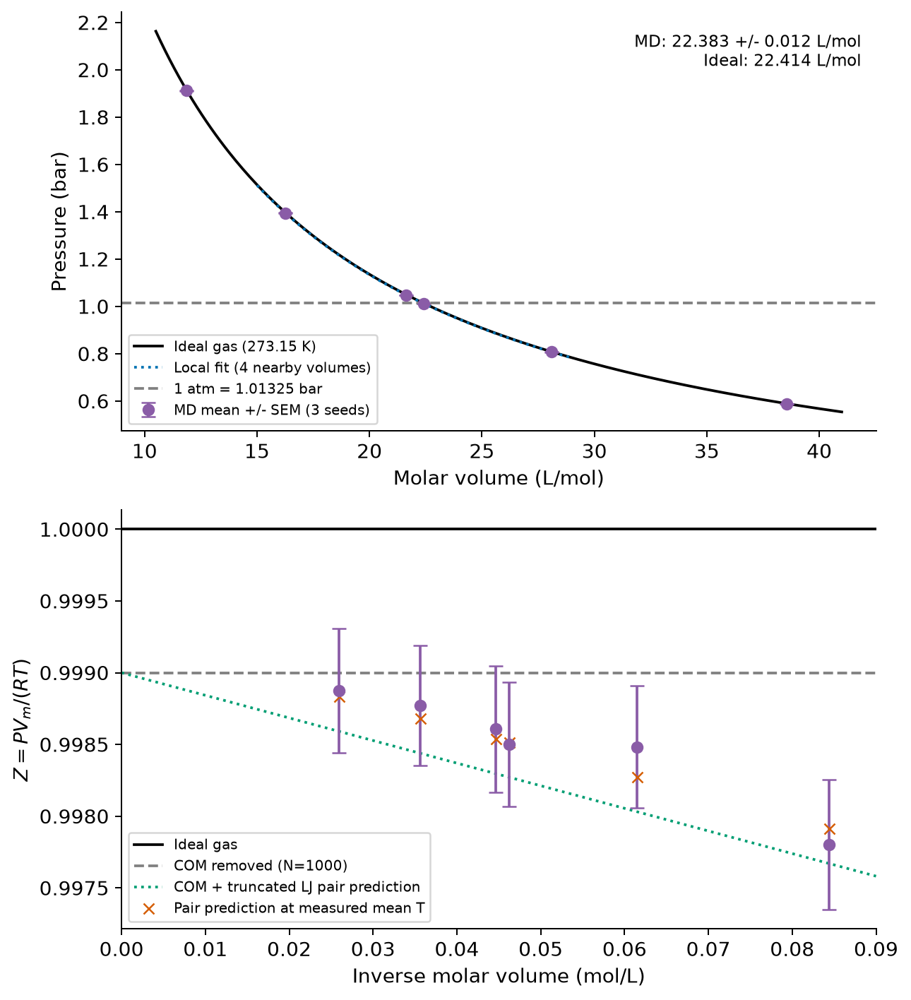

====================================
気体1 molはなぜ22.4 Lなのか？
====================================

高校の化学では「0 ℃、1気圧で、気体1 molの体積は約22.4 L」と習います。
1 molには約6.02×10²³個もの粒子があります。
粒子が動き回る気体に、なぜ決まった体積があるのでしょうか。

ここではアルゴン（Ar）原子を1,000個だけ用意し、箱の大きさを変えたときの圧力を計算します。
その結果から、1気圧に対応するモル体積を求めてみましょう。
使うのは、原子の運動を追う分子動力学（MD）という方法です。

計算対象と計算条件
==================

Arは原子が一つずつ独立に動く単原子気体です。
今回の原子は、近づきすぎると反発し、少し離れたところで弱く引き合うモデルに従います。
計算条件を :numref:`tab-argon-conditions` にまとめます。
力場の数値パラメータ、入力構造、解析の手順は :doc:`reproduction` で確認できます。

.. list-table:: Arの計算条件
   :name: tab-argon-conditions
   :header-rows: 1
   :widths: 30 70
   :class: wrap-table

   * - 項目
     - 条件
   * - 計算ソフトと環境
     - GROMACS 2026.2。WSLローカルのDockerで実行
   * - 粒子数
     - Ar 1,000原子
   * - 計算セル
     - 立方体。一辺27、30、33、33.3879144、36、40 nm
   * - 温度・境界条件
     - 273.15 K（0 ℃）、3方向周期境界
   * - 計算方法
     - NVT、時間刻み2 fs、V-rescaleによる温度制御
   * - 測定区間
     - 全440 psのうち、最初の40 psを除いた400 ps。各体積3シード
   * - 相互作用
     - 登録Arモデルargon_vrabec。LJカットオフ1.2 nm、長距離補正なし

一辺33.3879144 nmのセルの計算結果を :numref:`fig-argon-snapshot` に示します。
セルには壁がありません。ある面から出た原子は反対側に現れます。
この周期境界条件によって、広く続く気体の一部分を表しています。
図ではセル中央の厚さ2 nmの部分を取り出し、見やすいように原子を大きく描いています。
1原子あたりの体積の立方根は約3.34 nmで、相互作用の長さの目安であるσ＝0.33952 nmの約10倍です。

   Ar 1,000原子の440 ps時点の座標から、セル中央の厚さ2 nmに含まれる原子だけをxy平面へ投影した図です。
   軸の単位はnm、セルの一辺は約33.388 nmです。
   円の表示半径0.50 nmは、LJのσ/2＝0.16976 nmの約2.95倍です。
   黒線は図に含まれる5原子の430〜440 psの保存座標を結んだ経路です。経路は厚さ方向に部分領域の外へ出ることもあります。
   周期境界をまたぐ線分は描いていません。
   四角はセルの境界を示し、壁を表すものではありません。

理想気体の予想
==============

計算結果を見る前に、理想気体の式から予想しておきましょう。
モル体積 :math:`V_m` は、体積を物質量で割った「1 molあたりの体積」です。

.. math::
   :label: eq-gas-ideal

   PV=nRT,\qquad PV_m=RT.

ここで :math:`P` は圧力、:math:`n` は物質量、:math:`T` は絶対温度、:math:`R` は気体定数です。
温度をそろえれば、体積が小さいほど圧力は高くなるはずです。
今回の各セルについての理論値と、MDの測定値を :numref:`tab-argon-pv` に示します。

.. list-table:: 273.15 Kにおける体積と圧力
   :name: tab-argon-pv
   :header-rows: 1
   :widths: 16 25 24 35
   :class: wrap-table

   * - 一辺（nm）
     - モル体積（L/mol）
     - 理想気体（bar）
     - MD平均±標準誤差（bar）
   * - 27
     - 11.8534
     - 1.9160
     - 1.91178 ± 0.00087
   * - 30
     - 16.2598
     - 1.3968
     - 1.39464 ± 0.00060
   * - 33
     - 21.6418
     - 1.0494
     - 1.04783 ± 0.00045
   * - 33.3879
     - 22.4140
     - 1.01325
     - 1.01184 ± 0.00045
   * - 36
     - 28.0969
     - 0.8083
     - 0.80731 ± 0.00034
   * - 40
     - 38.5417
     - 0.5893
     - 0.58859 ± 0.00025

理想気体の列は、MDとは独立したスクリプトで計算した予測値です。
MDの列は3シードの時間平均を平均したものです。
標準誤差は、時間相関を考慮したブロック平均とシード間のばらつきから求めています。
この誤差には、原子間相互作用のモデルや粒子数の有限性による偏りは含めていません。

圧力の時間変化
==============

圧力はどの時刻でも同じ値になるわけではありません。
試験計算の圧力と温度の変化を :numref:`fig-argon-pressure-time` に示します。
この希薄な条件では、圧力の揺らぎの主な原因は温度、つまり運動エネルギーの揺らぎです。
測定温度の標準偏差は約7 K（約2.6%）で、瞬間圧力の相対的な幅と同程度です。
そこで、最初の40 psを除いた測定区間について平均を取ります。

   一辺33.3879144 nm、シード1101の計算です。
   上段はEDRから0.1 ps間隔で抽出した圧力（薄線）と10 psの移動平均（青線）、
   下段は温度です。横軸は時間（ps）、縦軸はそれぞれbar、Kです。
   黄色の0〜40 psは平均から除いた区間です。
   破線は上段が独立に計算した理想気体の圧力、下段が273.15 Kです。

このシードでは、測定区間の平均圧力は1.01192 bar、ブロック平均による標準誤差は約0.00066 barでした。
ブロックを5〜80 psに変えたときの標準誤差を調べ、最大の値を採用しています。
これは今回の区間で見積もった統計精度であり、あらゆる系統誤差がなくなったことを意味しません。

1気圧に対応するモル体積
========================

各体積の測定値を :numref:`fig-argon-pv` に示します。
体積を小さくすると圧力が上がり、全体として理想気体の曲線に近い関係になっています。

   上段の横軸は1 mol換算の体積（L/mol）、縦軸は圧力（bar）です。
   点と誤差棒は :numref:`tab-argon-pv` と同じMD平均と1標準誤差、黒線は式 :eq:`eq-gas-ideal` の予測です。
   水平破線は1 atm＝1.01325 bar、点線は一辺30、33、33.3879144、36 nmの測定値に対する近傍フィットです。
   誤差棒は点より小さい場合があります。
   下段は逆モル体積（mol/L）と圧力比Z＝PVm/(RT)です。
   黒線は理想気体、灰破線は全体の重心運動の除去だけを考えた予測、緑点線はさらに打ち切りLJの二体相互作用を加えた273.15 Kの予測です。
   橙の×印は各体積の実測平均温度へ補正した予測です。パラメータをMD圧力に合わせて決めてはいません。

1 atmは1 barと少し違い、1.01325 barです。
この圧力付近の4体積の測定値に :math:`P=a/V_m+b` を当てはめ、係数を自由に決めました。
22.4 Lという値はフィットに使っていません。
得られた1 atmのモル体積は **22.383 ± 0.012 L/mol** です。
±は統計的なフィットの1標準誤差です。
推定法と共分散は配布データの ``pv_fit.json`` に保存しています。

一方、理想気体の予測は次の値です。

.. math::

   \begin{aligned}
   V_m&=\frac{RT}{P}=22.413969545\ \mathrm{L/mol},\\
   T&=273.15\ \mathrm{K},\quad P=101325\ \mathrm{Pa}.
   \end{aligned}

MDの推定は理想値より約0.14%小さく、どちらも有効数字3桁では約22.4 L/molになります。
この差は、主に二つの効果で説明できます。
一つは全体の重心運動を取り除く効果で、原子1,000個では運動による圧力が約0.10%小さくなります。
もう一つは今回の打ち切りLJモデルの引力で、理想気体に近い密度での独立な見積もりでは、圧力を約0.07%下げます。
平均温度が指定値より約0.07 K高かった効果（約+0.02%）も合わせると、約−0.15%の予測になります。
6体積の各測定値とこの予測との差は、いずれも統計標準誤差の0.5倍以内でした。
見積もりの式と数値積分は :doc:`reproduction` にまとめています。
この一致は今回の有限個の粒子と相互作用モデルについての確認であり、実在Arの状態方程式を高精度に決めたという意味ではありません。

原子1,000個のセルの体積は、次の式で1 molあたりへ換算しました。

.. math::

   \begin{aligned}
   V_m[\mathrm{L/mol}]
   &=\frac{N_A}{1000}V_{\mathrm{box}}[\mathrm{nm^3}]\times10^{-24}\\
   &=0.000602214076\,V_{\mathrm{box}}[\mathrm{nm^3}].
   \end{aligned}

原子の運動と圧力
================

GROMACSは、原子の運動エネルギーと原子間力から圧力を計算します [1]_ 。
温度を一定に保つと運動エネルギーの平均が決まるので、運動による部分は理想気体の式と同じ形になります。
ここで調べたのは、原子間力による部分がどのくらい小さいかです。
1 atm付近では約0.07%、今回の体積の範囲では約0.04〜0.13%だけ圧力を下げる寄与でした。

22.4 Lは、原子1個が占める決まった大きさではありません。
温度と圧力を指定したときに、多数の粒子の運動から現れる体積です。
この数値実験では、その値に近い体積を、有限個のArの運動と圧力から求められました。
理想気体の式をゼロから証明する計算でも、実在気体の高精度な状態方程式を決める計算でもありません。

次の :doc:`five_gases_avogadro` では、分子の質量を変えたときの速さと圧力を比較します。

.. [1] GROMACS 2026.2, `Molecular dynamics, pressure and virial <https://manual.gromacs.org/2026.2/reference-manual/algorithms/molecular-dynamics.html>`__ 。
