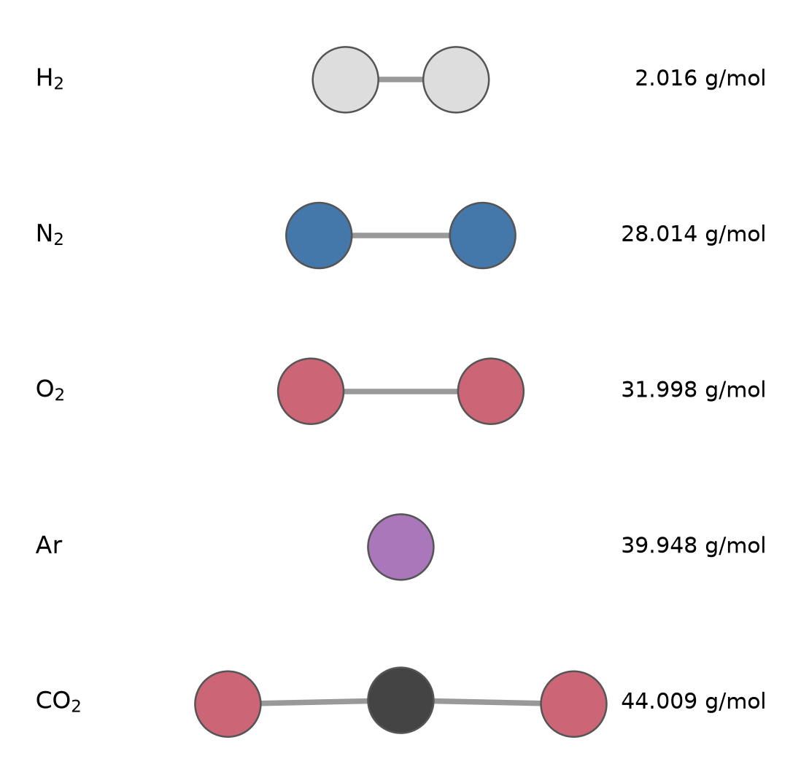
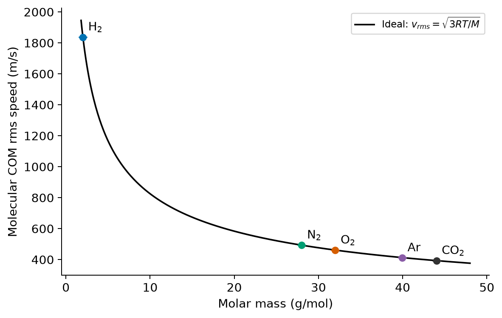
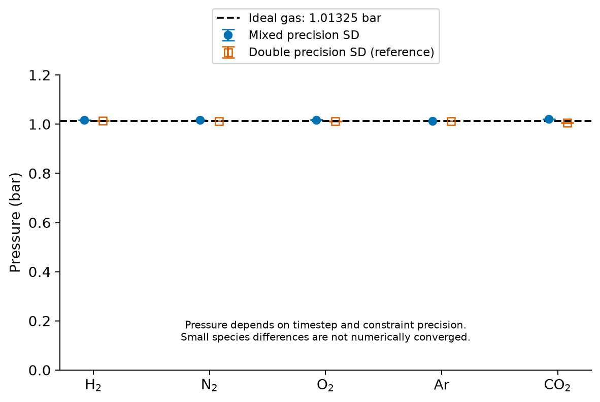

==========================================================
気体の種類が違っても、1 molの体積はほぼ同じ？
==========================================================

水素は軽く、二酸化炭素は重い気体です。
それでも高校の化学では、同じ温度と圧力なら、どちらも1 molの体積はほぼ同じだと習います。
重い分子と軽い分子の違いは、どこへ行くのでしょうか。

前回の :doc:`argon_molar_volume` では、Arの体積を変えて圧力を調べました。
今回はセルの大きさと分子数をそろえ、気体の種類だけを変えて、分子の速さと圧力を比べてみましょう。

計算対象と計算条件
==================

今回比較するのは、H₂、N₂、O₂、Ar、CO₂の5種類です。
使った分子モデルを :numref:`fig-five-gas-models` に示します。
Arは1原子が1個の気体粒子に相当するので、ここでは他の気体と合わせて粒子数を「分子数」と呼びます。

   各気体の440 ps時点の保存座標から代表1分子を取り出し、分子の平面を紙面に合わせて回転した図です。
   結合距離の表示スケールは5種で共通です。球の半径は表示用の0.022 nmで、原子の物理的な大きさを表しません。
   右の数値はモデルの原子質量を足したモル質量（g/mol）です。
   CO₂は登録モデルの角度に少し曲がる自由度があり、その保存座標の曲がりも保持しています。

条件を :numref:`tab-five-gas-conditions` にまとめます。
H₂・N₂・O₂を2,000原子にするのは、1,000分子をそろえるためです。
原子数を全部1,000個にそろえてしまうと、気体粒子の数が変わります。

.. list-table:: 5気体の比較条件
   :name: tab-five-gas-conditions
   :header-rows: 1
   :widths: 30 70
   :class: wrap-table

   * - 項目
     - 条件
   * - 分子数
     - 各1,000。原子数はAr：1,000、H₂・N₂・O₂：各2,000、CO₂：3,000
   * - 温度・セル
     - 273.15 K、一辺33.3879144 nmの立方体、3方向周期境界
   * - 計算方法
     - GROMACS 2026.2標準混合精度版、WSLローカルCPU、NVT、確率的動力学による温度制御
   * - 時間刻み
     - H₂：0.5 fs、ほかの4種：2 fs
   * - 測定区間
     - 全440 psのうち40 psより後の400 ps。各3シード
   * - 分子内の運動
     - H₂・N₂・O₂は結合長を拘束。CO₂はC–Oを2本拘束し、角度には調和ポテンシャル

計算には、それぞれの気体についてQuloudに登録されているモデルを使います。
とくにCO₂は文献の完全剛体TraPPEから変更されたモデルです。
モデルと数値条件の詳細、Quloudの標準設定との差は :doc:`reproduction` にまとめています。

分子の重心速度
==============

軽い気体の分子は、重い気体の分子より速く動くと予想されます。
ただし、H₂やCO₂の原子の速度には、分子全体の移動に加えて回転や内部の動きも混ざります。
そこで、分子ごとに原子の速度を質量で重み付けし、分子全体の重心の速度を取り出します。

速さを比べる指標には、重心速度の二乗を分子と時刻について平均した後に平方根を取る、
二乗平均平方根速度 :math:`v_{\mathrm{rms}}` を使います。
理想気体の理論式は、モル質量 :math:`M` をkg/molで表すと次のようになります。

.. math::
   :label: eq-gas-speed

   \begin{aligned}
   v_{\mathrm{rms}}&=\sqrt{\langle|\boldsymbol{v}_{\mathrm{COM}}|^2\rangle}\\
   &=\sqrt{\frac{3RT}{M}}.
   \end{aligned}

理論値とMDの測定値を :numref:`tab-five-gas-speeds` と :numref:`fig-five-gas-speeds` で比較します。
理論値にはモデルが持つ原子質量の合計を用いており、MDの速度から理論線を調整してはいません。

.. csv-table:: 分子の重心の二乗平均平方根速度
   :name: tab-five-gas-speeds
   :file: analysis/speed_table.csv
   :delim: ,
   :header-rows: 1
   :widths: 12 23 23 42
   :class: wrap-table

   横軸はモル質量（g/mol）、縦軸は分子重心の二乗平均平方根速度（m/s）です。
   点と誤差棒は :numref:`tab-five-gas-speeds` のMD平均と1標準誤差、曲線は式 :eq:`eq-gas-speed` による273.15 Kの事前予測です。
   速さはTRRの保存速度とTPRの分子ID・質量から求めています。
   原子速度や、保存座標の有限差分から求めた値ではありません。

MDの速さは、どの気体でも理論値と0.1%以内で一致しました。
軽い分子ほど速く、重い分子ほどゆっくり動きます。
ただし、今回の温度制御は各原子に温度に応じた揺らぎを直接与え、熱平衡の速度分布へ近づける方法です [2]_ 。
この一致は、そのように作った分布から分子全体の運動を正しく取り出せることを確認したものです。
分子どうしの衝突だけで、この関係が生まれる過程を独立に示したものではありません。

圧力とアボガドロの法則
======================

では、速さがこれだけ違う分子を同じ数だけ入れたとき、圧力はどうなるでしょうか。
今回の分子数・温度・体積について、理想気体の予測は約1.01325 barです。
MDの圧力は、速度から理想気体の式で作るのではなく、GROMACSのEDRに保存された ``Pressure`` を直接読み取ります。

結果を :numref:`fig-five-gas-pressure` に示します。

   横軸は5種類の気体、縦軸は圧力（bar）です。
   塗りつぶした丸は標準混合精度、白抜きの四角は倍精度の参考計算による各3シードのSD平均です。
   横位置を少しずらして示しています。誤差棒は1統計標準誤差で、この表示幅ではほぼ記号の中に収まります。
   時間刻みはどちらもH₂が0.5 fs、ほかは2 fsです。CO₂のLINCSは混合精度が次数4・反復1、倍精度が次数8・反復2です。
   倍精度版はQuloudの標準環境とは異なるローカル検証用の実行環境です。
   破線は理想気体の予測1.01325 barです。圧力の全体の大きさを比べるため、縦軸を0から表示しています。
   気体ごとの微小な差の数値収束は確認できていないため、拡大した比較は行いません。

分子の速さが大きく違っても、表に示した時間刻みでの圧力は、5種類とも理想気体の予測から1%以内でした。
これは、同じ温度と圧力で同じ体積の気体に含まれる分子数が等しいという、アボガドロの法則の考え方につながります。
ここでは体積を固定して圧力を比べたので、各気体について1 atmの体積そのものをフィットしたわけではありません。

ただし、拘束のある分子では、標準の混合精度で時間刻みを小さくすると、計算上の誤差で圧力が高くなる条件がありました。
H₂を0.25 fsにすると理想値から約+2.7%、CO₂を1 fsにすると約+7.3%になり、「1%以内」から外れます。
ここで示した値は表の時間刻みで得たもので、倍精度の参考計算でも5種類とも1%以内でした。
H₂の倍精度では刻みを半分にした対照とも統計誤差の範囲で一致していますが、混合精度の圧力の収束を保証する結果ではありません。
1%未満の違いも精度や拘束の計算条件で変わるため、気体ごとの性質の差とは考えません。
数値と対照条件は :doc:`reproduction` にまとめています。

分子の質量と運動エネルギー
==========================

理想気体では、圧力と分子の重心運動の関係を、分子1個の質量を :math:`m` として
次のように書けます。

.. math::

   \begin{aligned}
   P&=\frac{1}{3}\frac{N}{V}m\langle v_{\mathrm{COM}}^2\rangle,\\
   m\langle v_{\mathrm{COM}}^2\rangle&=3k_{\mathrm B}T.
   \end{aligned}

周期境界のセルには壁がありませんが、仮想的な面を横切る運動量の流れとしても同じ式を考えることができます。

質量が大きくなると、同じ温度での速さの二乗は小さくなります。
この二つを掛けた量は一定なので、式を合わせると
:math:`P=Nk_{\mathrm B}T/V` となり、質量は式から消えます。
重い分子がゆっくり動くことが、同じ温度でほぼ同じ圧力になることと両立するのです。

この説明は、分子間の力を無視できる希薄な気体についての近似です。
GROMACSの圧力には分子間力や拘束力の寄与も含まれます [1]_ 。
また、分子の回転や変角の運動は、分子全体の並進と区別しなければなりません。
全体の温度の表示だけを確認しても、これらの間に熱が十分行き渡ったとは限らない点に注意が必要です。

温度制御と数値精度
==================

この例題を準備する際、Quloudの既定と同じ、全体の温度を一定に保つV-rescaleでも計算しました。
するとCO₂では全体の温度が約273 Kでも、重心の速さは約440〜443 m/sで理論値より約12%速く、圧力も約1.27 barになりました。
希薄な気体では分子どうしの衝突がまれなため、並進と回転（CO₂では変角も）の間で熱が十分行き渡っていないと考えられます。
そこで、各原子に熱浴を作用させる確率的動力学（SD）へ変更しました。
採用しなかった計算も含めた温度・速さ・圧力を :doc:`reproduction` に載せています。

今回のSDは緩和時間0.1 psの強い熱浴を使っています。
速さの分布を比べる数値実験であり、実際の分子の飛び方や衝突時間を再現する計算としては使いません。

今回の結果は、登録モデルによる希薄な古典気体の数値実験です。
H₂の量子力学的な回転・振動や、実在気体の高精度な状態方程式まで再現するものではありません。
さらに圧縮した条件は、相互作用やモデルの限界も強く出る、別の実験として調べる必要があります。

.. [1] GROMACS 2026.2, `Molecular Dynamics <https://manual.gromacs.org/2026.2/reference-manual/algorithms/molecular-dynamics.html>`__ 。モデルの文献は :doc:`reproduction` を参照してください。
.. [2] GROMACS 2026.2, `Stochastic Dynamics <https://manual.gromacs.org/2026.2/reference-manual/algorithms/stochastic-dynamics.html>`__ 。
