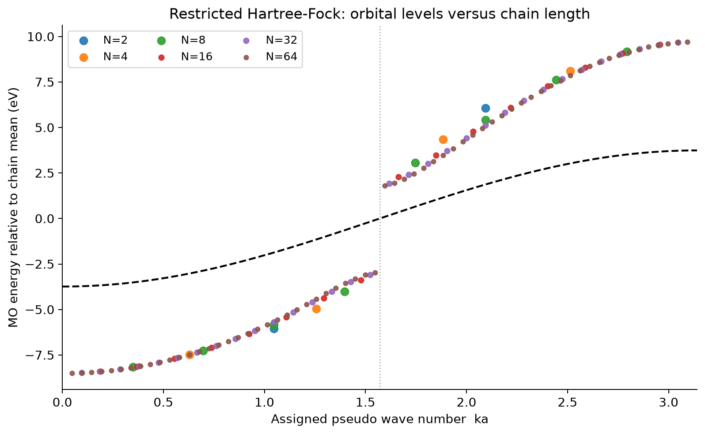
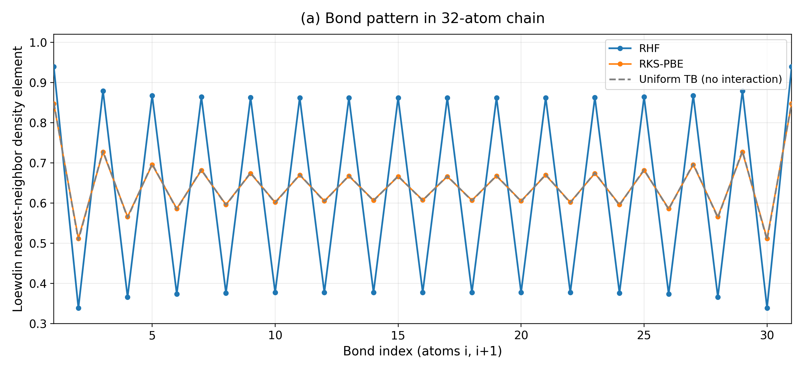
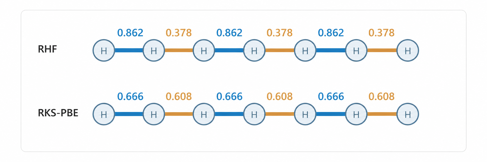

==============================================
水素原子を並べると電子バンドは生まれるのか
==============================================

固体物理の教科書では、原子がたくさん集まると、原子の離散的なエネルギー準位が密集して「バンド」になると説明されます。この過程を、実際の電子状態計算で確かめてみましょう。

.. このページでは、水素原子を2個、4個、8個……と一直線に並べ、量子化学計算で分子軌道のエネルギーを求めます。原子数が増えるにつれて準位は期待どおり密集していきます。ところが、Hartree–Fock（HF）法と密度汎関数理論（PBE汎関数）を比べると、予想外に大きな違いが現れます。その原因を結合次数やスピン分極から調べていくと、バンド形成だけでなく、電子状態の対称性の破れや平均場近似の限界まで見えてきます。

.. この例題は、実在材料の物性を予測するものではありません。原子核の位置を意図的に固定した理想化モデルを計算し、その結果から物理を読み取る「数値実験」です。

.. .. note::

..    このページの計算は、WSL上のDockerで実行したPsi4 1.10によるものです。Quloud上で実行した結果ではありません。計算条件、スクリプト、数値データ、図の再生成手順は :doc:`reproduction` にまとめています。

計算対象と計算条件
===================

計算するのは、等間隔に一直線に並んだ中性の水素原子鎖 :math:`\mathrm{H}_N` です（下図）。\
隣り合う水素原子の間隔はすべて1.8 Åとし、原子核の位置は最適化せずに固定します。\
鎖の両端は開いており、周期境界条件は課しません。\
これを\ :numref:`tab-hchain-conditions`\ にあるような設定で、量子化学計算ソフト Psi4 [1]_ を用いて計算します 。

.. figure:: figures/model_chains.png
   :name: fig-hchain-model
   :width: 85%

   計算モデルの模式図。全原子間隔を1.8 Åに保ち、原子核を固定したまま原子数 :math:`N` を増やします。原子を結ぶ線は並び方を示すためのもので、化学結合を表すものではありません。

.. list-table:: 計算条件
   :name: tab-hchain-conditions
   :header-rows: 1
   :widths: 30 70

   * - 項目
     - 条件
   * - 計算コード
     - Psi4 1.10
   * - モデル
     - 中性の有限水素原子鎖。開放端、原子核位置固定
   * - 原子間距離
     - 1.8 Å
   * - 原子数
     - 主に :math:`N` = 2, 4, 8, 16, 24, 32, 48, 64
   * - 基底関数
     - STO-3G（H原子あたり1個の空間基底関数）
   * - スピン制限計算
     - RHF、RKS-PBE
   * - スピン非制限計算
     - UHF、UKS-PBE（:math:`N` = 16, 32）
   * - 電子数とスピン
     - 電子数 :math:`N`、偶数原子数、:math:`N_\alpha = N_\beta = N/2`
   * - SCF収束条件
     - エネルギー・密度ともに :math:`10^{-9}`、最大500反復

原子数依存性の計算には密度フィッティング（DF）SCFを、後半のスピン制限解・非制限解の比較と安定性解析には近似のない4中心積分（PK法）を使いました。\
PBEの積分グリッドはPsi4の既定値です。以下に示す数値はすべて収束したSCF解から取得しています。

.. 水素原子そのものは実在しますが、等間隔・固定核の鎖は教育用の理想化モデルです。また、原子核を直線上に並べているだけで、電子の運動を数学的な1次元空間に閉じ込めているわけではありません。

Tight-Binding 模型による予想
==================================

孤立した水素原子の基底状態では、電子が1s軌道を占めます。\
水素原子を2個近づけると、2つの1s軌道から結合性軌道と反結合性軌道ができます。\
さらに原子を増やすと、 :math:`N` 個の1s基底関数から :math:`N` 個の分子軌道ができます。

中性の :math:`\mathrm{H}_N` 鎖には :math:`N` 個の電子があり、スピン制限の閉殻計算では、エネルギーの低い :math:`N/2` 個の分子軌道を2電子ずつ占有します。1原子あたり1電子なので、1軌道のバンド模型でいえば **半充填** の状態です。

この状況を説明する最も簡単なモデルが、隣接原子間のホッピングだけを考える強束縛（tight-binding）模型です。\
各原子の軌道エネルギーを :math:`\varepsilon_0` 、隣接原子間のホッピングを :math:`t` とすると、開放端の :math:`N` 原子鎖の固有値は

.. math::

   E_j = \varepsilon_0 - 2t\cos\left(\frac{j\pi}{N+1}\right),
   \qquad j = 1, \ldots, N

となります。一方、原子間隔 :math:`a` の無限周期鎖のバンド分散は

.. math::
   :label: nntb-band

   E(k) = \varepsilon_0 - 2t\cos(ka)

です。有限鎖の :math:`j` 番目の準位に形式的に :math:`k_j a = j\pi/(N+1)` という **擬似波数** を割り当てると、\
原子数を増やすほど、このコサインカーブを細かくサンプリングしていくことが分かります。

分子軌道エネルギーがバンドになるか
====================================

RKS-PBE計算で得た分子軌道エネルギーを、上記の疑似波数に対して並べたのが :numref:`fig-hchain-pbe-levels` です。

.. figure:: figures/pbe_levels.png
   :name: fig-hchain-pbe-levels
   :width: 90%

   RKS-PBEで求めた分子軌道エネルギー（原子数ごとに軌道エネルギーの平均を差し引いています）。黒い破線は、式 :eq:`nntb-band` で :math:`t \simeq 1.87` eV とした場合（後述）のバンドです。\
   横軸は擬似波数 :math:`ka = j\pi/(N+1)` 、中央にある垂直な点線は半充填位置（電子占有／非占有の境界） :math:`ka = \pi/2` を示しています。

原子数が少ないうちは準位がまばらですが、 :math:`N` = 32、64になると点が1本の滑らかな曲線を描きます。\
たしかに、分子軌道の集まりからバンド状のエネルギースペクトルが生まれる様子が、\
数値実験として直接確認できました。

ただし、ここで計算しているのは、あくまでも有限の孤立分子であり、周期結晶のバンド構造そのものではありません。\
擬似波数が実際の波動関数の空間振動と対応しているかは、軌道係数を解析して検証する必要があります。\
RKS-PBEの準位は黒い破線に近いものの、特に上下端付近ではずれています。

例えば :math:`N` = 64の全軌道エネルギーに :math:`A+B\cos(ka)` を最小二乗フィットすると、\
二乗平均平方根誤差は約 0.312 eV になります。\
:math:`C\cos(2ka)` を加えて、フィッティングの自由度を上げると、約 0.041 eV まで減らせます。\
これは、最近接以遠の相互作用、軌道の重なり、自己無撞着ポテンシャルなどが、単純な模型との差に寄与しているためだと考えられますが、\
今は、これ以上の深堀はしないことにします。

RHFの場合
====================================

同じ水素鎖の計算を、今度はRHF法で行い、先ほどと同様に、\
原子数を変えて軌道エネルギーをプロットしてみると :numref:`fig-hchain-rhf-levels` のようになります。\
RKS-PBEの場合とは大きく様子が異なり、はっきりとバンドギャップが現れているのがわかります。

   RHFで求めた分子軌道エネルギー。軸の定義と黒い破線は :numref:`fig-hchain-pbe-levels` と同じです。破線はPBEのギャップから求めた :math:`t \simeq 1.87` eVの強束縛模型を比較の基準として示しており、RHFへのフィットではありません。縦軸の表示範囲はRHFの準位に合わせています。

:numref:`tab-hchain-gaps` および :numref:`fig-hchain-gaps` に、RHFおよびRKS-PBEによる、\
最高被占有軌道（HOMO）と最低空軌道（LUMO）のエネルギー差（HOMO-LUMOギャップ）の、水素鎖長に対する変化を示しています。\
これをみると、RKS-PBEの場合は、水素鎖長とともに HOMO-LUMO ギャップがどんどん小さくなっていくのに対し、\
RHFの場合は、水素鎖長によらず、明らかに有意な差が残ることが分かります。\
その結果、RHF法で水素鎖のバンドを描くと、\ :numref:`fig-hchain-rhf-levels` のようにバンドギャップが現れることになります。

.. container:: hchain-gap-comparison

   .. container:: hchain-gap-table

      .. list-table:: HOMO–LUMO軌道ギャップ（DF-SCF）
         :name: tab-hchain-gaps
         :header-rows: 1
         :widths: 20 40 40

         * - 原子数 :math:`N`
           - RHF (eV)
           - RKS-PBE (eV)
         * - 2
           - 12.124
           - 3.806
         * - 4
           - 9.325
           - 2.327
         * - 8
           - 7.089
           - 1.302
         * - 16
           - 5.679
           - 0.691
         * - 24
           - 5.214
           - 0.470
         * - 32
           - 5.007
           - 0.356
         * - 48
           - 4.833
           - 0.240
         * - 64
           - 4.764
           - 0.181

   .. container:: hchain-gap-figure

      .. figure:: figures/orbital_gaps.png
         :name: fig-hchain-gaps
         :width: 70%

         原子数に対するHOMO–LUMO軌道ギャップ（縦軸は対数）。破線は有限サイズ則 :math:`11.75/(N+1)` eVです。

RKS-PBEのギャップは原子数とともに速やかに小さくなり、原子数を2倍にするとおおむね半分になります。\
実際、次のような式

.. math::
   :label: rks-pbe-gaps

   \Delta_N^{\mathrm{PBE}} \simeq \frac{11.75\ \mathrm{eV}}{N+1}

を考えると、\ :numref:`fig-hchain-gaps` の点線で示されるように、HOMO-LUMO ギャップの水素鎖長依存性のプロットによくフィットすることが分かります。\
上式 :eq:`rks-pbe-gaps` は、半充填の最近接強束縛模型での有限サイズギャップ

.. math::

   \Delta_N^{\mathrm{TB}} = 4t\sin\left(\frac{\pi}{2(N+1)}\right) \simeq \frac{2\pi t}{N+1}

と同じ形をしています。偶数 :math:`N` の半充填鎖では左の式が厳密に成り立ち、\
右の近似は大きな :math:`N` に対するものです。係数を比較し、フェルミ準位付近の準位間隔を対応させると、\
有効ホッピングは

.. math::

  t \approx 11.75/(2\pi) \approx 1.87 {\rm eV}

になります。\
この模型のバンド幅 :math:`4t \approx 7.48` eV は、\ :numref:`fig-hchain-pbe-levels` から読み取れる、\
RKS-PBEの :math:`N` = 64での軌道エネルギーの最大値と最小値の差、約 8.01 eVに近い値です。\

.. ここで用いたPBEの :math:`N` = 64の結果はSAD初期推定から収束した解です。コアハミルトニアン初期推定では500反復以内に収束しませんでした。計算条件とデータは :doc:`reproduction` を参照してください。

一方、RHFでは :math:`N` = 64まで増やしても約4.8 eVのギャップが残ります。

波動関数（分子軌道）の解析
====================================

あらためて、２つの手法で計算した :math:`N` = 64の軌道エネルギーを並べてプロットしたものを :numref:`fig-hchain-levels-n64` に示します。\
PBEの準位は半充填位置 :math:`ka = \pi/2` をはさんで途切れずにつながるのに対し、RHFでは占有軌道と空軌道の間に大きな段差があります。\
同じ原子配置と電子数なのに、なぜこれほど違う結果になるのでしょうか？

.. figure:: figures/rhf_pbe_levels_n64.png
   :name: fig-hchain-levels-n64
   :width: 90%

   :math:`N` = 64でのRHFとRKS-PBEの分子軌道エネルギー。塗りつぶしは占有軌道、白抜きは空軌道です。軸の定義は :numref:`fig-hchain-pbe-levels` と同じです。

原因を探るため、隣り合う原子の間の電子的な結びつきを調べます。\
重なり行列 :math:`S` と（スピンについて和をとった）密度行列 :math:`D` から、Löwdin直交化した密度行列

.. math::

   P^{\mathrm{L}} = S^{1/2} D S^{1/2}

をつくり、その隣接原子間の要素を **結合次数に相当する量**

.. math::
  :label: lowdin-bi

  B_i = P^{\mathrm{L}}_{i,i+1}

として使います（これはこの解析のための指標で、結合次数の唯一の定義ではありません）。\
例えば、最近接強束縛模型の場合であれば、波動関数

.. math::

   \phi_j(i) = \sqrt{\frac{2}{N+1}}\sin\left(\frac{ij\pi}{N+1}\right)

を使って以下のような評価を行うことになります。

.. math::
  :label: lowdin-bi-tb

   B_i = 2\sum_{j=1}^{N/2}\phi_j(i)\phi_j(i+1).

結合次数の解析結果を :numref:`fig-hchain-bond-order` に示します。

   N=32の各結合におけるLöwdin密度行列要素（式 :eq:`lowdin-bi` ）。Uniform TBは相互作用のない一様な最近接強束縛模型の場合（式 :eq:`lowdin-bi-tb` ）。

.. .. list-table:: 鎖中央の結合次数の交替振幅 :math:`A_{\mathrm{BOW}}` （PK積分）
..    :name: tab-hchain-bow
..    :header-rows: 1
..    :widths: 20 40 40

..    * - 原子数 :math:`N`
..      - RHF
..      - RKS-PBE
..    * - 16
..      - 0.24744
..      - 0.06340
..    * - 32
..      - 0.24222
..      - 0.02995
..    * - 64
..      - 0.24209
..      - 0.01481

RHFでは、鎖の中央でも :math:`B_i` がおおよそ0.86、0.38、0.86、0.38、……と大きく交替しています。\
PBEでは0.67と0.61程度の小さな交替にとどまります。これは、水素原子間の結合の強さが、\ :numref:`fig-hchain-bond-order-image` のようになっていることを示しています。

   :math:`N` = 32の水素鎖中央における結合次数の交替を表す模式図。数値は隣接原子間のLöwdin密度行列要素 :math:`B_i` の代表値です。原子間距離は一定で、青と橙はそれぞれ大きい値と小さい値を示します。

.. 鎖の中央にある8本の結合を1本おきの2組に分け、2組の平均値の差の半分を交替振幅 :math:`A_{\mathrm{BOW}}` と定義すると、次のようになります。

.. 端のある有限鎖では、単純な強束縛模型でも端に起因する結合次数の振動が生じ、鎖の中央に向かって弱まります。PBEの交替振幅が原子数とともに小さくなる傾向は、この端の効果とよく合います。これに対してRHFの交替は、少なくとも :math:`N` = 64までは鎖の中央に残り続けます。

このように、 **原子核は等間隔のまま、電子による結合の強さだけが「強・弱・強・弱」と交替する状態** は、\
結合次数波あるいは結合秩序波（bond-order wave、BOW）と呼ばれています\
（原子そのものが交互に変位する Peierls 歪みとは区別が必要です）。

BOW状態が無限鎖でも保たれるとすると、電子状態の周期は :math:`a` から :math:`2a` に倍化します。\
これは、強弱2種類のホッピング :math:`t_1, t_2` を交互に並べた Su-Schrieffer-Heeger (SSH) 模型 [5]_ と呼ばれる強束縛模型で記述できる状態となっており、\
簡単な計算から、折り返されたバンドの境界に

.. math::

   \Delta_{\mathrm{BOW}} = 2|t_1 - t_2|

のギャップが開くことが示されます。\
:numref:`fig-hchain-levels-n64` で、RHFの準位が半充填位置 :math:`ka = \pi/2` で段差を持つことも、この描像と整合しています。

.. ただし、これは仕組みを理解するための模型であり、RHFのFock演算子SSH模型と同一視するものではありません。

.. また、有限鎖にはもともと端があり、厳密な並進対称性はありません。 **原子数を増やしてもBOWの振幅が残ることは、無限鎖での対称性の破れを支持しますが、証明ではありません** 。周期境界条件での確認などは今後の課題です。

スピン分極を考慮した場合
========================================

ここまでの計算は、上向きスピンと下向きスピンの電子に同じ空間軌道を使わせるスピン制限計算でした。\
そこで、両スピンの軌道を独立に最適化できるUHFとUKS-PBEでも計算してみました。\
バンド風プロットの結果を :numref:`fig-hchain-uhf-spectrum` および :numref:`fig-hchain-uks-spectrum` に示します。

.. container:: hchain-spin-spectra

   .. figure:: figures/hydrogen_chain_uhf_orbital_spectrum.png
      :name: fig-hchain-uhf-spectrum
      :width: 100%

      UHFの軌道エネルギー。横軸は軌道番号から割り当てた擬似波数で、塗りつぶしは占有軌道、白抜きは空軌道を示します。

   .. figure:: figures/hydrogen_chain_uks_pbe_orbital_spectrum.png
      :name: fig-hchain-uks-spectrum
      :width: 100%

      UKS-PBEの軌道エネルギー。横軸と記号の意味は左図と同じですが、縦軸の範囲は異なります。

この結果から、まず :math:`\alpha` スピン、 :math:`\beta` スピンの軌道エネルギーが全く同じであることがわかります。\
そして今度は UHF と UKS-PBE の両方で大きなバンドギャップが現れています。\
:numref:`tab-hchain-spin` に、バンドギャップ（HOMO-LUMOギャップ）と\
Löwdin のスピン電荷密度解析の結果を示します。この結果から、各サイトには平均して\
0.6 :math:`\sim` 0.9 のスピン差が生じていることがわかります。\

.. list-table:: :math:`N` = 32でのスピン制限解と非制限解の比較（PK積分）
   :name: tab-hchain-spin
   :header-rows: 1
   :widths: 22 36 42

   * - 手法
     - HOMO–LUMO軌道ギャップ (eV)
     - Löwdinスピン密度の平均絶対値
   * - RHF
     - 5.005
     - 0
   * - RKS-PBE
     - 0.356
     - 0
   * - UHF
     - 19.493
     - 0.898
   * - UKS-PBE
     - 3.611
     - 0.626

続いて :numref:`fig-hchain-spin` に、\
UHF および UKS-PBE の結合次数解析の結果と、スピン密度分布の結果を示します。

.. figure:: figures/spin_and_bonds_n32.png
   :name: fig-hchain-spin
   :width: 90%

   :math:`N` = 32の鎖のLöwdin結合次数（上）とLöwdinスピン密度 :math:`\alpha-\beta` （下）。RHFの結合交替に対し、UHFとUKS-PBEでは結合次数がほぼ一様になり、スピン密度が原子ごとに反転します。

RHFで大きかったBOWはほぼ消え、代わりに **隣り合う原子ごとにスピン密度の符号が反転する（反強磁性的）な状態** が得られていることがわかります。

.. ここでのスピン密度は、各原子上のLöwdin解析によるα電子数とβ電子数の差（原子ごとのスピン人口）です。
.. その平均絶対値はUHFで約0.90、UKS-PBEで約0.63でした。
.. 各原子に交互のスピン分極が現れるこの解は、反強磁性的なスピン密度波（SDW）に相当する **平均場解** と解釈できます。
.. 非制限計算の軌道ギャップは、αとβの両スピンを通じた最高被占有軌道と最低空軌道の差です。

非制限計算では、もう一つ、強磁性的な状態も実現する可能性がありますが、計算してみたところ、\
原子あたり 0.6 :math:`\sim` 1 eV 近くエネルギーの高い不安定な状態でした。\
もちろん、RHF および RKS-PBE も、よりエネルギーの高い\
（\ :math:`N` = 32では、UHF→RHFで1原子あたり約1.49 eV、UKS-PBE→RKS-PBEで1原子あたり約0.125 eVだけ不安定化する）状態です。

したがって、今回の計算で得られた中では、反強磁性的な解が最も安定な電子状態ということになります。\
そしてこの「スピンの向きが異なるサイトが隣同士になっている」という状況は、とりもなおさず、\
系の周期を2倍にするという効果につながることになります。

.. HFとPBEはエネルギー汎関数が異なるため、HFとPBEの全エネルギー同士を比べて優劣を判断することはできません。比較は同じ汎関数の中で行います。

どの結果が「正しい」のか？
===========================

ここで注意したいのは、軌道ギャップが開いているのが正しいわけではない、ということです。\
反対に、スピン制限のPBE計算で軌道ギャップがほぼ :math:`1/N` で小さくなったことも、真の多電子系が金属であることの証明ではありません。\
今回行った計算は全て「それぞれの理論手法の特徴を見た」という程度の話だと思っておくのが安全です。

誤解のないように言っておくと、DFTによる第一原理計算は、通常の状況であれば非常に信頼できる結果が得られる手法です。\
しかしその一方で「強相関電子系」と呼ばれる特別な系の記述を不得手とすることも知られています。

実は、水素原子鎖は、電子相関を扱う手法のベンチマークとして広く使われている系です。\
多体計算による研究では、原子間距離に応じてMott絶縁体的な振る舞い、準長距離の反強磁性相関、絶縁体–金属転移などの性質が報告されています [2]_ 。\
有限の水素鎖でHF解の安定性と対称性の破れを調べた古典的な研究もあります [3]_ 。\
また別の研究では、原子間距離1.4 Åの水素鎖について、PBEなどがほぼゼロのギャップを与える一方、密度行列繰り込み群（DMRG）による多電子計算では絶縁体ギャップが得られています [4]_ 。\

.. 計算条件は今回と異なり、この数値を1.8 Åの鎖に直接適用することはできませんが、Kohn–Sham軌道ギャップと多電子系のギャップを区別する必要性を示しています。

.. STO-3G基底・固定距離・有限鎖の今回の計算から、これらの相の境界や真の電荷ギャップを決めることはできません。

今回の計算での教訓は、 **同じ原子配置と電子数であっても、計算手法が違えば、得られる電子状態の解釈そのものが変わるケースもある** ということです。

.. この数値実験から分かること
.. ==========================

.. 水素原子鎖の計算から、次の3点が読み取れます。

.. 1. **原子軌道からバンドへ。** 原子数を増やすと分子軌道の準位が密集し、周期系のバンド分散に対応する構造が見えてきます。
.. 2. **バンド形成は終点ではない。** 電子状態が結合次数波やスピン密度波といった空間パターンをつくると、半充填の単純なバンド描像からは予想されないギャップが現れ得ます。
.. 3. **計算結果はモデルと近似を通して読む。** RHF、RKS-PBE、UHF、UKS-PBEの違いは単なる数値誤差ではなく、採用した近似と対称性の制約を反映しています。

.. 次の課題として、例えば :math:`N` = 16の分子軌道係数を、強束縛模型の定在波 :math:`c_i^{(j)} \propto \sin(ij\pi/(N+1))` と比較すれば、擬似波数と軌道の空間分布の対応を検証できます。また、今回は原子間距離を1.8 Åに固定しましたが、距離を変えてバンド幅の変化を調べることや、周期境界条件で計算することも今後の課題です。

.. 実在材料に似せることだけがシミュレーションの役割ではありません。結果が何を表し、どこに近似の影響が現れるかを学ぶために理想化した系を計算してみることも、計算科学の有用な使い方です。

参考文献
========

.. [1] Psi4 documentation, "HF: Hartree–Fock Theory." https://psi4.github.io/psi4docs/master/scf.html
.. [2] M\. Motta et al., "Ground-State Properties of the Hydrogen Chain: Dimerization, Insulator-to-Metal Transition, and Magnetic Phases," *Physical Review X* **10**, 031058 (2020). https://doi.org/10.1103/PhysRevX.10.031058
.. [3] M\. Bénard and J. Paldus, "Stability of Hartree–Fock solutions and symmetry breaking in the independent particle model: An ab initio case study of the LCAO–MO–SCF solutions for finite chains of hydrogen atoms," *The Journal of Chemical Physics* **72**, 6546–6559 (1980). https://doi.org/10.1063/1.439112
.. [4] "Bridging the gap between molecules and materials in quantum chemistry with localized active spaces," *Nature Communications* **16**, 10832 (2025). https://doi.org/10.1038/s41467-025-65846-1
.. [5] W\. P. Su, J. R. Schrieffer, and A. J. Heeger, "Solitons in Polyacetylene," *Physical Review Letters* **42**, 1698 (1979). https://doi.org/10.1103/PhysRevLett.42.1698
