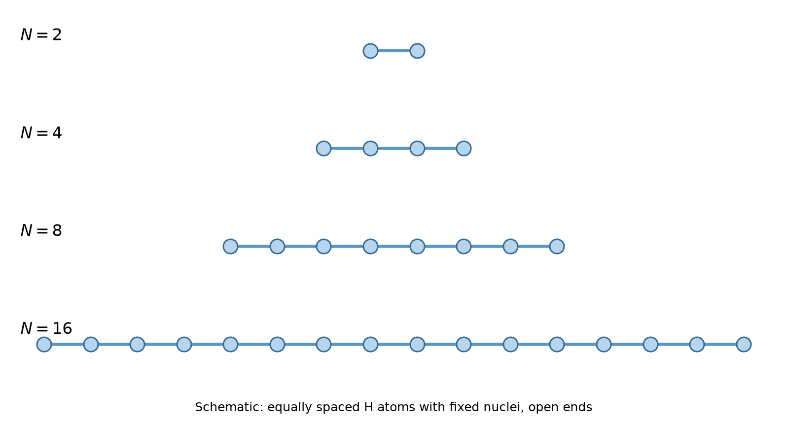
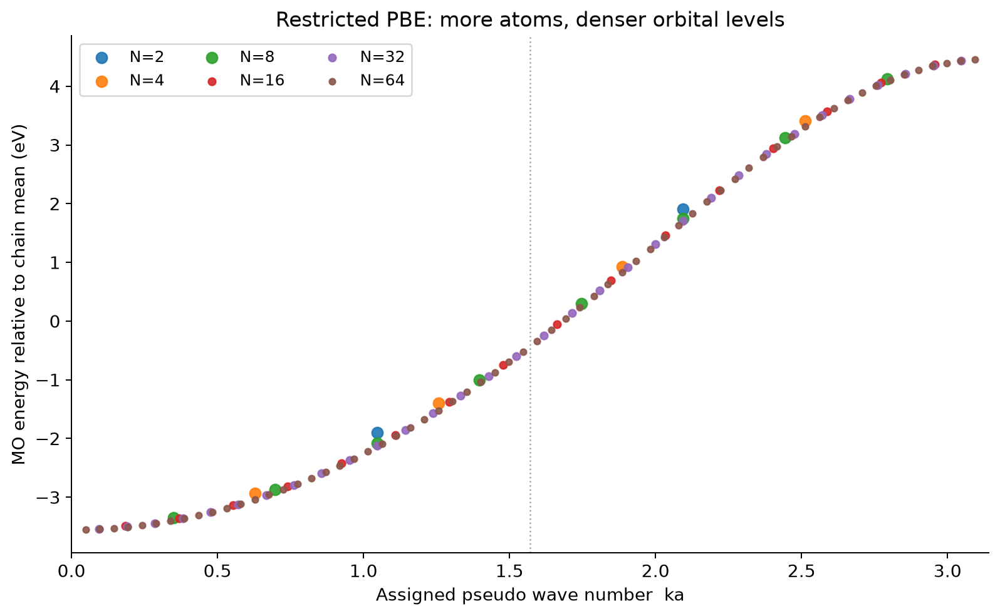
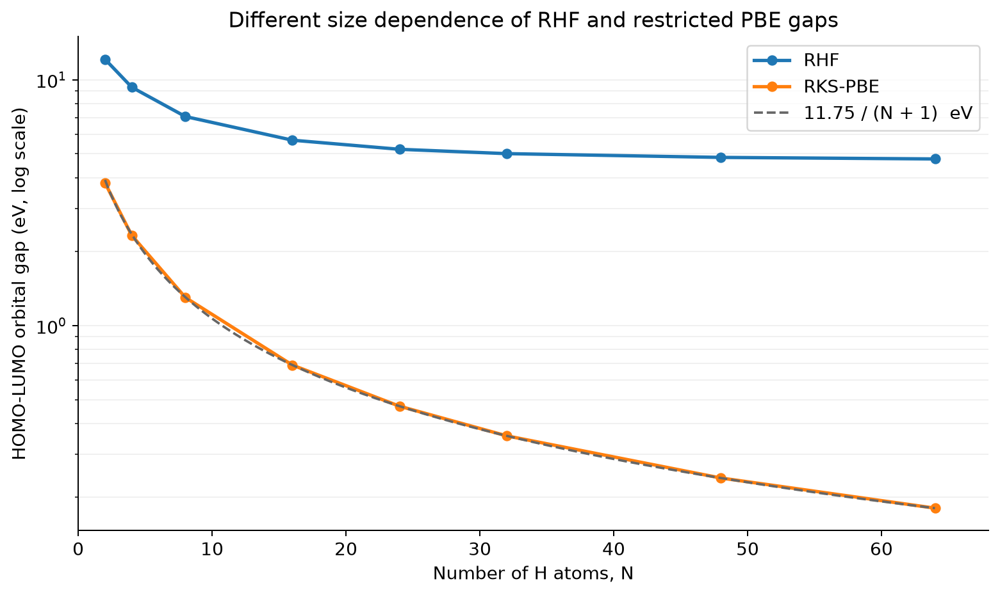
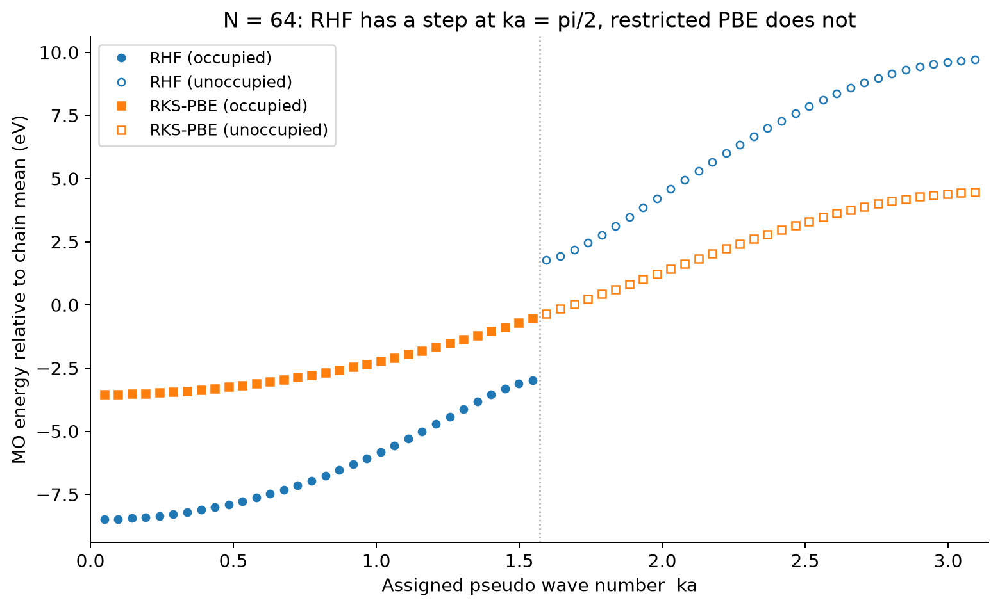
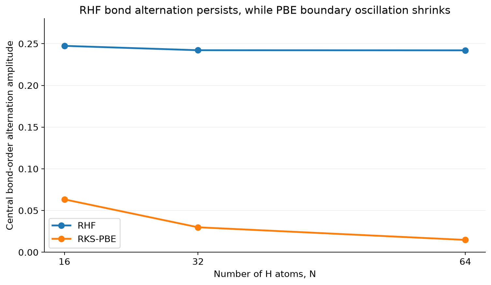
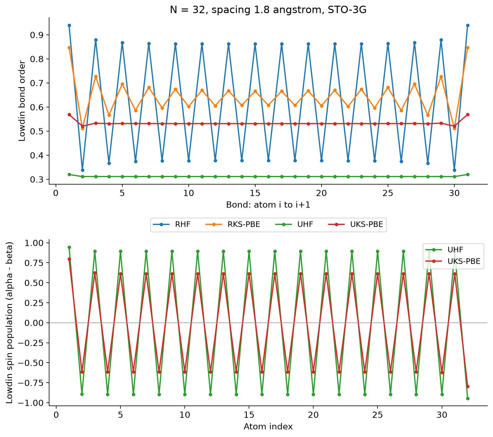

==============================================
水素原子を並べると電子バンドは生まれるのか
==============================================

固体物理の教科書では、原子がたくさん集まると、原子の離散的なエネルギー準位が密集して「バンド」になると説明されます。この過程を、実際の電子状態計算で確かめてみましょう。

このページでは、水素原子を2個、4個、8個……と一直線に並べ、量子化学計算で分子軌道のエネルギーを求めます。原子数が増えるにつれて準位は期待どおり密集していきます。ところが、Hartree–Fock（HF）法と密度汎関数理論（PBE汎関数）を比べると、予想外に大きな違いが現れます。その原因を結合次数やスピン分極から調べていくと、バンド形成だけでなく、電子状態の対称性の破れや平均場近似の限界まで見えてきます。

この例題は、実在材料の物性を予測するものではありません。原子核の位置を意図的に固定した理想化モデルを計算し、その結果から物理を読み取る「数値実験」です。

.. note::

   このページの計算は、WSL上のDockerで実行したPsi4 1.10によるものです。Quloud上で実行した結果ではありません。計算条件、スクリプト、数値データ、図の再生成手順は :doc:`reproduction` にまとめています。

計算対象と条件
==============

計算するのは、等間隔に一直線に並んだ中性の水素原子鎖 :math:`\mathrm{H}_N` です。隣り合う水素原子の間隔はすべて1.8 Åとし、原子核の位置は最適化せずに固定します。鎖の両端は開いており、周期境界条件は課しません。

   計算モデルの模式図。全原子間隔を1.8 Åに保ち、原子核を固定したまま原子数 :math:`N` を増やします。原子を結ぶ線は並び方を示すためのもので、化学結合を表すものではありません。

.. list-table:: 計算条件
   :name: tab-hchain-conditions
   :header-rows: 1
   :widths: 30 70

   * - 項目
     - 条件
   * - 計算コード
     - Psi4 1.10
   * - モデル
     - 中性の有限水素原子鎖。開放端、原子核位置固定
   * - 原子間距離
     - 1.8 Å
   * - 原子数
     - 主に :math:`N` = 2, 4, 8, 16, 24, 32, 48, 64
   * - 基底関数
     - STO-3G（H原子あたり1個の空間基底関数）
   * - スピン制限計算
     - RHF、RKS-PBE
   * - スピン非制限計算
     - UHF、UKS-PBE（:math:`N` = 16, 32）
   * - 電子数とスピン
     - 電子数 :math:`N`、偶数原子数、:math:`N_\alpha = N_\beta = N/2`
   * - SCF収束条件
     - エネルギー・密度ともに :math:`10^{-9}`、最大500反復

原子数依存性の計算には密度フィッティング（DF）SCFを、後半のスピン制限解・非制限解の比較と安定性解析には近似のない4中心積分（PK法）を使いました。PBEの積分グリッドはPsi4の既定値です。示す数値はすべて収束したSCF解から取得しています。

水素原子そのものは実在しますが、等間隔・固定核の鎖は教育用の理想化モデルです。また、原子核を直線上に並べているだけで、電子の運動を数学的な1次元空間に閉じ込めているわけではありません。

分子軌道の集まりはバンドに近づくか
==================================

孤立した水素原子の基底状態では、電子が1s軌道を占めます。水素原子を2個近づけると、2つの1s軌道から結合性軌道と反結合性軌道ができます。さらに原子を増やすと、 :math:`N` 個の1s基底関数から :math:`N` 個の分子軌道ができます。

中性の :math:`\mathrm{H}_N` 鎖には :math:`N` 個の電子があり、スピン制限の閉殻計算では、エネルギーの低い :math:`N/2` 個の分子軌道を2電子ずつ占有します。1原子あたり1電子なので、1軌道のバンド模型でいえば **半充填** の状態です。

この状況を説明する最も簡単なモデルが、隣接原子間のホッピングだけを考える強束縛（tight-binding）模型です。各原子の軌道エネルギーを :math:`\varepsilon_0` 、隣接原子間のホッピングを :math:`t` とすると、開放端の :math:`N` 原子鎖の固有値は

.. math::

   E_j = \varepsilon_0 - 2t\cos\left(\frac{j\pi}{N+1}\right),
   \qquad j = 1, \ldots, N

となります。一方、原子間隔 :math:`a` の無限周期鎖のバンド分散は

.. math::

   E(k) = \varepsilon_0 - 2t\cos(ka)

です。有限鎖の :math:`j` 番目の準位に形式的に :math:`k_j a = j\pi/(N+1)` を割り当てると、原子数を増やすほど、この余弦曲線を細かくサンプリングしていくことが分かります。

RKS-PBE計算で得た分子軌道エネルギーを、同じように割り当てた **擬似波数** に対して並べたのが :numref:`fig-hchain-pbe-levels` です。

   RKS-PBEで求めた分子軌道エネルギー。原子数ごとに軌道エネルギーの平均を差し引いています。横軸はエネルギー順の軌道番号 :math:`j` から割り当てた擬似波数 :math:`ka = j\pi/(N+1)` で、波動関数から求めたBloch波数ではありません。点線は半充填位置 :math:`ka = \pi/2` です。

原子数が少ないうちは準位がまばらですが、 :math:`N` = 32、64になると点が1本の滑らかな曲線を描きます。分子軌道の集まりからバンド状のエネルギースペクトルが生まれる様子を、数値実験として直接確認できます。

ただし、ここで計算しているのは有限の孤立分子であり、周期結晶のバンド構造そのものではありません。擬似波数が実際の波動関数の空間振動と対応しているかは、軌道係数を解析すればさらに検証できます。また、PBEの曲線は全域で完全な余弦関数にはなりません。実際の電子状態計算には、隣接原子以外との軌道の重なりや長距離の相互作用が含まれるためです。

RHFとPBEでギャップの振る舞いが違う
====================================

同じ水素鎖をRHFとRKS-PBEで計算すると、最高被占有軌道（HOMO）と最低空軌道（LUMO）のエネルギー差、すなわち軌道ギャップが大きく異なります。

.. list-table:: HOMO–LUMO軌道ギャップ（DF-SCF）
   :name: tab-hchain-gaps
   :header-rows: 1
   :widths: 20 40 40

   * - 原子数 :math:`N`
     - RHF (eV)
     - RKS-PBE (eV)
   * - 8
     - 7.089
     - 1.302
   * - 16
     - 5.679
     - 0.691
   * - 32
     - 5.007
     - 0.356
   * - 64
     - 4.764
     - 0.181

   原子数に対するHOMO–LUMO軌道ギャップ（縦軸は対数）。破線は有限サイズ則 :math:`11.75/(N+1)` eVです。

PBEのギャップは原子数とともに速やかに小さくなり、今回の計算範囲では

.. math::

   \Delta_N^{\mathrm{PBE}} \simeq \frac{11.75\ \mathrm{eV}}{N+1}

とよく表せます。これは、半充填の最近接強束縛模型での有限サイズギャップ

.. math::

   \Delta_N^{\mathrm{TB}} = 4t\sin\left(\frac{\pi}{2(N+1)}\right) \simeq \frac{2\pi t}{N+1}

と同じ形です。フェルミ準位付近の準位間隔だけを対応させると、有効ホッピングは :math:`t \approx 1.87` eVになります。ただし、これはエネルギー分散の全体を1つの最近接ホッピングで再現できるという意味ではありません。

一方、RHFでは :math:`N` = 64まで増やしても約4.8 eVのギャップが残ります。 :math:`N` = 64の軌道エネルギーを2つの手法で並べると、違いがはっきり見えます（ :numref:`fig-hchain-levels-n64` ）。PBEの準位は半充填位置 :math:`ka = \pi/2` をはさんで途切れずにつながるのに対し、RHFでは占有軌道と空軌道の間に大きな段差があります。

   :math:`N` = 64でのRHFとRKS-PBEの分子軌道エネルギー。塗りつぶしは占有軌道、白抜きは空軌道です。軸の定義は :numref:`fig-hchain-pbe-levels` と同じです。

同じ原子配置と電子数なのに、なぜこれほど違う結果になるのでしょうか。

原子核は等間隔なのに、結合が交替する
====================================

原因を探るため、隣り合う原子の間の電子的な結びつきを調べます。重なり行列 :math:`S` と（スピンについて和をとった）密度行列 :math:`D` から、Löwdin直交化した密度行列

.. math::

   P^{\mathrm{L}} = S^{1/2} D S^{1/2}

をつくり、その隣接原子間の要素 :math:`B_i = P^{\mathrm{L}}_{i,i+1}` を **結合次数に相当する量** として使います。これはこの解析のための指標で、結合次数の唯一の定義ではありません。

RHFでは、鎖の中央でも :math:`B_i` がおおよそ0.86、0.38、0.86、0.38、……と大きく交替していました。PBEでは0.67と0.61程度の小さな交替にとどまります。

鎖の中央にある8本の結合を1本おきの2組に分け、2組の平均値の差の半分を交替振幅 :math:`A_{\mathrm{BOW}}` と定義すると、次のようになります。

.. list-table:: 鎖中央の結合次数の交替振幅 :math:`A_{\mathrm{BOW}}` （PK積分）
   :name: tab-hchain-bow
   :header-rows: 1
   :widths: 20 40 40

   * - 原子数 :math:`N`
     - RHF
     - RKS-PBE
   * - 16
     - 0.24744
     - 0.06340
   * - 32
     - 0.24222
     - 0.02995
   * - 64
     - 0.24209
     - 0.01481

   鎖中央のLöwdin結合次数の交替振幅。PBEでは原子数とともに小さくなり、RHFではほぼ一定のまま残ります。

端のある有限鎖では、単純な強束縛模型でも端に起因する結合次数の振動が生じ、鎖の中央に向かって弱まります。PBEの交替振幅が原子数とともに小さくなる傾向は、この端の効果とよく合います。これに対してRHFの交替は、少なくとも :math:`N` = 64までは鎖の中央に残り続けます。

このように、 **原子核は等間隔のまま、電子による結合の強さだけが「強・弱・強・弱」と交替する状態** を、結合次数波（bond-order wave、BOW）と呼びます。原子そのものが交互に変位する通常のPeierls歪みとは区別が必要です。

BOWが無限鎖でも保たれるなら、電子状態の周期は :math:`a` から :math:`2a` に倍化します。強弱2種類のホッピング :math:`t_1, t_2` を交互に並べた簡単な模型（SSH模型）では、折り返されたバンドの境界に

.. math::

   \Delta_{\mathrm{BOW}} = 2|t_1 - t_2|

のギャップが開きます。 :numref:`fig-hchain-levels-n64` でRHFの準位が半充填位置 :math:`ka = \pi/2` で段差を持つことも、この描像と整合します。ただし、これは仕組みを理解するための模型であり、RHFのFock演算子をSSH模型と同一視するものではありません。

また、有限鎖にはもともと端があり、厳密な並進対称性はありません。 **原子数を増やしてもBOWの振幅が残ることは、無限鎖での対称性の破れを支持しますが、証明ではありません** 。周期境界条件での確認などは今後の課題です。

スピン分極を許すと、別の電子状態が現れる
========================================

ここまでの計算は、上向きスピンと下向きスピンの電子に同じ空間軌道を使わせるスピン制限計算でした。そこで、両スピンの軌道を独立に最適化できるUHFとUKS-PBEでも計算しました。

その結果、RHFで大きかったBOWはほぼ消え、代わりに **隣り合う原子ごとにスピン人口の符号が反転する解** が得られました。

.. list-table:: :math:`N` = 32でのスピン制限解と非制限解の比較（PK積分）
   :name: tab-hchain-spin
   :header-rows: 1
   :widths: 22 26 22 30

   * - 手法
     - HOMO–LUMO軌道ギャップ (eV)
     - 中央のBOW振幅
     - Löwdinスピン人口の平均絶対値
   * - RHF
     - 5.005
     - 0.24222
     - 0
   * - RKS-PBE
     - 0.356
     - 0.02995
     - 0
   * - UHF
     - 19.493
     - 約0
     - 0.898
   * - UKS-PBE
     - 3.611
     - 約0
     - 0.626

   :math:`N` = 32の鎖のLöwdin結合次数（上）とLöwdinスピン人口 :math:`\alpha-\beta` （下）。RHFの結合交替に対し、UHFとUKS-PBEでは結合次数がほぼ一様になり、スピン人口が原子ごとに反転します。

スピン人口は、各原子上のLöwdin解析によるα電子数とβ電子数の差です。その平均絶対値はUHFで約0.90、UKS-PBEで約0.63でした。各原子に交互のスピン分極が現れるこの解は、反強磁性的なスピン密度波（SDW）に相当する **平均場解** と解釈できます。非制限計算の軌道ギャップは、αとβの両スピンを通じた最高被占有軌道と最低空軌道の差です。

非制限計算では、交互のスピン分極を誘起する仮想的な場を加えて初期軌道を準備しましたが、自己無撞着な本計算のハミルトニアンにはこの場を含めていません。得られた解は初期値に依存し得るもので、唯一の解であるとは限りません。

非制限解の全エネルギーは、対応するスピン制限解より低くなりました。 :math:`N` = 32では、RHF→UHFで1原子あたり約1.49 eV、RKS-PBE→UKS-PBEで1原子あたり約0.125 eVの低下です。HFとPBEはエネルギー汎関数が異なるため、HFとPBEの全エネルギー同士を比べて優劣を判断することはできません。比較は同じ汎関数の中で行います。

RHFでは結合が交替し、UHFとUKS-PBEではスピンが交替しました。どちらも元の1原子周期とは異なる空間パターンです。平均場の自己無撞着解では、どの対称性の破れを許すかによって解の性質そのものが変わることが分かります。

どの結果が「正しい」のか
========================

ここで注意したいのは、 **軌道ギャップが大きい計算ほど正しいわけではない** ということです。

RHF解についてPsi4の安定性解析 [1]_ を行うと、スピン制限の範囲（RHF→RHF）では最低固有値がすべて正で、結合交替した解は局所的に安定でした。一方、スピン対称性を破る方向（RHF→UHF）には負の固有値があり、不安定でした。固有値はエネルギーの低下量そのものではありませんが、この結果と整合して、UHFでは実際によりエネルギーの低い、スピン分極した解が得られています。

.. list-table:: RHF解の安定性解析の最低固有値（PK積分、単位 :math:`E_\mathrm{h}`）
   :name: tab-hchain-stability
   :header-rows: 1
   :widths: 20 40 40

   * - 原子数 :math:`N`
     - RHF→RHF（一重項）
     - RHF→UHF（三重項）
   * - 16
     - +0.126
     - −0.359
   * - 32
     - +0.107
     - −0.361
   * - 64
     - +0.103
     - −0.362

ただし、UHF解は一重項のスピン固有状態ではありません。 :math:`N` = 32ではUHF行列式の :math:`\langle S^2\rangle` が約12.97で（一重項なら0）、大きなスピン混入を含みます。UKS-PBEの補助的なKohn–Sham行列式でも約6.89です。交互のスピン人口を持つ平均場解が得られたからといって、実際の無限水素鎖に静的な長距離反強磁性秩序があると結論することはできません。

スピン制限のPBE計算で軌道ギャップがほぼ :math:`1/N` で小さくなったことも、真の多電子系が金属であることの証明ではありません。HFの軌道エネルギー差もKohn–Shamの軌道エネルギー差も、一般には電子を1個加えたり取り去ったりするときの多電子系の電荷ギャップとは一致しません。特にDFTのギャップには、交換相関汎関数の微分不連続性が関わります。

水素原子鎖は、電子相関を扱う手法のベンチマークとして広く使われている系です。多体計算による研究では、原子間距離に応じてMott絶縁体的な振る舞い、準長距離の反強磁性相関、絶縁体–金属転移などの性質が報告されています [2]_ 。有限の水素鎖でHF解の安定性と対称性の破れを調べた古典的な研究もあります [3]_ 。STO-3G基底・固定距離・有限鎖の今回の計算から、これらの相の境界や真の電荷ギャップを決めることはできません。

今回の計算で確認できたのは、 **同じ原子配置と電子数であっても、計算手法と対称性の制約が違えば、得られる電子状態の解釈そのものが変わる** ということです。

この数値実験から分かること
==========================

水素原子鎖の計算から、次の3点が読み取れます。

1. **原子軌道からバンドへ。** 原子数を増やすと分子軌道の準位が密集し、周期系のバンド分散に対応する構造が見えてきます。
2. **バンド形成は終点ではない。** 電子状態が結合次数波やスピン密度波といった空間パターンをつくると、半充填の単純なバンド描像からは予想されないギャップが現れ得ます。
3. **計算結果はモデルと近似を通して読む。** RHF、RKS-PBE、UHF、UKS-PBEの違いは単なる数値誤差ではなく、採用した近似と対称性の制約を反映しています。

今回は原子間距離を1.8 Åに固定しました。距離を縮めたり広げたりすると、軌道の重なりと電子の局在しやすさが変わります。原子間距離依存性、周期境界条件での計算、軌道係数の空間分布の解析などが次の検討課題です。

実在材料に似せることだけがシミュレーションの役割ではありません。結果が何を表し、どこに近似の影響が現れるかを学ぶために理想化した系を計算してみることも、計算科学の有用な使い方です。

参考文献
========

.. [1] Psi4 documentation, "HF: Hartree–Fock Theory." https://psi4.github.io/psi4docs/master/scf.html
.. [2] M. Motta et al., "Ground-State Properties of the Hydrogen Chain: Dimerization, Insulator-to-Metal Transition, and Magnetic Phases," *Physical Review X* **10**, 031058 (2020). https://doi.org/10.1103/PhysRevX.10.031058
.. [3] M. Bénard and J. Paldus, "Stability of Hartree–Fock solutions and symmetry breaking in the independent particle model: An ab initio case study of the LCAO–MO–SCF solutions for finite chains of hydrogen atoms," *The Journal of Chemical Physics* **72**, 6546–6559 (1980). https://doi.org/10.1063/1.439112
