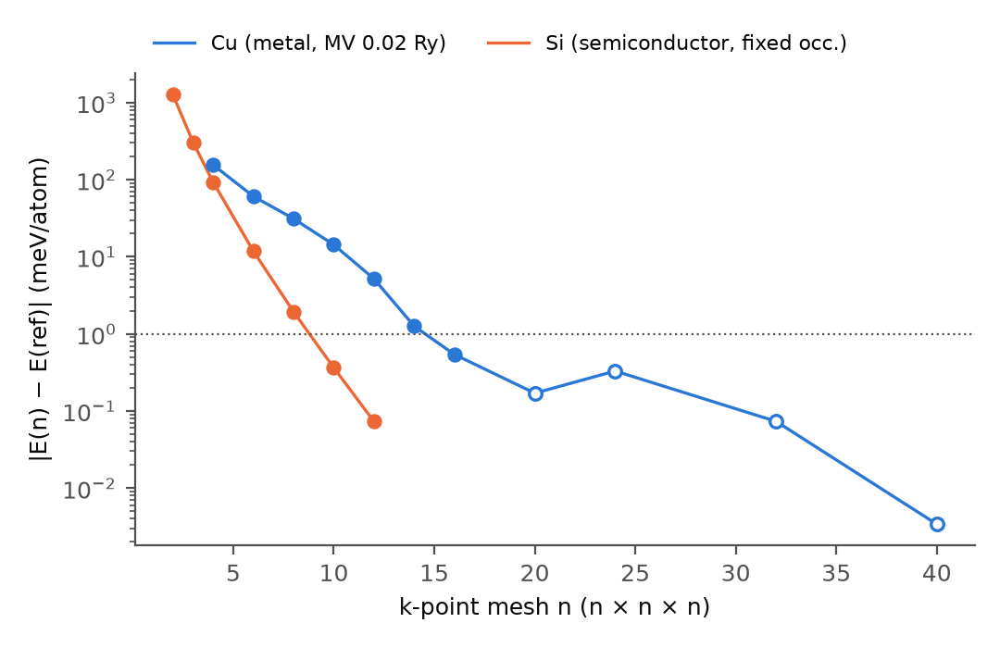
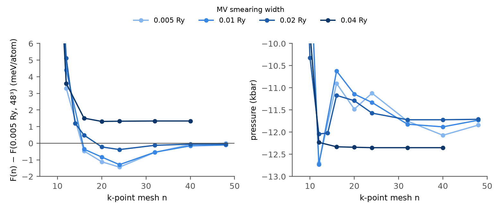
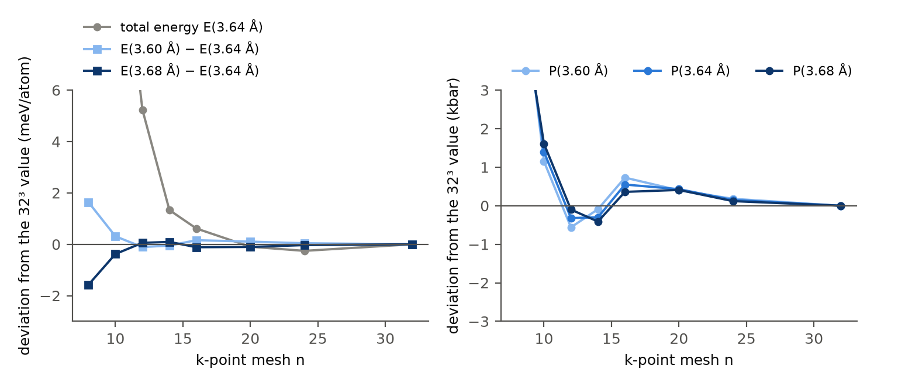
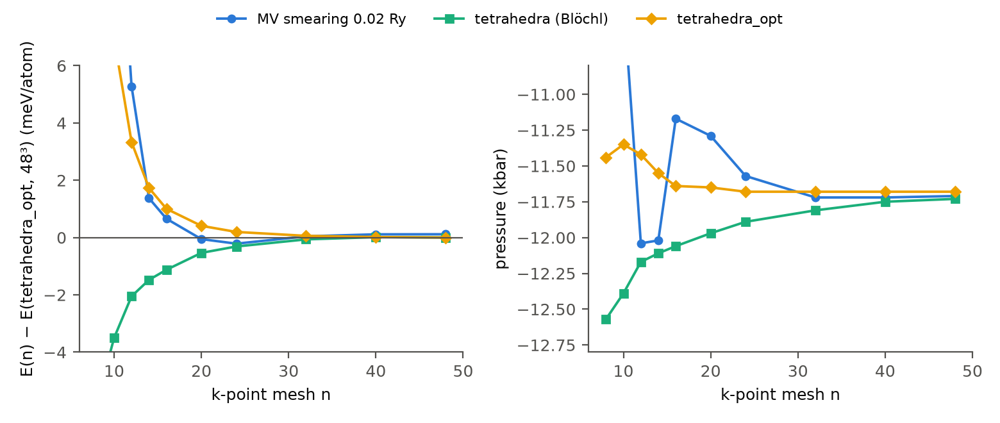

==============================================
k点はいくつ必要か：金属Cuと半導体Siの収束
==============================================

周期結晶の電子状態計算では、入力に「k点メッシュ」を指定します。\
実は多少メッシュが粗くても、何らかの計算結果は出てしまうものなのですが、運が悪いと、\
定性的にも誤った結果になるという事が起こります。\
したがって、十分にk点を増やして「収束した結果」を得る必要があるのですが、\
当然、メッシュを細かくすると、その分計算時間が増えることになります。\
本稿では、このk点とはいったい何か、どのくらいあれば十分なのか、\
という感覚を掴むための計算事例をご紹介します。

.. k点メッシュは、ブリルアンゾーン（BZ）全体にわたる積分を、有限個の点での値の和で近似するための点の集まりです。\
.. 和で積分を近似する精度は、被積分関数がどれだけ滑らかかで決まります。\
.. 半導体では、占有されたバンドはBZ全体で占有されたままなので、被積分関数は滑らかです。\
.. 金属では、絶対零度の占有数はフェルミ面を境に1から0へ飛ぶので、被積分関数に段差があります。\
.. 同じk点メッシュでも、金属と半導体では近似の精度が大きく違うはずです。

.. このページでは、金属の銅（Cu）と半導体のシリコン（Si）について、k点メッシュを細かくしながら全エネルギーと圧力を計算し、\
.. 収束の速さが物質と物理量によってどう違うかを調べます。\
.. 最後に、格子定数を求める計算に必要なk点メッシュとスメアリング幅を決めます。

.. _sec-kp-mesh:

k点メッシュ
===========

結晶の全エネルギーや電子密度を求めるには、各バンド・各波数 :math:`\boldsymbol{k}` の状態からの寄与を占有数で重み付けて、ブリルアンゾーン（BZ）全体にわたって積分する必要があります。\
実際の計算では、この積分を、BZを規則正しく覆う有限個のk点、つまり **k点メッシュ** での値の平均で近似します。

.. math::
   :label: kp-bz-average

   \frac{1}{\Omega_\mathrm{BZ}}\int_\mathrm{BZ} A(\boldsymbol{k})\,\mathrm{d}\boldsymbol{k}
   \;\approx\;
   \frac{1}{n^3}\sum_{\boldsymbol{k}\in\text{メッシュ}} A(\boldsymbol{k})
   \;=\;
   \sum_{i} w_i\,A(\boldsymbol{k}_i)

:math:`\Omega_\mathrm{BZ}` はBZの体積、 :math:`n` はBZを各方向に等分する数です。\
今回は、 :math:`\Gamma` 点を含む（オフセットなしの） :math:`n\times n\times n` メッシュを使います。\
最後の形は、対称性で等価な点をまとめた既約k点 :math:`\boldsymbol{k}_i` と重み :math:`w_i` による和です（ :numref:`{number}節 <sec-kp-irreducible>` ）。

和で積分を近似する精度は、被積分関数 :math:`A(\boldsymbol{k})` がどれだけ滑らかかで決まります。\
半導体・絶縁体では、占有バンドがBZ全体で占有されたままなので被積分関数は滑らかで、和は :math:`n` とともに指数関数的に速く収束するはずです。\
金属では、フェルミ面を境に占有数が1から0へ飛ぶため、被積分関数に段差があり、収束は遅く、誤差は符号を変えながら減ると予想されます。\
この段差を扱うために、占有数をなめらかにする **スメアリング** や、段差を含んだまま積分を近似する **テトラヘドロン法** が使われます。

許されるk点が結晶の周期性からどう決まるかは技術ノートの `周期境界条件とバンドの折り返し <https://technical-notes.quemix.com/solid/periodic_boundary.html>`__ に、等間隔の点の和の誤差が何で決まるか、スメアリングとテトラヘドロン法の考え方は `k点サンプリングとブリルアンゾーン積分 <https://technical-notes.quemix.com/solid/kpoint_sampling.html>`__ にまとめました。\
本稿では、これらの予想を、CuとSiの実際の計算で確かめます。

計算対象と計算条件
==================

計算するのは、面心立方（fcc）構造のCuと、ダイヤモンド構造のSiです。\
どちらも原始胞（Cuは1原子、Siは2原子）を使います。\
原始胞は、3辺の長さが立方晶の格子定数 :math:`a` の :math:`1/\sqrt{2}` で、辺のなす角がすべて60°のセルです。\
以下では、格子の大きさを立方晶の格子定数 :math:`a` で表します。

格子定数は、Cuが3.60、3.64、3.68 Å、Siが5.42、5.47、5.52 Åの3通りです。\
いずれもPBE汎関数で求まる格子定数の付近の値で、格子定数を変えたときのエネルギー差と圧力も調べるために3通り用意しました。\
k点メッシュは、BZを各方向に :math:`n` 等分した :math:`n\times n\times n` のメッシュで、 :math:`n` を変えて計算します。\
計算は平面波基底の第一原理計算コードQuantum ESPRESSO（QE） [1]_ [2]_ で行い、条件を :numref:`tab-kp-conditions` にまとめました。

.. list-table:: 計算条件
   :name: tab-kp-conditions
   :header-rows: 1
   :widths: 30 35 35

   * - 項目
     - Cu
     - Si
   * - 計算コード
     - Quantum ESPRESSO 7.5 [1]_ [2]_
     - 同左
   * - 交換相関汎関数
     - PBE [3]_
     - 同左
   * - 擬ポテンシャル
     - PAW（pslibrary 1.0.0 [4]_ ）
     - 同左
   * - セル
     - fcc、原始胞1原子
     - ダイヤモンド構造、原始胞2原子
   * - 格子定数 :math:`a`
     - 3.60、3.64、3.68 Å
     - 5.42、5.47、5.52 Å
   * - カットオフエネルギー
     - 波動関数 60 Ry、電荷密度 600 Ry
     - 同左
   * - k点メッシュ :math:`n`
     - 4〜32（3.64 Åでは48まで）
     - 2〜16
   * - 占有数
     - MVスメアリング [5]_ 、幅0.02 Ry
     - 固定
   * - SCF収束閾値
     - :math:`10^{-12}` Ry
     - 同左

擬ポテンシャルのファイルは、Cuが ``Cu.pbe-dn-kjpaw_psl.1.0.0.UPF`` 、Siが ``Si.pbe-n-kjpaw_psl.1.0.0.UPF`` です。\
MVはMarzari–Vanderbiltの略で、スメアリングについては :numref:`{number}節 <sec-kp-smearing>` で説明します。\
Cuの3.64 Åでは、スメアリング幅を0.005、0.01、0.04 Ryに変えた計算も行います。\
Cuでは、スメアリングのかわりにテトラヘドロン法を使った計算も行い、 :numref:`{number}節 <sec-kp-tetra>` で比べます。\
SCFの収束閾値を :math:`10^{-12}` Ryと厳しくしているのは、圧力を比べるためです。\
圧力（応力）は全エネルギーより収束が遅く、 :math:`10^{-9}` Ryでは、Cuの圧力が計算の設定により約1 kbarばらつきました（ :doc:`reproduction` の「計算と数値を扱う上での注意」）。\
以下では、エネルギーは1原子あたりの値をmeVで、圧力はQEの出力どおりkbar（10 kbar = 1 GPa）で示します。

.. _sec-kp-irreducible:

既約k点
=======

結晶に対称性があると、全エネルギーのようなスカラー量の被積分関数は、対称操作で互いに移り合うk点で等しくなります。\
そこで、メッシュの点を対称操作で移り合う組に分け、各組から1点（既約k点）だけを計算して、組の点の数に比例する重み :math:`w_i` をかけて足します（式 :eq:`kp-bz-average` の最後の形）。\
fccのCuとダイヤモンド構造のSiは、どちらも48個の対称操作を持つ立方晶の点群に属します。\
:numref:`tab-kp-irreducible-4` は、Cuの :math:`4\times4\times4` メッシュ（64点）を、QEが8個の既約k点にまとめた結果です。

.. list-table:: Cuの :math:`4\times4\times4` メッシュの既約k点（QEの出力から）
   :name: tab-kp-irreducible-4
   :header-rows: 1
   :widths: 34 26 20 20

   * - k点（ :math:`2\pi/a` 単位）
     - 位置
     - 同等な点の数
     - 重み :math:`w_i`
   * - (0, 0, 0)
     - :math:`\Gamma`
     - 1
     - 0.0156
   * - (−1/4, 1/4, −1/4)
     - :math:`\Gamma`–L上
     - 8
     - 0.1250
   * - (1/2, −1/2, 1/2)
     - L
     - 4
     - 0.0625
   * - (0, 1/2, 0)
     - :math:`\Gamma`–X上
     - 6
     - 0.0938
   * - (3/4, −1/4, 3/4)
     - —
     - 24
     - 0.3750
   * - (1/2, 0, 1/2)
     - :math:`\Gamma`–K上
     - 12
     - 0.1875
   * - (0, −1, 0)
     - X
     - 3
     - 0.0469
   * - (−1/2, −1, 0)
     - W
     - 6
     - 0.0938

重みは、同等な点の数を全点数64で割ったものです（QEの出力の ``wk`` は、スピンの縮退を含めて合計が2になるように書かれているので、表では2で割っています）。\
L点が4点、X点が3点と少なく見えるのは、BZの境界の点は逆格子ベクトルだけずれた点と同じ点なので、メッシュの中では重複して数えないためです。

メッシュを細かくしたときの既約k点の数と計算時間を :numref:`tab-kp-count` に示します。\
既約k点の数は、細かいメッシュではメッシュの点の数 :math:`n^3` の1/30〜1/40で、対称操作の数48に近い割合で減ります。\
大きなメッシュでは、計算時間はおおむね既約k点の数に比例して増えます。

.. list-table:: k点メッシュの点の数、既約k点の数、1回のSCF計算の時間
   :name: tab-kp-count
   :header-rows: 1
   :widths: 16 20 20 22 22

   * - :math:`n`
     - :math:`n^3`
     - 既約k点
     - 時間（Cu）
     - 時間（Si）
   * - 2
     - 8
     - 3
     - —
     - 5 秒
   * - 4
     - 64
     - 8
     - 2 秒
     - 7 秒
   * - 8
     - 512
     - 29
     - 3 秒
     - 7 秒
   * - 12
     - 1728
     - 72
     - 5 秒
     - 12 秒
   * - 16
     - 4096
     - 145
     - 8 秒
     - 18 秒
   * - 24
     - 13824
     - 413
     - 18 秒
     - —
   * - 32
     - 32768
     - 897
     - 39 秒
     - —
   * - 48
     - 110592
     - 2769
     - 125 秒
     - —

時間は、Cuは3.64 Å・スメアリング幅0.02 Ry、Siは5.47 Åの計算の、MPI 4並列での実行時間です（計算環境は :doc:`reproduction` ）。\
既約k点の数はCuとSiで同じです。

.. _sec-kp-energy:

全エネルギーの収束
==================

Cu（3.64 Å、スメアリング幅0.02 Ry）とSi（5.47 Å）の全エネルギーが、メッシュを細かくするとどう変わるかを :numref:`fig-kp-energy` に示します。\
縦軸は、最も細かいメッシュ（Cuは :math:`48^3` 、Siは :math:`16^3` ）の値との差の絶対値で、対数軸です。\
Cuの全エネルギーは、スメアリングを使った計算で最小化される自由エネルギー :math:`F` （ :numref:`{number}節 <sec-kp-smearing>` で説明します）です。

   全エネルギーの、最も細かいメッシュの値（参照値）との差 :math:`|E(n)-E(\mathrm{ref})|` （1原子あたり）。青はCu（3.64 Å、MVスメアリング0.02 Ry、参照は :math:`48^3` ）、オレンジはSi（5.47 Å、固定占有、参照は :math:`16^3` ）。塗りつぶしの点は参照値より高い、白抜きの点は低い値です。点線は1 meV/atom。

Siの差は、 :math:`n` を2増やすごとにおよそ1/5〜1/8になり、片対数のグラフでほぼ直線に並びます。\
:math:`8^3` で1.9 meV、 :math:`12^3` で0.07 meV/atomです。\
占有されたバンドのエネルギーはkの滑らかな周期関数なので、等間隔の点での平均（式 :eq:`kp-bz-average` ）が、点を増やすと指数関数的に速く正確になるためです。

Cuは、 :math:`n` が小さいうちは差が大きく、 :math:`4^3` で155 meV、 :math:`8^3` で31 meV/atomです。\
:math:`14^3` で1.3 meV、 :math:`16^3` で0.5 meVまで減りますが、そこから先は参照値より低い側に振れ、 :math:`24^3` の差（−0.33 meV）は :math:`20^3` の差（−0.17 meV）より大きくなります。\
k点を増やせば単調に正確になる、とは限らないのです。\
同じ1 meV/atomの精度を得るのに、Siは :math:`10^3` 、Cuは :math:`16^3` が必要で、既約k点の数では47点と145点です。

Quloudの「k グリッド」の既定値は4です。\
:math:`4\times4\times4` では、Cuで155 meV、Siで92 meV/atomのずれがあります。\
既定値のまま、全エネルギーの値を議論に使うことはできません。

金属では、 :numref:`{number}節 <sec-kp-mesh>` で見たように、フェルミ面付近の占有数が積分の精度に影響します。\
今回のCuではスメアリングによって占有数の段差は滑らかになっていますが、フェルミ面付近では依然として急に変化します。\
メッシュの点とその領域の位置関係が変わるため、誤差は正にも負にもなり、単調には減りません。

.. _sec-kp-smearing:

スメアリング幅
==============

金属の計算では、占有数の段差をならすために、占有数を幅 :math:`\sigma` のなめらかな関数に置き換えます（スメアリング）。\
このとき自己無撞着に最小化されるのは、全エネルギー :math:`U` から「スメアリングによるエントロピーの項」 :math:`TS` を引いた自由エネルギー :math:`F = U - TS` です。\
スメアリングの関数の種類と :math:`F` の性質は、技術ノートの `k点サンプリングとブリルアンゾーン積分 <https://technical-notes.quemix.com/solid/kpoint_sampling.html>`__ で説明しています。\
QEの出力では、 ``!`` で始まる行の ``total energy`` が :math:`F` 、 ``smearing contrib. (-TS)`` が :math:`-TS` 、 ``internal energy E=F+TS`` が :math:`U` です。\
:math:`\sigma \to 0` で、 :math:`F` も :math:`U` も、スメアリングのない本来の全エネルギーに近づきます（この極限の値は、 :numref:`{number}節 <sec-kp-tetra>` でテトラヘドロン法を使って確かめます）。

幅を広げるほど段差がなめらかになり、少ないk点で収束するはずですが、そのかわり :math:`\sigma \to 0` の値からずれます。\
今回使ったMarzari–Vanderbilt（MV）スメアリング [5]_ は、 :math:`F` の :math:`\sigma` への依存が小さくなるように作られた関数です。\
Cu（3.64 Å）で幅を0.005、0.01、0.02、0.04 Ryの4通りに変えた結果を :numref:`fig-kp-smearing` に示します。

   Cu（3.64 Å）のMVスメアリングの幅ごとの、自由エネルギー :math:`F` （左）と圧力（右）。左の縦軸は、幅0.005 Ry・ :math:`48^3` の :math:`F` との差（1原子あたり）で、4本の曲線に共通の基準です。幅0.04 Ryは :math:`40^3` まで計算しました。 :math:`n=8` の点は縦軸の範囲外です。

左の図から、2つのことが読み取れます。

* **収束の速さ。** 幅が狭いほど、 :math:`n` を増やしたときの振れが大きく、長く続きます。0.005 Ryと0.01 Ryでは :math:`24^3` でも基準から1.3〜1.4 meV離れていて、0.005 Ryは :math:`40^3` から :math:`48^3` の間でもまだ0.08 meV動いています。0.04 Ryは :math:`20^3` 以降、自分の収束値から0.03 meV以内に収まります。
* **収束する値。** 0.005、0.01、0.02 Ryの :math:`F` は、最も細かいメッシュで約0.1 meVの範囲にそろいます。0.04 Ryだけは、それより1.3 meV高い値に収束します。

圧力（右）でも同じ兼ね合いが見えます。\
0.04 Ryの圧力は :math:`16^3` 以降 −12.33〜−12.35 kbarで変わりませんが、狭い3つの幅の最も細かいメッシュでの値（−11.71〜−11.84 kbar）より0.5〜0.6 kbar低くなっています。

最も細かいメッシュでの :math:`F` 、 :math:`U` 、 :math:`-TS` を :numref:`tab-kp-smearing` にまとめます。

.. list-table:: Cu（3.64 Å）の、最も細かいメッシュでの自由エネルギー、全エネルギー、圧力
   :name: tab-kp-smearing
   :header-rows: 1
   :widths: 16 12 18 18 18 18

   * - 幅（Ry）
     - メッシュ
     - :math:`F` （meV/atom）
     - :math:`U` （meV/atom）
     - :math:`-TS` （meV/atom）
     - 圧力（kbar）
   * - 0.005
     - :math:`48^3`
     - 0.00
     - 0.09
     - −0.09
     - −11.84
   * - 0.01
     - :math:`48^3`
     - −0.10
     - 0.05
     - −0.16
     - −11.73
   * - 0.02
     - :math:`48^3`
     - −0.05
     - −0.45
     - 0.40
     - −11.71
   * - 0.04
     - :math:`40^3`
     - 1.34
     - −7.52
     - 8.86
     - −12.35

:math:`F` と :math:`U` は、幅0.005 Ry・ :math:`48^3` の :math:`F` との差です。\
幅0.04 Ryでは、 :math:`U` は7.5 meV下がり、 :math:`F` のずれ（1.3 meV）よりずっと大きくずれます。\
MVスメアリングでは、 :math:`\sigma \to 0` の値に近いのは :math:`F` （QEの ``!`` の行）のほうです。\
なお、MVスメアリングの :math:`-TS` は正にも負にもなり、物理的なエントロピーではありません。

この結果から、今回のCuでは、幅0.02 Ryが兼ね合いのよい選択です。\
収束値は狭い幅とほぼ同じ（ :math:`F` で0.1 meV、圧力で0.13 kbar以内）で、狭い幅より振れが小さく、早く収束します。

.. _sec-kp-differences:

エネルギー差と圧力
==================

格子定数や構造を比べる計算で必要なのは、全エネルギーそのものではなく、格子定数を変えたときのエネルギー差や、圧力です。\
これらの量は、全エネルギーと同じ速さで収束するのでしょうか。\
:numref:`fig-kp-differences` に、Cu（スメアリング幅0.02 Ry）の3つの格子定数の結果を示します。\
ここでは3つの格子定数で共通に計算した最も細かいメッシュ :math:`32^3` の値を基準にしました（3.64 Åでは、 :math:`32^3` と :math:`48^3` の差は全エネルギーで0.07 meV、圧力で0.01 kbarです）。

   Cu（MVスメアリング0.02 Ry）の、 :math:`32^3` の値からのずれ。左：3.64 Åの全エネルギー（灰色）と、格子定数を3.64 Åから ±0.04 Å変えたときのエネルギー差（青）。右：3つの格子定数での圧力。縦軸の範囲外の点（ :math:`n` が小さいもの）は描いていません。

左の図で、 :math:`12^3` では全エネルギーが5.2 meVずれているのに、エネルギー差のずれは0.1 meV程度です。\
:math:`12^3` から :math:`32^3` まで、 :math:`E(3.60\,\text{Å})-E(3.64\,\text{Å})` は2.93〜3.20 meV、 :math:`E(3.68\,\text{Å})-E(3.64\,\text{Å})` は8.02〜8.23 meVの範囲にあり、ずれは0.16 meV以内です。\
格子定数が少し違うだけの2つの計算では、同じメッシュによる誤差がほぼ同じだけ入るので、差をとると打ち消し合います。

右の図の圧力は、 :math:`12^3` 〜 :math:`20^3` で −0.6〜+0.7 kbarの範囲で振れ、 :math:`24^3` で0.2 kbar以内に収まります。\
3つの格子定数で、振れ方がほぼそろっていることにも注目してください。\
圧力の誤差は、エネルギー差の誤差と同じく、近い格子定数でほぼ共通です。\
ただし、圧力は「エネルギーの格子定数による傾き」なので、共通の誤差がそのまま残り、圧力が0になる格子定数をずらします。\
3.60 Åと3.68 Åの圧力の差から、圧力の格子定数による変化は約1100 kbar/Åです（ :math:`32^3` ）。\
圧力の誤差1 kbarは、格子定数の約0.001 Åのずれに相当します。

Siでは、エネルギー差も圧力も速く収束します。\
:math:`E(5.42\,\text{Å})-E(5.47\,\text{Å})` は :math:`8^3` で4.277、 :math:`16^3` で4.255 meV/atomで、5.47 Åの圧力は :math:`8^3` で −0.38 kbar、 :math:`10^3` 以降は −0.43 kbarで変わりません。

.. _sec-kp-tetra:

テトラヘドロン法との比較
========================

ここまでのCuの計算は、すべてスメアリングを使っていました。\
ここでは、スメアリングを使わない **テトラヘドロン法** で同じ計算を行い、スメアリングと比べます。\
テトラヘドロン法は、メッシュの点を頂点とする四面体でBZを埋め、その中でバンドのエネルギーを線形に補間して、占有数の段差を含んだまま積分する方法です（技術ノートの `k点サンプリングとブリルアンゾーン積分 <https://technical-notes.quemix.com/solid/kpoint_sampling.html>`__ ）。\
線形補間の誤差を補正したBlöchlらの方法 [6]_ と、補間を改良した最適化テトラヘドロン法 [7]_ の2つを使います。\
QEでは、入力の ``occupations`` を ``'tetrahedra'`` （Blöchlの方法）または ``'tetrahedra_opt'`` （最適化テトラヘドロン法）にすると使えます。\
Quloudの「電子占有数スメアリング」ではテトラヘドロン法を選べないので、入力ファイルを書き換えて計算しました（ :doc:`reproduction` ）。

Cuの3つの格子定数で、 :math:`n` = 8〜32（3.64 Åでは48まで）を、2つのテトラヘドロン法で計算しました。\
占有数のほかは :numref:`tab-kp-conditions` と同じ条件です。\
3.64 Åの全エネルギーと圧力を、MVスメアリング0.02 Ryの結果と並べて :numref:`fig-kp-tetra` に示します。

   Cu（3.64 Å）の、MVスメアリング0.02 Ry（青、丸）、Blöchlのテトラヘドロン法（緑、四角）、最適化テトラヘドロン法（黄、ひし形）による全エネルギー（左）と圧力（右）。左の縦軸は、最適化テトラヘドロン法の :math:`48^3` の値との差（1原子あたり）で、MVは自由エネルギー :math:`F` です。縦軸の範囲外の点（ :math:`n` が小さいもの）は描いていません。

**全エネルギー（左）。** 2つのテトラヘドロン法の値は、 :math:`48^3` で0.003 meV/atomの差で一致しました。\
スメアリング幅0の極限の値を、スメアリングとは別の方法で求めたことになります。\
MV 0.02 Ryの :math:`F` は、 :math:`48^3` でこれより0.12 meV/atom高い値です。\
:numref:`tab-kp-smearing` の基準（幅0.005 Ry・ :math:`48^3` の :math:`F` ）は、これより0.17 meV/atom高く、幅0.02 Ryの :math:`U` は0.28 meV/atom低い値なので、ここでも幅0の極限に近いのは :math:`F` のほうです。

収束の仕方は、スメアリングとはっきり違います。\
Blöchlの方法は下から、最適化テトラヘドロン法は上から、 :math:`n` を増やすと一方向に近づき、MVのように参照値をまたいで振れることはありません。\
ただし、収束の速さはMVと大きくは変わりません。\
自分の :math:`48^3` の値との差が1 meV/atom以内になるのは、MVが :math:`16^3` 、2つのテトラヘドロン法が :math:`20^3` からで、0.1 meV/atom以内になるのはどれも :math:`32^3` からです。

**圧力（右）。** 最適化テトラヘドロン法の圧力は、 :math:`14^3` で −11.55 kbar、 :math:`24^3` 以降は −11.68 kbarで変わりません。\
Blöchlの方法の圧力は、 :math:`8^3` の −12.57 kbarから :math:`48^3` の −11.73 kbarまで一方向にゆっくり変わり、 :math:`32^3` でもまだ0.08 kbar動いています。\
QEは、テトラヘドロン法で力や応力を計算すると、推奨しないという警告（ ``BEWARE: stress calculation with tetrahedra (not recommanded)`` ）を出力します。\
Blöchlの補正を加えたエネルギーは変分的でないため、そこから求めた応力は、スメアリングの場合ほど信頼できません。\
最も細かいメッシュでの圧力は、MV 0.02 Ryが −11.71、Blöchlの方法が −11.73、最適化テトラヘドロン法が −11.68 kbarで、0.05 kbarの範囲にそろいました。

**エネルギー差。** 格子定数を変えたときのエネルギー差は、テトラヘドロン法のほうが粗いメッシュで収束しました。\
:math:`32^3` の値との差が0.1 meV/atom以内に収まるのは、最適化テトラヘドロン法が :math:`8^3` 、Blöchlの方法が :math:`12^3` 、MVが :math:`24^3` からです。\
:math:`32^3` での値は、 :math:`E(3.60\,\text{Å})-E(3.64\,\text{Å})` が3.03〜3.05 meV/atom、 :math:`E(3.68\,\text{Å})-E(3.64\,\text{Å})` が8.12〜8.14 meV/atomで、3つの方法で0.02 meV以内に一致します。

:numref:`tab-kp-tetra` に、 :numref:`tab-kp-summary` と同じ基準で求めた、許容誤差に収まるメッシュと計算時間をまとめます。

.. list-table:: Cuで許容誤差に収まるk点メッシュ :math:`n` と、 :math:`24^3` の計算時間
   :name: tab-kp-tetra
   :header-rows: 1
   :widths: 28 18 18 18 18

   * - 方法
     - 全エネルギー（1 meV）
     - エネルギー差（0.1 meV）
     - 圧力（0.2 kbar）
     - 時間（ :math:`24^3` ）
   * - MV 0.02 Ry
     - 16
     - 24
     - 24
     - 18 秒
   * - Blöchl
     - 20
     - 12
     - 20
     - 38 秒
   * - 最適化
     - 20
     - 8
     - 14
     - 56 秒

全エネルギーは自分の :math:`48^3` の値、エネルギー差と圧力（3.64 Å）は :math:`32^3` の値との差で判定しました。\
テトラヘドロン法は、同じメッシュでもMVより時間がかかります（ :math:`24^3` で2〜3倍、 :math:`48^3` では4倍以上）。\
テトラヘドロン法では、既約k点だけでなく、メッシュ全体の四面体（ :math:`6n^3` 個）を扱います。\
SCFの各反復で占有数の重みを計算する時間（QEの出力の ``sum_band:wei`` ）が :math:`24^3` で9〜16秒かかり、SCFの最初の反復が始まるまでの時間も、MVの1秒に対して7〜8秒でした。\
:math:`48^3` では、最初の反復が始まるまでに4〜5分かかりました（MVは4秒）。

格子定数を求めるという目的では、最適化テトラヘドロン法は :math:`14^3` （既約k点104点、17秒）で、MV 0.02 Ryの :math:`24^3` （413点、18秒）と同じ精度に届きます。\
計算時間はほぼ同じで、Quloudの画面では選べず、QEも応力の計算には推奨していないので、格子定数の計算にはMVスメアリングを使います。\
テトラヘドロン法は、スメアリング幅の影響を受けない参照値を得たいときや、状態密度（DOS）の計算に向いています。\
QuloudのDOS計算でも、SCFのあとのNSCF計算ではテトラヘドロン法が使われます。

.. _sec-kp-choice:

必要なk点メッシュ
=================

ここまでの結果を、量ごとに「どのメッシュから許容誤差に収まるか」でまとめます（ :numref:`tab-kp-summary` ）。\
表の :math:`n` は、そのメッシュと、それより細かい計算したすべてのメッシュで、参照値との差が許容誤差以内になる最小の :math:`n` です。\
参照値は、Cuの全エネルギーは :math:`48^3` 、Cuのエネルギー差と圧力は :math:`32^3` 、Siはすべて :math:`16^3` の値です。

.. list-table:: 許容誤差に収まるk点メッシュ :math:`n`
   :name: tab-kp-summary
   :header-rows: 1
   :widths: 34 22 22 22

   * - 量
     - 許容誤差
     - Cu（MV 0.02 Ry）
     - Si
   * - 全エネルギー
     - 1 meV/atom
     - 16
     - 10
   * - 全エネルギー
     - 0.1 meV/atom
     - 32
     - 12
   * - エネルギー差（ :math:`a` を約1 %変えたとき）
     - 0.1 meV/atom
     - 24（12以降は0.16以内）
     - 8
   * - 圧力
     - 0.5 kbar
     - 20
     - 8
   * - 圧力
     - 0.2 kbar
     - 24
     - 8

必要なメッシュは、物質と同じくらい、何を求めたいかで変わります。\
例えば、Cuの格子定数をエネルギーの曲線や圧力から0.001 Åの桁まで求めたいなら、圧力の誤差を1 kbarより十分小さくしたいので、 :math:`24^3` が目安になります。\
このとき、全エネルギーの値そのものは0.3 meV/atomずれていますが、格子定数を決めるのに使うエネルギー差と圧力は十分に収束しています。\
Siなら :math:`8^3` 〜 :math:`10^3` で足ります。

そこで、Cuの格子定数を求める計算では、MVスメアリング0.02 Ry、 :math:`24\times24\times24` メッシュを使うことにします。\
既約k点は413点で、1回のSCF計算は約18秒（MPI 4並列）です。

この条件で、Cuの格子定数をエネルギー曲線と応力の2つの方法で求めた結果は、 :doc:`../cu_lattice/lattice_constant` で紹介します。

この数値実験から分かること
==========================

* k点メッシュは、BZ平均を等間隔の点の和で近似するためのもので、結晶の対称性を使うと、計算する点（既約k点）をメッシュの点の数の1/30〜1/40に減らせました。
* 半導体のSiの全エネルギーは、メッシュを細かくすると指数関数的に速く収束しました。金属のCuは、スメアリングを使ってもフェルミ面付近の占有数の変化が急なため、収束が遅く、細かくするほど正確になるとは限りませんでした。1 meV/atomの精度に必要な既約k点の数は、SiとCuで約3倍違いました。
* スメアリングの幅を広げると収束は速くなりますが、収束する値が幅0の極限からずれます。今回のCuでは、MVスメアリング0.02 Ryで、狭い幅とほぼ同じ値に、より早く収束しました。
* 格子定数を変えたときのエネルギー差は、全エネルギーより粗いメッシュで収束しました。圧力の誤差は近い格子定数で共通に入るので、そのまま格子定数のずれになります。必要なメッシュは、求めたい量と精度で決まります。
* スメアリングを使わないテトラヘドロン法では、全エネルギーは振れずに一方向から収束し、スメアリング幅0の極限の値が得られました。収束に必要なメッシュはMVと同程度でしたが、最適化テトラヘドロン法では、エネルギー差と圧力がより粗いメッシュで収束しました。ただし同じメッシュでは計算時間が長く、格子定数を求める計算の時間は、MVとほぼ同じでした。

今回の結果は、Cu、Siと、 :numref:`tab-kp-conditions` の計算条件（擬ポテンシャル、カットオフ、Γ点を含むメッシュ）についてのものです。\
メッシュのオフセットや、ほかのスメアリングの方式（Gaussian、Methfessel–Paxtonなど）は調べていません。\
ほかの物質では、セルの大きさやフェルミ面の形によって必要なメッシュは変わるので、同じように収束を確かめてください。

参考文献
========

.. [1] P\. Giannozzi *et al.*, "QUANTUM ESPRESSO: a modular and open-source software project for quantum simulations of materials," *Journal of Physics: Condensed Matter* **21**, 395502 (2009). https://doi.org/10.1088/0953-8984/21/39/395502
.. [2] P\. Giannozzi *et al.*, "Advanced capabilities for materials modelling with Quantum ESPRESSO," *Journal of Physics: Condensed Matter* **29**, 465901 (2017). https://doi.org/10.1088/1361-648X/aa8f79
.. [3] J\. P. Perdew, K. Burke, and M. Ernzerhof, "Generalized Gradient Approximation Made Simple," *Physical Review Letters* **77**, 3865 (1996). https://doi.org/10.1103/PhysRevLett.77.3865
.. [4] A\. Dal Corso, "Pseudopotentials periodic table: From H to Pu," *Computational Materials Science* **95**, 337–350 (2014). https://doi.org/10.1016/j.commatsci.2014.07.043
.. [5] N\. Marzari, D. Vanderbilt, A. De Vita, and M. C. Payne, "Thermal Contraction and Disordering of the Al(110) Surface," *Physical Review Letters* **82**, 3296 (1999). https://doi.org/10.1103/PhysRevLett.82.3296
.. [6] P\. E. Blöchl, O. Jepsen, and O. K. Andersen, "Improved tetrahedron method for Brillouin-zone integrations," *Physical Review B* **49**, 16223 (1994). https://doi.org/10.1103/PhysRevB.49.16223
.. [7] M\. Kawamura, Y. Gohda, and S. Tsuneyuki, "Improved tetrahedron method for the Brillouin-zone integration applicable to response functions," *Physical Review B* **89**, 094515 (2014). https://doi.org/10.1103/PhysRevB.89.094515
