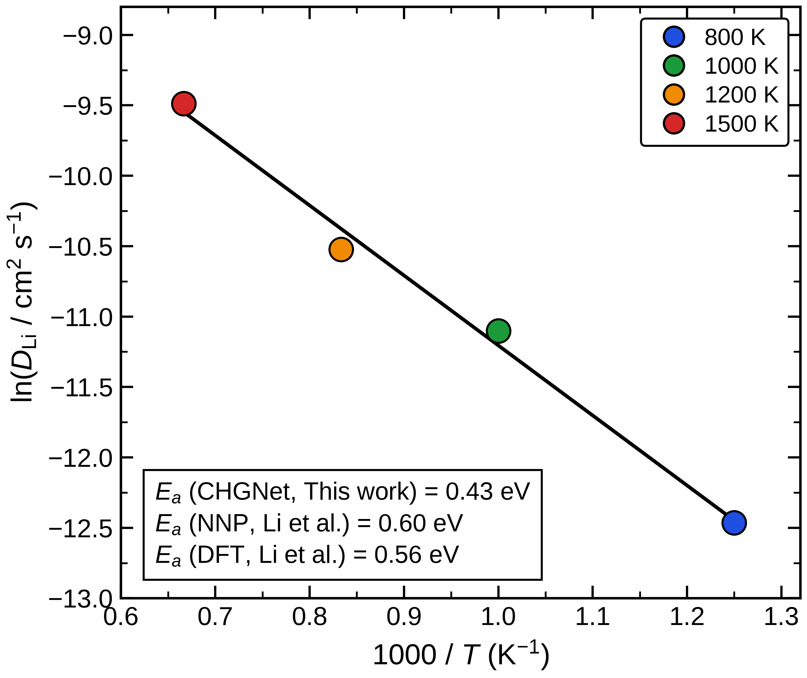

.. _li3po4-doc-diffusivity-temperature:

拡散係数の温度依存性
====================

温度を上げると、Li空孔を含むモデルでLiの拡散係数はどれだけ大きくなるでしょうか。
31原子モデルをCHGNetで計算すると、800～1500 Kで拡散係数が増え、拡散の活性化エネルギーは0.43 eVでした。
これは文献の長時間NNP-MDの値（0.59 eV）より0.16 eV低く、この温度範囲では拡散係数の温度依存性が文献計算より緩やかです。

31原子のLi空孔モデルを、CHGNetによる分子動力学（MD）で4つの温度について計算しました。
各温度の拡散係数 :math:`D_{\mathrm{Li}}` は、 :numref:`{number}. {name} <li3po4-doc-lithium-msd>` で見た平均二乗変位（MSD）の傾きから求めます。

:numref:`li3po4-diffusivity-31atoms` では、横軸に逆温度 :math:`1000/T`、縦軸に拡散係数の自然対数を取ります。
アレニウス式に従う場合、プロットは直線となり、その傾きの絶対値が大きいほど拡散の活性化エネルギーが高くなります。
図の4点を直線で近似すると、活性化エネルギーは0.43 eVとなります。

.. _li3po4-diffusivity-31atoms:

   31原子モデルのLi拡散係数。点は本計算、黒線はアレニウス式による近似。
   図中の文献値「NNP 0.60 eV」「DFT 0.56 eV」は、各手法で求めた移動経路と障壁を使った速度論的モンテカルロ（KMC）の値です。

文献のKMCの活性化エネルギーは、NNPの経路を使う場合で0.602 eV、DFTの経路を使う場合で0.561 eVです。後者と本計算との差は0.131 eVです。
文献の長時間NNP-MDとKMCでも、同じ小セルで拡散係数の絶対値に差があります。著者らは、KMCで全遷移に共通の試行頻度を設定した近似を一因に挙げています。 `Liらの図7とその解説 <https://doi.org/10.1063/1.4997242>`__

まとめ
------

CHGNetで求めた活性化エネルギー0.43 eVは、文献の長時間NNP-MDの0.59 eVより低くなりました。
拡散の活性化エネルギーは、Liが多数回移動したときの拡散係数の温度依存性を表します。
各温度での拡散係数の絶対値を比べるには、構造、ポテンシャル、軌跡長、拡散係数の算出条件を確認します。
特に800 Kではホップが少ないと拡散係数が観測時間に敏感になるため、平均二乗変位から傾きが安定して得られるかを確認する必要があります。
