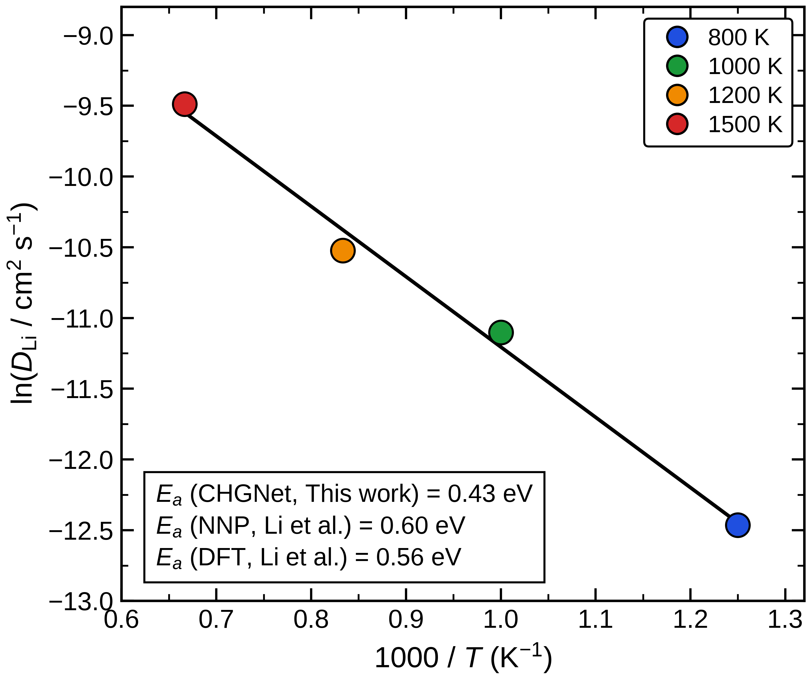

================================
拡散係数の温度依存性
================================

   本計算：31原子Li空孔モデルのCHGNet-MDによる拡散係数。

図の800–1500 Kの点は概ね直線的なアレニウス関係を示し、
図示されたフィットの活性化エネルギーは0.43 eVである。
`文献図7 <https://doi.org/10.1063/1.4997242>`_ の長時間NNP-MDは約0.59 eV、
文献KMCはNNP経路で0.602 eV、DFT経路で0.561 eVであり、
本計算の温度依存性はこれらより緩やかである。

長時間NNP-MDの0.59 eVとの差は0.16 eV、文献KMCのDFT経路
（0.561 eV）との差は0.131 eVである。文献では同じ小セルの
NNP-MDとKMCでも拡散係数の絶対値に差があり、その一因を
KMCで全遷移に共通のホップ頻度を用いた近似に求めている。
したがって本図の0.43 eVは温度依存性を比較する量であり、
個々の空孔移動経路の障壁や空孔形成エネルギーとは同一視しない。

この比較は傾きから得た活性化エネルギーに限る。
モデル構造、ポテンシャル、軌跡長と拡散係数の評価条件が異なるため、
各温度の拡散係数の絶対値が一致するかはこの図だけでは判断できない。
とくに800 Kの拡散係数はホップ数と観測時間に敏感なため、
図の直線性だけで低温側の統計収束を保証できない。

まとめ
------

本計算の31原子モデルの活性化エネルギー0.43 eVは、文献の長時間NNP-MD値
約0.59 eVより低い。拡散係数の定量比較には、特に低温側のホップ統計と
構造・軌跡条件をそろえた検証が必要である。
