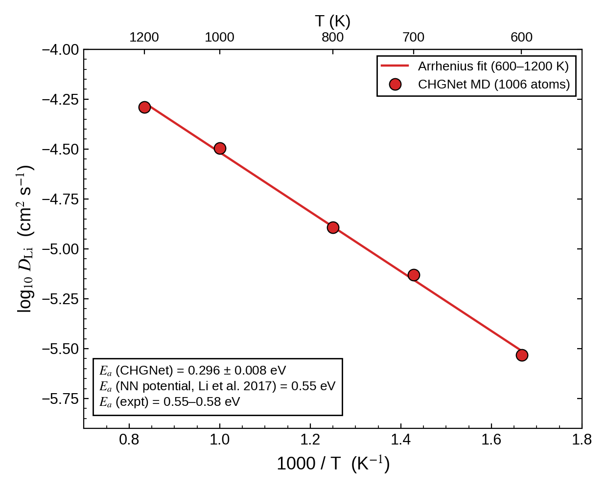

.. _li3po4-doc-large-model-diffusivity:

大規模モデルのLi拡散係数
========================

文献と同じ組成・原子数のモデルを使うと、Li拡散の温度依存性はどこまで一致するでしょうか。\
1006原子モデルの活性化エネルギーはCHGNetで0.296 eVでした。文献NNP-MDの0.55 eVと、薄膜実験で得られた0.55～0.58 eVを下回ります。

.. raw:: html

   

1006原子モデルの拡散係数
------------------------

:numref:`{number}. {name} <li3po4-doc-large-structure-rdf>` の1006原子モデル（Li₃₇₂P₁₂₈O₅₀₆）を、QuloudのGPU上でCHGNetを使って計算しました。\
:numref:`li3po4-diffusivity-1006atoms` の600、700、800、1000、1200 Kの5点を直線で近似し、拡散の活性化エネルギーとして :math:`0.296\pm0.008` eVを得ました。\
±0.008 eVはこの直線近似の不確かさです。構造の選び方、軌跡長、拡散係数を求める時間範囲の影響は別途評価する必要があります（技術ノートの\ `平均二乗変位の解釈と限界 <https://technical-notes.quemix.com/md/diffusion.html#msd-interpretation-limits>`__）。

.. _li3po4-diffusivity-1006atoms:

   1006原子モデルのLi拡散係数。赤丸は本計算、赤線はアレニウス式による近似。\
   縦軸は拡散係数の常用対数で、 :numref:`li3po4-diffusivity-31atoms` の縦軸は自然対数です。常用対数の軸での傾きの換算は技術ノートの\ `アレニウス式 <https://technical-notes.quemix.com/md/thermal_activation.html#arrhenius-equation>`__\ にあります。

文献・実験との比較
------------------

文献NNP-MDも同じ組成と原子数で600～1200 Kを調べ、活性化エネルギーは0.55 eVでした。薄膜実験では、二次イオン質量分析（SIMS）から0.57～0.58 eV、インピーダンス測定から0.55 eVが報告されています（SIMSのトレーサー拡散係数とインピーダンス測定の伝導度の対応は技術ノートの\ `トレーサー拡散係数とイオン伝導度 <https://technical-notes.quemix.com/md/diffusion.html#tracer-diffusion-and-conductivity>`__）。 `Liらの図11とその解説 <https://doi.org/10.1063/1.4997242>`__

本計算の活性化エネルギーは、文献NNP-MDより0.254 eV、実験値より0.254～0.284 eV低いです。文献計算との差は、本計算の直線近似の不確かさより大きく、両計算の原子数は同じです。\
また、 :numref:`{number}. {name} <li3po4-doc-diffusivity-temperature>` の0.43 eVより0.134 eV低いです。31原子モデルとは組成や作製した構造も異なるため、サイズの影響を調べるには他の条件をそろえた比較が必要です。

まとめ
------

同じ組成・原子数でも、CHGNetの活性化エネルギーは文献NNP-MDの値を下回り、拡散係数の温度依存性は緩やかでした。\
図で比較した活性化エネルギーは直線の傾きから求めた値なので、各温度での拡散係数の絶対値を比べるには、文献・実験の拡散係数そのものと照合する必要があります。
