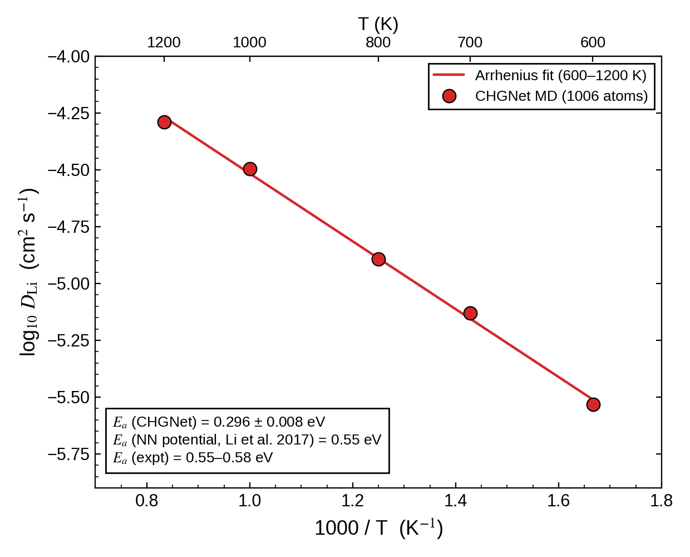

====================================
大規模モデルのLi拡散係数
====================================

Quloud上のGPUを用いて1006原子モデルのCHGNet-MDを実行し、
Li拡散係数の温度依存性を評価した。

Quloud GPU計算の結果
----------------------------

   本計算：1006原子モデルのCHGNet-MDによるLi拡散係数。

本計算図の600–1200 Kの5点はほぼ直線上にあり、
アレニウスフィットから :math:`E_a=0.296\pm0.008` eVを得ている。

文献・実験との比較
----------------------------

`文献図11 <https://doi.org/10.1063/1.4997242>`_ の1006原子NNP-MDでは
0.55 eV、実験ではSIMSの0.57–0.58 eVとインピーダンス由来の
0.55 eVが報告されている。

両者の1006原子モデルは図中の組成もLi₃₇₂P₁₂₈O₅₀₆で一致し、
評価温度も600–1200 Kに重なる。それでも文献NNP-MDの0.55 eVとの差は
0.254 eVであり、原子数の違いだけには帰せない。文献の実験値
0.55–0.58 eVとの差は0.254–0.284 eVである。小さい31原子
空孔モデルの本計算値0.43 eVよりも0.134 eV低いが、両モデルは
組成と作成した構造が異なるため、この差をサイズ効果と断定しない。

したがって、同程度のモデルサイズでもCHGNetが文献の温度依存性を
再現したとは言えない。図に文献・実験の拡散係数の点は重ねていないため、
絶対値の一致は判断しない。また、高温のフィットを室温へ外挿する際には
構造・組成・軌跡長による影響を別途確認する必要がある。
図中の±0.008 eVは表示された直線フィットの不確かさであり、
構造の選び方、軌跡長、拡散係数の算出窓による系統差を含むとは限らない。

まとめ
------

1006原子CHGNet-MDの活性化エネルギー0.296 eVは、文献NNP-MDの
0.55 eVと実験の0.55–0.58 eVより低い。
フィットの不確かさだけではこの差を説明できず、構造とMD評価条件を
そろえた追加検証が必要である。
