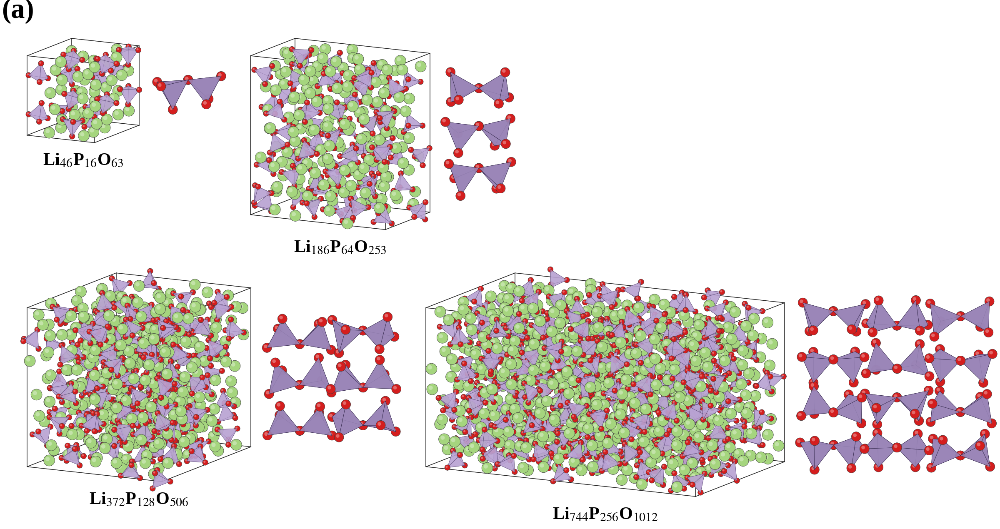
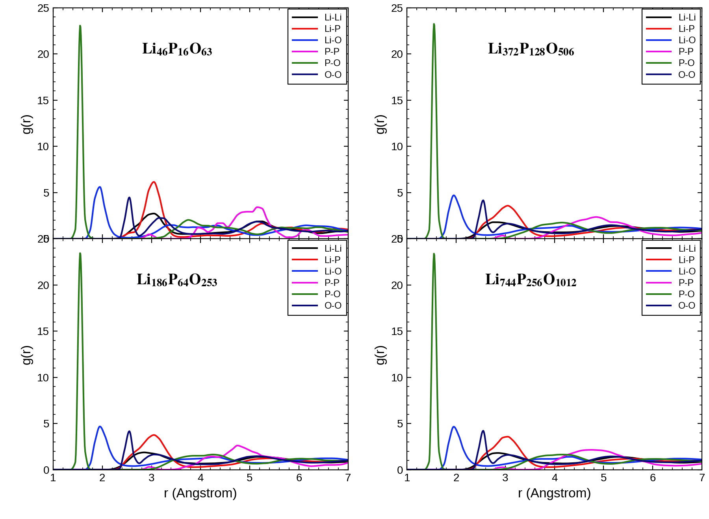

.. _li3po4-doc-large-structure-rdf:

大規模構造とRDF
===============

モデルを大きくすると、溶融・急冷後の原子対の距離分布はどう変わるでしょうか。\
CHGNetで作った503、1006、2012原子のモデルでは部分RDFの曲線がおおむね一致し、125原子モデルではLi–PやP–Pのピークの形に違いが見られました。\
P–Oの第一ピークは、どのモデルでも約1.5 Åに現れました。

.. raw:: html

   

構造と局所配位
--------------

QuloudのGPU上でCHGNetによる分子動力学を実行し、125、503、1006、2012原子の構造を\ `溶融・急冷 <https://technical-notes.quemix.com/md/heating_simulation.html#melt-quench>`__\ で作りました。\
:numref:`li3po4-large-structures` に、溶融・急冷後の各セルの原子配置を示します。

.. _li3po4-large-structures:

   CHGNetによる溶融・急冷後の構造。上段左から125、503原子、下段左から1006、2012原子。\
   各セルの右に、酸素を共有してつながるPO₄四面体の例を示します。

:numref:`li3po4-rdf-large-models` では、300 KのMD軌跡から求めた部分RDFを比べます。\
503、1006、2012原子モデルでは、6種類の部分RDFはおおむね同じ形です。\
125原子モデルでは、約3 ÅのLi–Pのピークと2 Å弱のLi–Oの第一ピークが、ほかのモデルより高くなります。P–Pにも4～5.5 Åに複数の山が見られます。\
約1.5 Åの鋭いP–Oの第一ピークは、4つのモデルに共通するリン酸四面体内の結合距離に対応します。

.. _li3po4-rdf-large-models:

   Li–Li、Li–P、Li–O、P–P、P–O、O–Oの部分RDF（300 Kの5 psの軌跡で平均）。\
   左上から縦に125、503原子、右上から縦に1006、2012原子のモデル。横軸は原子対の距離（Å）です。

文献との比較
------------

本計算の組成から求めたLi/P比は、125原子モデルで2.875、ほかの3つで約2.906です。文献が模した薄膜の実測値（約2.9）に近く、125、503、1006原子モデルは文献と組成・原子数がそろっています。溶融・急冷の履歴もそろっているかは確認が必要です。

文献では、125原子モデルに部分的な結晶秩序が残り、503、1006原子モデルでは結晶的な並びが見られなくなりました。\
また、2つのPO₄四面体が酸素を1個共有するP₂O₇二量体を見いだし、薄膜の赤外分光の結果と整合することを報告しています。 `Liらの図10とその解説 <https://doi.org/10.1063/1.4997242>`__

本計算でも125原子モデルだけ部分RDFがほかと異なり、文献で125原子モデルにだけ結晶秩序が残ったことと同じ傾向です。ただし、結晶秩序が残ったかどうかは部分RDFだけでは判断できず、原子の配列を定量的に調べる必要があります。

まとめ
------

503原子以上の3つのモデルで部分RDFがおおむね一致し、P–Oの第一ピークは125原子モデルも含めて約1.5 Åに現れました。\
セルサイズに対して構造の特徴が収束したか、実験試料とどこまで対応するかを評価するには、RDFと構造図に加えて、結晶秩序や\ `四面体の連結性 <https://technical-notes.quemix.com/md/rdf.html#polyhedral-connectivity>`__\ を定量化し、P₂O₇二量体の割合などを調べる必要があります。 \
:numref:`{number}. {name} <li3po4-doc-large-model-diffusivity>` では、1006原子モデルでLiの拡散を調べます。
