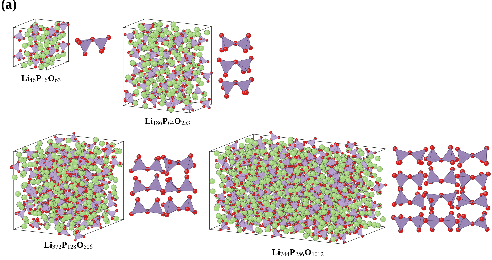
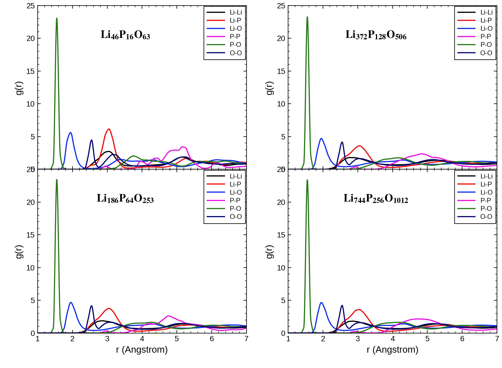

============================
大規模構造とRDF
============================

Quloud上のGPUを用いたCHGNetのMD計算で大規模構造を作成し、
300 Kの軌跡から部分RDFを評価した。構造と局所的な原子配置を、
モデルサイズを変えて比較する。

Quloud GPU計算の結果
----------------------------

   本計算：CHGNetによる125、503、1006、2012原子モデルの構造。

125原子モデルでは局所配置の反復が目立つ一方、
大きい構造では長距離の配列が視覚的に不規則になる。

   本計算：各構造の300 KのMDから得た部分RDF（スライド記載の平均時間は5 ps）。

部分RDFでは、モデルサイズによらずP–Oの第一ピークが約1.5 Åに鋭く残り、
リン酸四面体の短距離結合が維持される。Li–OやP–Pなど、より長い距離の
ピーク形状にはサイズによる差がある。

文献との比較
----------------------------

`文献図10 <https://doi.org/10.1063/1.4997242>`_ も、125原子では
部分的な結晶秩序が残り、503・1006原子では不規則性が増すと報告する。
本計算には2012原子モデルも含まれる。ただし、見た目とRDFだけで
実験試料との構造的一致やサイズ収束を確定することはできない。

図の組成から計算したLi/P比は125原子で2.875、503・1006・2012原子で
約2.906となり、論文が模した薄膜の実測値約2.9に近い。文献の
125・503・1006原子モデルと組成・サイズが対応するので構造傾向を
比較しやすいが、同じ溶融急冷履歴を経たことまでは意味しない。
文献は大きい二つのモデルで部分結晶化が解消し、PO₄四面体に加えて
頂点共有のP₂O₇二量体を認め、赤外分光との整合も述べた。
本計算図にも頂点共有型の例が描かれているものの、二量体の存在率や
実験との一致には結合判定・連結性の定量解析が必要である。

まとめ
------

大きいモデルほど長距離の規則性は見えにくくなる一方、P–Oの第一殻は残る。
非晶質構造のサイズ収束やP₂O₇二量体の存在率は、RDFと画像に加えて
結合・連結性の定量評価で確かめる必要がある。
