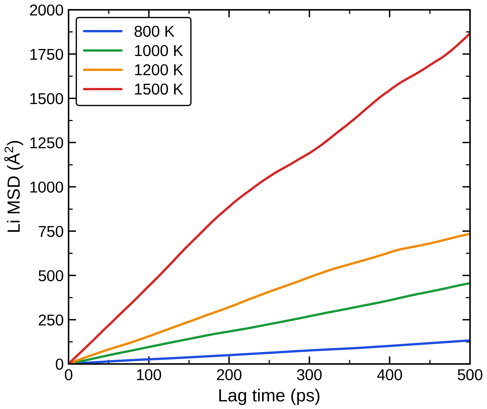

==========================
Liの平均二乗変位
==========================

   本計算：31原子Li空孔モデルのLi平均二乗変位（MSD）。

図では800、1000、1200、1500 Kの順にMSDの増加が大きく、
高温ほどLiの移動が速い。横軸は最大500 psのラグ時間を示し、
1000–1500 Kの曲線は広い範囲で増加する。一方、
個々の曲線の傾きと誤差を確定するには、フィット範囲と平均化手順の確認が必要である。

`文献図8 <https://doi.org/10.1063/1.4997242>`_ は50 psの軌跡を用い、
800 Kではホップ数不足による非線形性を指摘した。本計算図は500 psまで示すため、
文献の短時間800 K曲線をそのまま重ねた比較ではない。

論文の800 K曲線は50 psでは非線形だが、補足資料の1 ns計算では
ほぼ線形となり、観測時間の重要性を示した。本計算の800 K曲線も
500 psのラグ時間まで増加を続けるため、短い窓だけで拡散を判断しない
という点では論文と整合する。ただし、横軸の最大値は独立なホップ数や
統計誤差を示さない。高温側を含め、拡散係数の比較には直線領域の選択と
複数の時間起点または独立軌跡で得た傾きのばらつきが必要である。

まとめ
------

LiのMSDは高温ほど速く増え、温度上昇による移動の促進を示す。
拡散係数の確定には、直線領域の選択とホップ数・傾きの統計収束を確認する。
