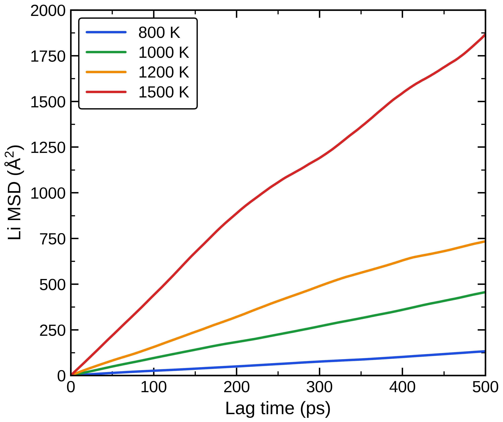

.. _li3po4-doc-lithium-msd:

Liの平均二乗変位
================

Liイオンは、同じ時間にどれだけ移動するでしょうか。
Li空孔を1つ含む31原子モデル（Li₁₁P₄O₁₆）では、800、1000、1200、1500 Kの順にLiの平均二乗変位（MSD）の増加が速くなりました。

MSDは、ある時間間隔の前後でLiの位置の差を取り、その大きさの二乗をLi原子や観測の起点について平均した量です。
:numref:`li3po4-msd-31atoms` の横軸には、この時間間隔（ラグ時間）を取ります。
三次元の拡散係数は、MSDが時間に比例する領域の傾きの6分の1です。
:numref:`{number}. {name} <li3po4-doc-diffusivity-temperature>` では、こうして求めた拡散係数を温度に対して並べます。

.. _li3po4-msd-31atoms:

   31原子のLi空孔モデルでの平均二乗変位（Ų）。横軸は最大500 psのラグ時間。
   各曲線は800 K（青）、1000 K（緑）、1200 K（橙）、1500 K（赤）のMDに対応します。

1000～1500 Kでは、広い時間範囲でMSDが増加します。800 Kでも500 psまで増え続けますが、傾きは小さいです。
図の横軸から読み取れるのは観測した時間間隔です。傾きの不確かさを評価するには、ホップ（Liのサイト間移動）の回数や軌跡の平均化手順を確認する必要があります。

Liらは、50 psの軌跡から求めた800 KのMSDが直線から外れる理由を、ホップ数の少なさで説明しました。
同じ温度で1 nsまで計算すると、MSDはほぼ直線になりました。ホップがまれな温度では、十分な回数を観測できる時間が必要です。 `Liらの図8と補足資料の図S2 <https://doi.org/10.1063/1.4997242>`__

まとめ
------

MSDは高温ほど速く増え、Liが同じ時間により広い範囲を移動することが分かります。
拡散係数を評価するには、MSDが時間に比例する範囲を選び、複数の時間起点や独立な軌跡から求めた傾きのばらつきを調べます。
