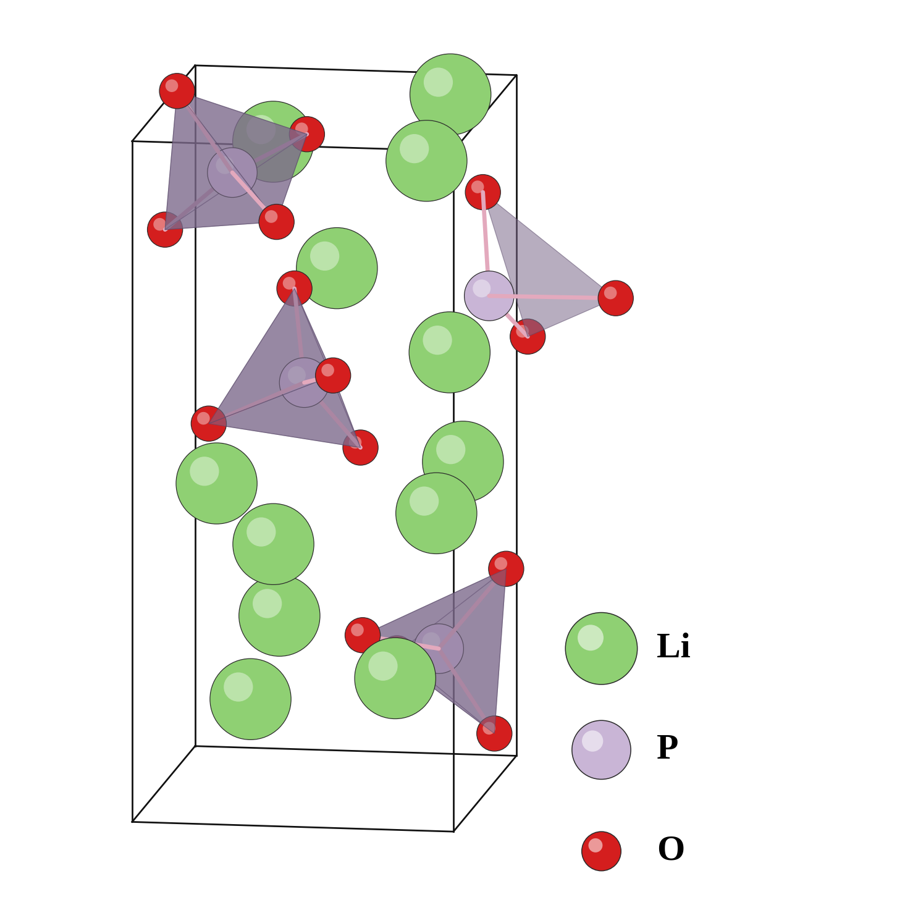

.. _li3po4-doc-melt-quench-structure:

溶融・急冷後の構造
==================

γ相のLi₃PO₄を溶かして急冷すると、原子の並びはどう変わるでしょうか。
OpenMXで32原子のモデルを作ると、初期の結晶に比べてPO₄四面体の向きとLiの配置が乱れました。
この構造を :numref:`{number}. {name} <li3po4-doc-vacancy-formation>` 以降の小セルの計算に使います。

32原子モデル
------------

γ相の単位胞を出発点とし、第一原理分子動力学（AIMD）で高温保持、急冷、300 Kでの保持を行いました。
その後、セルの大きさと形を固定し、DFTで原子座標を緩和しました。 :numref:`li3po4-relaxed-32atoms` に緩和後の構造を示します。

.. _li3po4-relaxed-32atoms:

   OpenMXで溶融・急冷し、原子座標を緩和した32原子モデル（Li₁₂P₄O₁₆）。
   緑の球はLi、紫の球はP、赤の球はOを表します。紫の多面体はPO₄四面体です。

文献との比較
------------

本計算と文献の32原子モデルについて、溶融・急冷の各段階にかけた時間を :numref:`li3po4-melt-quench-times` に示します。 `Liらの図3とその解説 <https://doi.org/10.1063/1.4997242>`__

.. _li3po4-melt-quench-times:

.. list-table:: 溶融・急冷の時間
   :header-rows: 1
   :align: center
   :class: table-sm

   * - 段階
     - 本計算
     - 文献（図3）
   * - 高温保持
     - 1.20 ps
     - 15 ps
   * - 急冷
     - 0.57 ps
     - 約5.7 ps
   * - 300 Kでの保持
     - 0.53 ps
     - 3 ps
   * - 合計
     - 2.30 ps
     - 約23.7 ps

文献では、表のように長い時間をかけた場合でも部分的に結晶秩序が残りました。
本計算の32原子モデルについても、バルク非晶質の代表構造とみなすには、初期のγ相の秩序がどれだけ残るかを評価する必要があります。
より大きなセルの原子配置は :numref:`{number}. {name} <li3po4-doc-large-structure-rdf>` で調べます。

まとめ
------

2.30 psの溶融・急冷過程とその後の座標緩和で、PO₄四面体とLiの配置が乱れた32原子モデルを得ました。
小セルでは結晶秩序が残る可能性があるため、このモデルは空孔形成と移動を調べるための不規則構造として扱います。
