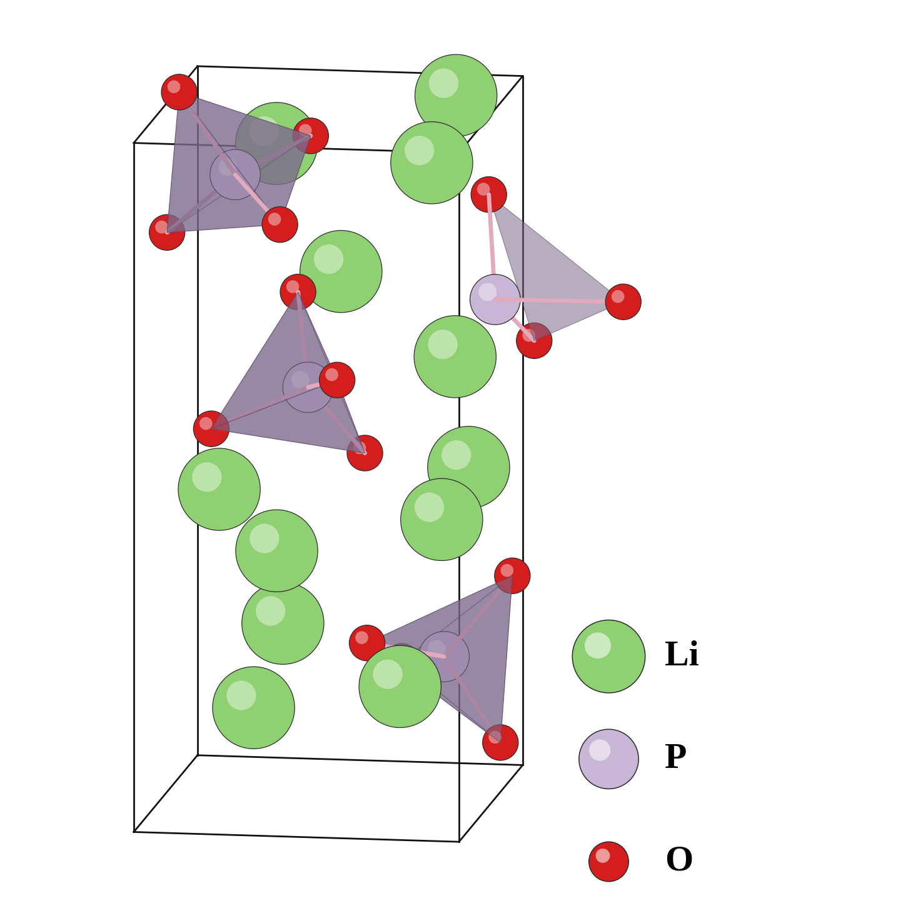

=================================
溶融・急冷後の構造
=================================

   本計算：32原子Li\ :sub:`12`\ P\ :sub:`4`\ O\ :sub:`16` のDFT緩和構造。

本計算ではγ相を出発点にOpenMX-AIMDで溶融・急冷し、32原子の構造を
固定セルのDFT原子座標緩和で得た。AIMDは合計2.30 psであり、
高温保持1.20 ps、急冷0.57 ps、300 K保持0.53 psからなる。
図ではPO\ :sub:`4` 四面体の向きとLi配置が初期結晶から乱れている。
ただし、一つの小セルの画像だけで非晶質の統計的な代表性は判定できない。

`文献図3 <https://doi.org/10.1063/1.4997242>`_ も32原子の溶融・急冷モデルを示すが、
高温保持は15 psであり、本計算より長い。著者ら自身も小セルに部分的な
結晶秩序が残ると述べる。本計算の構造は、以降の空孔・拡散評価に用いる
「溶融急冷で得た不規則構造」と表現し、バルク非晶質の確証とはしない。

文献では急冷（約5.7 ps）と300 K保持（3 ps）も実施しており、
溶融・急冷・保持の合計は約23.7 psとなる。それでも著者らは部分的な
結晶化を認めているため、2.30 psの本計算では初期γ相の構造記憶が
残っていないか、後述の大規模構造とRDFでも確認する必要がある。
文献は同じ32原子モデルのNNP緩和構造とDFT緩和構造について
原子位置の平均差0.02 Åも示したが、本図はOpenMX緩和構造のみであり、
本計算について同様の手法間一致を示すものではない。

まとめ
------

本計算では溶融・急冷後の不規則な32原子構造を得た。
短い作成時間と小さいセルを踏まえ、バルク非晶質の代表構造とみなす前に
残存する結晶秩序を確認する必要がある。
