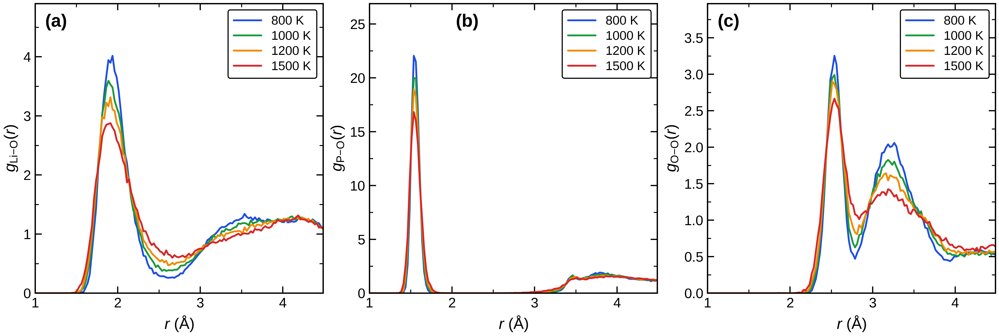

.. _li3po4-doc-partial-rdf:

MD軌跡の部分RDF
===============

温度を上げてLiが動きやすくなると、周囲の原子の並び方はどう変わるでしょうか。
31原子のLi空孔モデルでは、800～1500 KでP–Oの第一ピークが約1.5 Åに残る一方、Li–Oの第一ピークは高温ほど広がりました。

原子対ごとの\ `動径分布関数（部分RDF） <https://technical-notes.quemix.com/md/rdf.html#radial-distribution-function>`__\ は、ある元素の原子から距離 :math:`r` の位置に、別の原子が平均密度に比べてどれだけ見つかりやすいかを示します。
:numref:`{number}. {name} <li3po4-doc-lithium-msd>` ではLiの位置の時間変化を見ました。ここではMD軌跡の各時刻での原子対の距離を使い、近くの原子の並び方を :numref:`li3po4-rdf-31atoms` で比べます。

.. _li3po4-rdf-31atoms:

   31原子モデルの部分RDF。(a) Li–O、(b) P–O、(c) O–O。
   パネルごとに縦軸の目盛りが異なります。同じパネル内で温度を変えたときのピークを比べます。

P–Oの第一ピークは、高温で低くなっても約1.5 Åに鋭く残ります。これはPO₄四面体に対応する短いP–O結合が保たれることを示します。
Li–Oの約1.9 Åの第一ピークは高温ほど低く広くなり、Liの周囲の酸素までの距離にばらつきが増えます。
O–Oの第一・第二ピークも高温で弱まり、酸素同士の距離の分布が広がります。

文献では、NNP-MDとDFT-MDで原子対の種類をまとめた全RDFが近いことを確かめています。
本計算で掲載しているのは原子対別の部分RDFです。文献と同じ精度検証を行うには、同じ条件でDFT-MDを実施し、同じ種類のRDFを比べる必要があります。 `Liらの図9 <https://doi.org/10.1063/1.4997242>`__

まとめ
------

高温でもP–Oの短距離結合は保たれ、Li–Oの距離のばらつきは増えました。
この結果は、リン酸基の周囲でLiの配置が変わり、温度を上げるとLiのMSDが増える傾向と整合します。
RDFは同時刻の原子間距離を集計するため、個々のLiの移動経路やPO₄四面体の寿命を調べるには、軌跡上で各原子の動きを追う必要があります。
