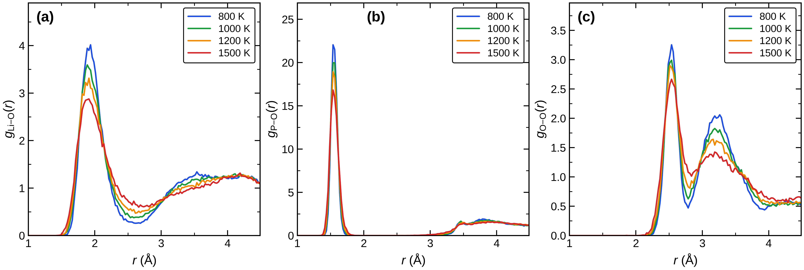

========================
MD軌跡の部分RDF
========================

   本計算：800–1500 KのLi–O、P–O、O–O部分RDF。

P–Oの鋭い第一ピークは約1.5 Å付近に保たれ、温度上昇で高さは下がっても
PO\ :sub:`4` の短距離結合は残る。Li–Oの約1.9 Åの第一ピークは
高温ほど低く広くなり、Li周囲の分布が拡がる。O–Oの第一・第二ピークも
高温で弱まり、局所配置の熱的な広がりを示す。

`文献図9 <https://doi.org/10.1063/1.4997242>`_ は文献NNP-MDとDFT-MDの
**全RDF** が近いことを示す。本図は原子対ごとの**部分RDF** であり、
同じ量の曲線を重ねた精度比較ではない。各ピークの高さを異なる原子対の間で
直接比較することも避ける。

本計算ではP–Oの第一殻が
ほぼ同じ位置に残る一方、Li–Oの第一殻は温度とともに広がる。
これは比較的保たれたリン酸基の周囲でLiの配置が変わるという
MSDの傾向と矛盾しない。ただしRDFは同時刻の原子対距離の分布であり、
個々のLiホップ経路やPO₄四面体の寿命を示さない。本計算のDFT-MDによる
同条件のRDFがないため、論文と同じ精度検証までは行えない。

まとめ
------

P–Oの短距離結合は高温でも保たれ、Li–Oの分布は広がる。
この部分RDFは局所構造の温度変化を示すが、文献の全RDFとの直接的な
精度比較や個々のLi拡散経路の決定には使えない。
