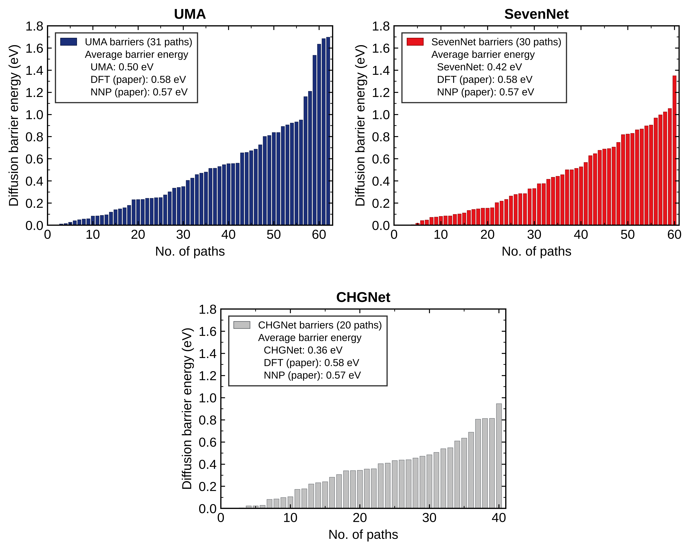

========================
Li空孔移動障壁
========================

`文献図6 <https://doi.org/10.1063/1.4997242>`_ は、46本の経路を順方向・逆方向に
数えた92個の空孔移動障壁を比較する。文献DFTと文献NNPの平均障壁は
それぞれ0.58、0.57 eV、平均絶対差は0.048 eVである。

   Quloudで得たLi空孔移動障壁（昇順）。UMAは31経路・62方向（青）、SevenNetは30経路・60方向（赤）、CHGNetは20経路・40方向（灰色）。枠内に各モデルと文献図6の平均値を示す。

平均障壁はUMAが0.50 eV、SevenNetが0.42 eV、CHGNetが0.36 eVである。
文献DFTの0.58 eVとの差はそれぞれ−0.08、−0.16、−0.22 eV、
文献NNPの0.57 eVとの差は−0.07、−0.15、−0.21 eVとなる。
文献平均値に数値上最も近いのはUMAである。いずれのモデルも障壁は広く分布し、
同じモデル内でも移動しやすさは経路によって異なる。

これらは **異なる非晶質構造と経路集合についての平均値の差** であり、
一対一に対応する障壁の誤差ではない。本例の非晶質Li₃PO₄は文献の32原子構造と
同一ではなく、図の棒も障壁順で個々の経路番号に対応付けていない。
したがって、UMAが文献平均に近いことだけで3モデルの精度順位は決められない。
経路図と本図の経路数は各モデルで一致する。

文献NNPは対象のLi₃PO₄についてDFTデータを使って構築され、拡散途中の構造も学習に含む。
文献ではその構造を含めたときの障壁の平均絶対誤差が0.048 eV、
含めない別のNNPでは0.073 eVと報告され、障壁の再現には遷移領域の情報が重要と分かる。
本例の事前学習済みUMA・SevenNet・CHGNetについても、本例と同じ非晶質構造で
始点・終点と計算条件をそろえたOpenMX DFT-NEBを行い、各経路の障壁と形状を
照合するまでは、文献NNPと同じ意味での誤差や精度順位は求められない。
なお、移動障壁は空孔形成エネルギーやMDから求める拡散の活性化エネルギーとは別の量である。

まとめ
------

UMAは3モデル中で文献平均に最も近いが、構造と経路集合が異なるため
精度の実証にはならない。定量評価には同一構造・同一経路でのOpenMX DFT-NEBとの比較が必要である。
