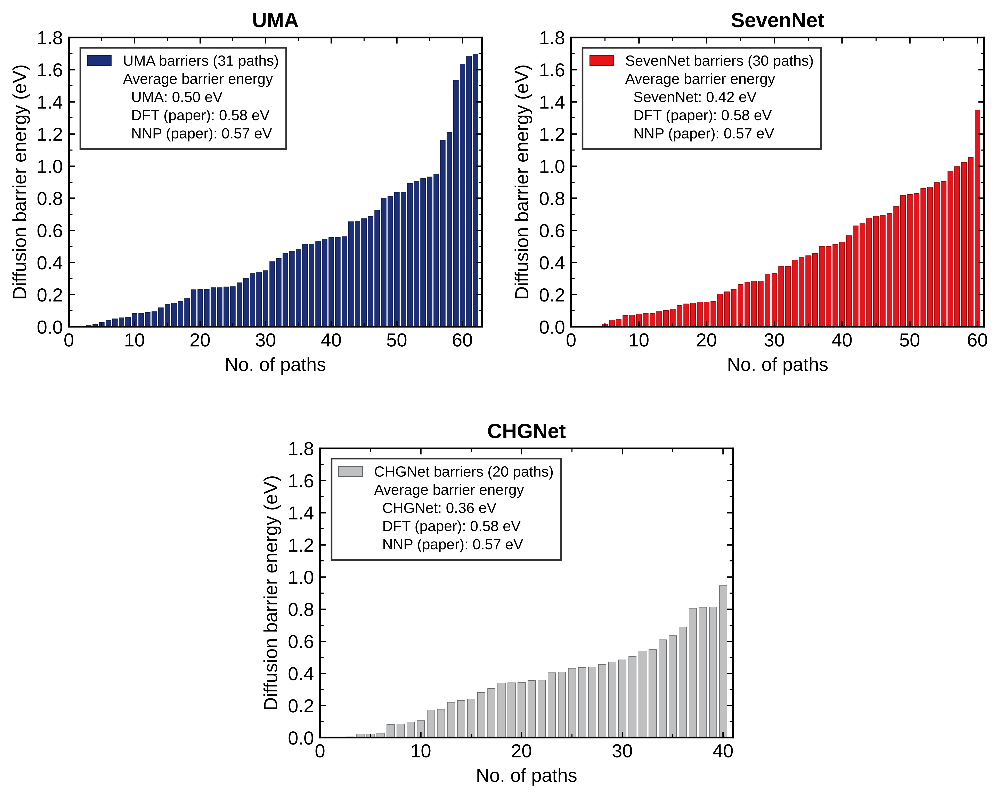

.. _li3po4-doc-vacancy-barriers:

Li空孔移動障壁
==============

Liが空孔へ移るときに越えるエネルギー障壁は、経路や計算モデルによってどれだけ変わるでしょうか。
3つの機械学習原子間ポテンシャルで求めた平均障壁はUMAで0.50 eV、SevenNetで0.42 eV、CHGNetで0.36 eVでした。
3つのモデルの中ではUMAの平均が文献DFTの0.58 eVと文献NNPの0.57 eVに最も近い値です。

移動障壁は、経路上の最高エネルギーと出発点のエネルギーの差です。
出発点を入れ替えると基準となるエネルギーが変わるため、 :numref:`li3po4-migration-barriers` では :numref:`{number}. {name} <li3po4-doc-vacancy-paths>` の各経路について順・逆両方向の障壁を数えます。

.. _li3po4-migration-barriers:

   方向ごとのLi空孔移動障壁（eV）。上段左はUMA（31経路・62方向）、上段右はSevenNet（30経路・60方向）、下段はCHGNet（20経路・40方向）。
   棒は各モデルの障壁が低い順に並んでいます。横軸はこの並び順で、経路図の番号とは対応しません。

どのモデルにも低い障壁と高い障壁があり、Liの移動しやすさは経路によって異なります。
本計算の平均は、UMA、SevenNet、CHGNetの順に、文献DFTより0.08、0.16、0.22 eV、文献NNPより0.07、0.15、0.21 eV低くなりました。
これらは、構造と経路の組が異なる計算の平均値を比べた差です。

文献では同じ46経路の順・逆92方向を照合し、NNPとDFTの障壁の平均絶対差を0.048 eVと求めました。
移動途中の構造を学習から外したNNPでは0.073 eVに増え、文献のモデルでは遷移途中の構造が障壁の精度に影響することが分かります。 `Liらの図6とその解説 <https://doi.org/10.1063/1.4997242>`__

まとめ
------

UMAの平均障壁が文献の平均に最も近い値でした。個々の障壁の精度を評価するには、本計算の不規則構造で始点・終点と計算条件をそろえ、OpenMXのDFT-NEBによる値と経路ごとに比較する必要があります。
ここで求めた障壁は1回の移動に対する量です。多数の移動を含む拡散は、 :numref:`{number}. {name} <li3po4-doc-lithium-msd>` で分子動力学によりLiの変位を時間に沿って追い、 :numref:`{number}. {name} <li3po4-doc-diffusivity-temperature>` で拡散係数の温度依存性として評価します。
