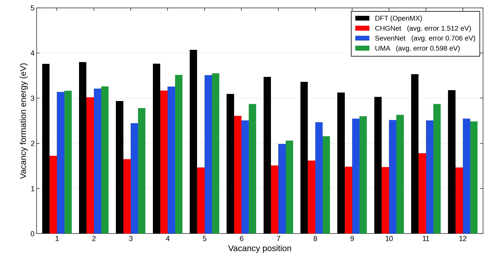

.. _li3po4-doc-vacancy-formation:

Li空孔形成エネルギー
====================

Liを取り除く位置によって、空孔を作るのに必要なエネルギーはどう変わるでしょうか。
32原子の不規則構造で12か所を比較したところ、3つの機械学習原子間ポテンシャル（UMA、SevenNet、CHGNet）は、全サイトでOpenMXより低い値を示しました。
サイトごとの平均絶対差は0.598～1.512 eVでした。

`空孔形成エネルギー <https://technical-notes.quemix.com/electronic/defect_formation.html#defect-formation-energy>`__\ は、Liを1個取り除いた構造と元の構造のエネルギー差に、取り除いたLiの参照エネルギー（Li\ `化学ポテンシャル <https://technical-notes.quemix.com/thermo/gibbs_energy.html#chemical-potential>`__）を加えた量です。
:numref:`li3po4-formation-energies` では、 :numref:`{number}. {name} <li3po4-doc-melt-quench-structure>` で作った構造からLiを1個ずつ取り除いた場合を比べます。

.. _li3po4-formation-energies:

   Li空孔の形成エネルギー。横軸は取り除いたLiのサイト番号、縦軸は空孔形成エネルギー（eV）。
   凡例の平均誤差は、OpenMXと各モデルの差の絶対値を12サイトで平均した値です。

OpenMXを基準とする平均絶対差は、UMAで0.598 eV、SevenNetで0.706 eV、CHGNetで1.512 eVです。
一様なずれに加え、サイト間の違いにも注目します。例えばOpenMXでは5番サイトの形成エネルギーが最も高く、CHGNetではこのピークが現れません。

文献の12サイトでも、NNPはDFTより低い形成エネルギーを与えました。差は平均0.029 eV、最大0.040 eVと、本計算の各モデルとOpenMXの差より小さいです。
文献DFTの形成エネルギーは約5 eV、本計算のOpenMXでは約3～4 eVです。これらの差を手法の精度差として評価するには、構造とLi化学ポテンシャル、緩和条件をそろえる必要があります（化学ポテンシャルの基準と形成エネルギーの関係は技術ノートの\ `点欠陥の形成エネルギーの解釈と限界 <https://technical-notes.quemix.com/electronic/defect_formation.html#defect-formation-limits>`__）。 `Liらの図4 <https://doi.org/10.1063/1.4997242>`__

まとめ
------

この構造では、3つのモデルが全12サイトでOpenMXより低い形成エネルギーを与え、平均絶対差はCHGNetで最も大きくなりました。
形成エネルギーが表すのは空孔を作るコストです。\ `空孔の濃度 <https://technical-notes.quemix.com/electronic/defect_formation.html#defect-concentration>`__\ を見積もるには、温度や欠陥の状態も考慮する必要があります。
できた空孔にLiが移る経路と障壁は、 :numref:`{number}. {name} <li3po4-doc-vacancy-paths>` と :numref:`{number}. {name} <li3po4-doc-vacancy-barriers>` で調べます。
