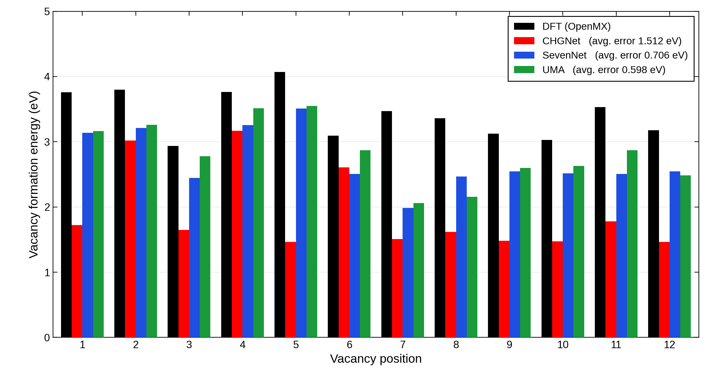

============================
Li空孔形成エネルギー
============================

   本計算：12個のLiサイトに対する空孔形成エネルギー。

本計算のOpenMX値を基準にすると、図中に示された12サイトの平均絶対差は
CHGNetで1.512 eV、SevenNetで0.706 eV、UMAで0.598 eVである。
各手法はサイトごとの変動をある程度追う一方、いずれもOpenMXより低い値を示し、
特にCHGNetの差が大きい。これは本構造・本設定での差であり、
空孔形成エネルギーの一般的なモデル性能を示すものではない。

`文献図4 <https://doi.org/10.1063/1.4997242>`_ では同じ12サイトという設定で
文献NNPと文献DFTの平均差が0.029 eVであった。ただし、空孔形成エネルギーは
Li化学ポテンシャルと緩和条件にも依存する。両研究の構造・参照条件が同一とは
確認できないため、0.029 eVと本計算の平均差を同一条件の精度順位としては扱わない。

論文では文献NNPが文献DFTの形成エネルギーを系統的に低く見積もり、
最大差も0.040 eVに収まった。一方、本計算の三手法のずれは
0.598–1.512 eVで、同じ方向の偏りでも規模は大きい。
図の5番サイトはOpenMXで最も高い形成エネルギーを示すが、
CHGNetはこの特徴を再現していない。共通のエネルギー基準による
一様なずれと、サイト間の相対的な順位・差の誤りは分けて調べる必要がある。
論文の約5 eVという絶対値と本計算の約3–4 eVのOpenMX値も、
Li化学ポテンシャルと構造・緩和条件をそろえずに直接比較しない。
形成エネルギーだけから実際の空孔濃度や移動障壁は決まらない。

まとめ
------

三つのuMLIPはいずれも本計算のOpenMX値より低い形成エネルギーを与え、
12サイトの平均絶対差は0.598–1.512 eVであった。
文献NNPの誤差との精度比較には、構造とLi化学ポテンシャルをそろえる必要がある。
