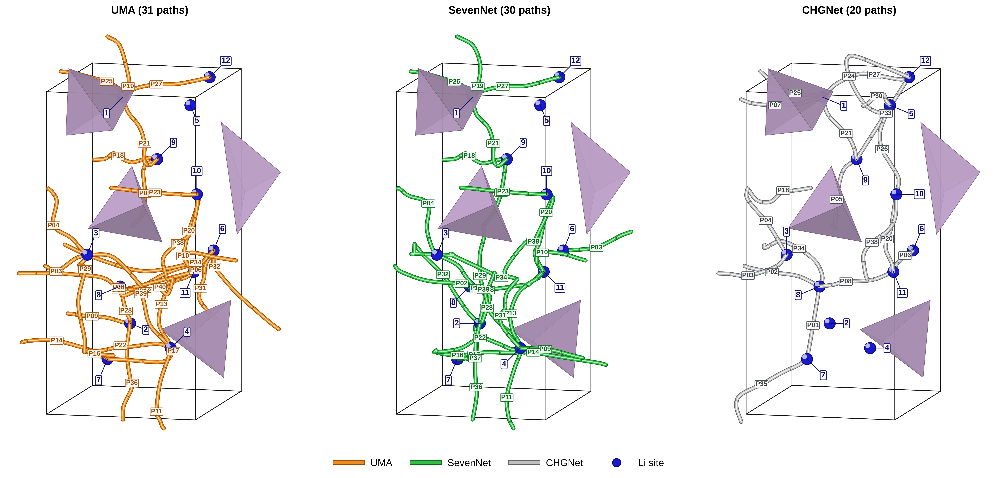

========================
Li空孔の拡散経路
========================

`文献図5 <https://doi.org/10.1063/1.4997242>`_ では、32原子の不規則構造中で
Liサイト間距離3.5 Å未満を候補とした46本の空孔移動経路を比較している。
文献NNPと文献DFTが与える経路の位置・形状は近い。

   Quloudで得たLi空孔拡散経路。左からUMAの31経路（橙）、SevenNetの30経路（緑）、CHGNetの20経路（灰色）。青い球と数字はLiサイト、P番号は経路、紫の多面体はリン酸塩骨格を示す。

3モデルとも複数のLiサイトを結ぶ経路を示す。UMAとSevenNetは広い範囲に分岐した
経路網を描き、CHGNetでは経路が比較的少ない。各モデルの経路数は次ページの
移動障壁図と一致する。ただし、経路数や形状の違いには候補経路の選び方と
経路の成立判定も関わるため、経路数だけで精度や拡散速度を順位付けできない。

文献図5は同じ構造・候補経路でDFTとLi₃PO₄専用学習NNPの経路形状が近いことを示す。
本例のUMA、SevenNet、CHGNetは事前学習済みの汎用モデルである。本例の非晶質構造は
文献の32原子構造と同一ではなく、文献の46経路との一対一の比較はできない。
移動経路の再現性を確かめるには、本例と同じ構造、始点・終点についてOpenMXによる
DFT-NEB計算を行い、各モデルの経路形状と障壁を照合する必要がある。

まとめ
------

3モデルはいずれもLi空孔の移動経路を示したが、選ばれた経路は一致しない。
定量的な精度評価には、同一構造・同一経路でのOpenMX DFT-NEBとの比較が必要である。
