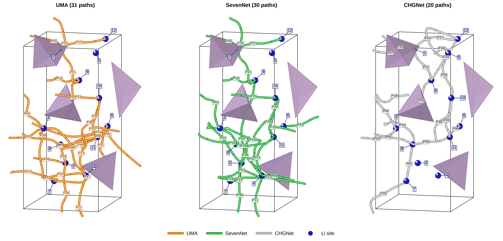

.. _li3po4-doc-vacancy-paths:

Li空孔の拡散経路
================

Liの位置が1つ空いているとき、隣のLiはどの経路を通ってそこに移るでしょうか。\
3つの機械学習原子間ポテンシャルを使ってQuloudで求めた経路数は、UMAで31、SevenNetで30、CHGNetで20でした。\
:numref:`li3po4-migration-paths` で、各モデルでどのLiサイトが経路で結ばれるかを比べます。

隣のLiが空孔に移ると、そのLiがもといた位置が空くため、空孔はLiと逆向きに移ります。\
図の曲線は、このときLiがたどると計算された経路です。図を選ぶと元の大きさで確認できます。

.. _li3po4-migration-paths:

   Li空孔の移動に対応するLiの経路。左からUMAの31経路（橙）、SevenNetの30経路（緑）、CHGNetの20経路（灰色）。\
   青い球と数字はLiサイト、Pで始まる番号は経路、紫の多面体はPO₄四面体を表します。

UMAとSevenNetでは広い範囲に分岐した経路が見えます。CHGNetでは経路の数が少なく、結ばれるサイトの組み合わせも異なります。\
経路数には、候補の選び方や経路が成立するかどうかの判定が影響します（技術ノートの\ `端点・経路の候補・イメージの数 <https://technical-notes.quemix.com/electronic/neb.html#neb-path-setup>`__）。また、Liの移動しやすさは経路ごとの障壁にも左右されます。 :numref:`{number}. {name} <li3po4-doc-vacancy-barriers>` では、図に示した経路の障壁を比較します。

文献では、32原子の不規則構造で3.5 Å未満のLiサイト間を候補とし、46経路を調べました。\
両端のサイトを結ぶ\ `最低エネルギー経路 <https://technical-notes.quemix.com/electronic/neb.html#minimum-energy-path>`__\ を求める\ `NEB（nudged elastic band）法 <https://technical-notes.quemix.com/electronic/neb.html#nudged-elastic-band>`__\ を用い、同じ構造・同じサイトの組み合わせでNNPとDFTの経路の位置と形が近いことを確かめています。 `Liらの図5 <https://doi.org/10.1063/1.4997242>`__

まとめ
------

3つのモデルで、Liサイトを結ぶ経路の数とつながり方が異なりました。\
文献とは元の原子配置が異なるため、本計算の経路の再現性を評価するには、同じ構造と始点・終点でOpenMXによるDFT-NEB計算を行い、経路の形と障壁を照合する必要があります。
